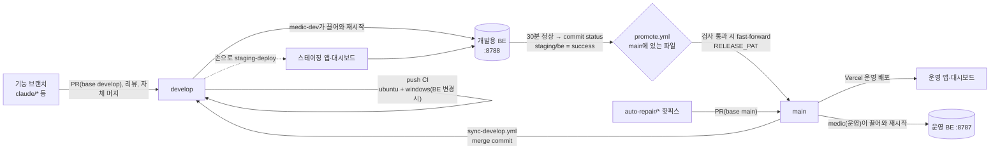

# develop → main 배포 흐름 설계

- 상태: 확정 v2 (Dahun 결정 2026-10-24, 스레드 "develop→main 배포 흐름으로 바꾸기". v2: 리뷰 반영)
- 작성일: 2026-10-24
- 상위 문서: [마스터 설계](2026-10-23-my-planner-master-design.md), [SP3-4 스펙](2026-10-24-sp3-4-life-curve-dashboard-design.md) (BE 주소·CORS·`tailscale serve`), [SP6 자동 복구](2026-10-24-sp6-auto-recovery-design.md) (medic 업데이터·자동 수리)
- 결정 기록: [ADR 0012](../../adr/0012-develop-staging-auto-promote-to-main.md)
- 범위: 브랜치 규칙, CI, Vercel 두 프로젝트, 노트북의 개발용 BE, develop → main 자동 승격, 자동 수리(핫픽스)와의 관계. 앱 기능과 API 계약은 바꾸지 않는다. 개발용 BE를 띄우기 위한 설정 몇 개와, 대시보드의 포트 있는 출처 받기만 더한다.

## 1. 왜 바꾸나

2026-10-24에 Vercel 무료 플랜의 하루 배포 100회 한도(계정 전체)에 걸렸다. 그날 커밋 182개, 브랜치 63개, `main` 머지 69번이었다. 두 Vercel 프로젝트가 **모든 브랜치 푸시마다** 미리보기 빌드를 만들었다. `ignoreCommand`(폴더 변경 없으면 건너뜀)는 `web/app`에만 있었고(#144로 대시보드에도 넣음), 그것도 새 브랜치의 첫 푸시는 `VERCEL_GIT_PREVIOUS_SHA`가 비어 늘 빌드한다. 또 머지가 곧바로 운영 반영이라 운영 BE와 앱이 하루 수십 번 바뀌었다.

Dahun 요청: "개발서버(develop)에서 테스트 완료하고 최종 운영(main)에 올리는 방식으로 변경".

**완료 조건**

1. 기능 브랜치 푸시는 Vercel 배포를 만들지 않는다. Vercel 자동 배포는 `main`(운영) 푸시에서만, 그 프로젝트 폴더가 바뀌었을 때만 생긴다. `develop`(스테이징)은 손으로 배포한다(5.1, 2026-10-25 개정).
2. 모든 스레드의 기능 PR은 `develop`을 대상으로 하고, Claude가 리뷰 후 자체 머지한다(지금 규칙 그대로, 대상만 바뀜).
3. 노트북에 개발용 BE(`my-planner-dev`)가 `develop` 코드로 돈다. 운영 BE와 DB·포트·토큰을 공유하지 않고, 텔레그램과 회차 스케줄러는 끈다.
4. 스테이징 웹앱(두 프로젝트의 `develop` 고정 주소)은 개발용 BE에만 붙는다.
5. `develop` 머리가 검사를 모두 통과하고 30분 동안 문제없이 돌면 `main`이 그 커밋으로 자동으로 빨리감기(fast-forward)된다. 사람 승인은 없다.
6. 자동 수리(SP6 핫픽스)는 계속 `main`으로 바로 가고, 곧바로 `develop`에 합쳐진다.

## 2. Dahun 결정 (2026-10-24)

| # | 질문 | 결정 |
|---|---|---|
| R1 | 스테이징 웹앱은 어떤 BE에 붙나 | 노트북에 개발용 BE를 하나 더 띄운다(develop 코드, 별도 포트·DB, 스케줄러 끔). 운영 BE에 붙이지 않는다 |
| R2 | develop → main은 누가 결정하나 | 자동 승격한다. 건별 승인 없음 |
| R3 | 얼마나 자주 | develop 머지마다. 연달아 머지되면 develop이 30분 조용해졌을 때 한 번에 올린다 |
| R4 | 개발용 BE의 텔레그램 | 끈다. 스테이징 웹앱으로만 확인하고, 텔레그램 변경은 CI 테스트로 검증한다 |

## 3. 전체 흐름



## 4. 브랜치 규칙

| 브랜치 | 역할 | 누가 바꾸나 |
|---|---|---|
| `main` | 운영, **GitHub 기본 브랜치 그대로**. 노트북 운영 BE와 Vercel 운영 배포가 따른다 | `promote.yml`의 빨리감기, 자동 수리 PR(`auto-repair/*`) 머지만 |
| `develop` | 스테이징. 개발용 BE가 따르고, Vercel 스테이징은 손으로 배포한다(5.1) | 기능 PR 머지, `sync-develop.yml`의 `main` 합치기 |
| 그 밖 (`claude/*`, `auto-repair/*` 등) | 작업 브랜치 | 각 스레드 |

- 기능 PR은 **`base: develop`을 명시해서** 연다. 기능 브랜치는 `origin/develop`에서 딴다. `main`을 대상으로 한 기능 PR은 머지하지 않고 대상을 `develop`으로 바꾼다.
- 기본 브랜치를 `main`으로 두는 이유: `status`·`schedule`·`workflow_dispatch`·`issues` 이벤트 워크플로는 기본 브랜치의 파일로 돈다. 기본이 `main`이면 `promote.yml`과 SP6 `repair.yml`이 운영 코드 기준으로 돌고, 수리 PR의 기본 checkout·base도 `main`으로 남는다. 대신 승격·수리 워크플로를 고친 변경은 승격된 뒤에야 효력이 생긴다.
- `main`의 이력은 `develop`의 앞부분이어야 한다(빨리감기가 되려면). 핫픽스로 갈라지면 7장 동기화로 다시 맞춘다.
- 자체 머지 규칙(`.claude/agents`의 리뷰어 → 고침 → squash 머지)은 기능 PR → `develop`에 그대로 쓴다.
- `main` 보호 규칙을 걸 때(SP6 "가능하면 필수 검사")는 PR 필수 규칙을 넣지 않고, `RELEASE_PAT` 계정의 우회를 허용한다. 그렇지 않으면 빨리감기가 거부된다.

## 5. 환경

### 5.1 Vercel (두 프로젝트 `web/app`, `web/dashboard`)

각 `vercel.json`에 다음을 더한다.

```json
"git": { "deploymentEnabled": { "**": false, "main": true } }
```

Vercel 규칙: 여러 규칙에 맞으면 하나라도 `true`면 배포한다(minimatch, `**`는 `/`가 든 이름도 맞음). 그래서 `main`만 자동 배포하고 나머지 브랜치는 배포 기록 자체를 만들지 않는다. 기존 `ignoreCommand`는 그대로 둔다.

**develop 스테이징은 손으로 배포한다**(2026-10-25 개정, Dahun 결정). 처음에는 `develop`도 자동 배포했지만, 여러 스레드가 하루 40번 넘게 develop에 머지하자 머지마다 두 프로젝트가 배포를 만들어(`ignoreCommand`로 건너뛴 것도 배포 기록이 생긴다) 다시 하루 100회 한도에 걸렸다. 한도에 걸리면 운영 배포도 막힌다. 그래서 스테이징은 필요할 때 `staging-deploy.yml`(workflow_dispatch)이 Vercel Deploy Hook(프로젝트마다 develop 훅, 저장소 시크릿 `VERCEL_DEPLOY_HOOK_APP`, `VERCEL_DEPLOY_HOOK_DASHBOARD`)을 불러 배포한다. Claude 스레드나 Dahun이 돌린다. 승격 검사는 Vercel 스테이징 상태를 보지 않는다(6.2의 5). 대신 웹 폴더를 바꾼 마지막 커밋의 CI `web-app`·`web-dashboard` 작업이 통과해야 한다(6.2의 3). 머리 CI만 보면 뒤 커밋이 경로 필터로 그 작업을 건너뛰어 앞 커밋의 실패를 놓친다.

- `staging-deploy.yml`은 workflow_dispatch라 기본 브랜치(`main`)에 있어야 돌릴 수 있다. 이 개정이 승격된 뒤부터 쓴다.
- 훅 배포에도 `ignoreCommand`가 적용될 수 있다. 직전 develop 배포 뒤 폴더가 안 바뀌었으면 건너뛴 배포 1건이 생긴다. 첫 수동 실행에서 두 스테이징 별칭이 실제로 새 배포로 바뀌는지 확인한다(8장 D2).

| 환경 | 브랜치 | 주소 | `NEXT_PUBLIC_CONNECT_SRC` |
|---|---|---|---|
| Production | `main` | 지금 운영 주소 | `https://*.<tailnet>.ts.net` (지금 값) |
| Preview (branch = `develop`) | `develop` | 브랜치 고정 별칭(첫 develop 배포 뒤 실제 문자열을 기록, 8장 D3) | `https://*.<tailnet>.ts.net:8443` |

- 스테이징 값은 Vercel 프로젝트 설정 → Environment Variables에서 Preview, 브랜치 `develop`에만 건다(8장 D2).
- 스테이징 앱은 운영 앱과 출처(origin)가 달라서 저장된 BE 주소·토큰을 공유하지 않는다. 스테이징 앱에서 한 번 개발용 BE 주소(`https://<노트북>.<tailnet>.ts.net:8443`)와 개발용 토큰을 넣는다. 다른 주소이므로 앱 안에 따로 표시는 두지 않는다.
- CSP: 출처에 포트가 없으면 443만, `:8443`이면 8443만 허용한다(브라우저 규칙). 두 앱의 `hostMatches`는 이미 `u.host`(포트 포함)로 비교해서 포트를 구분한다. **바꿀 곳은 대시보드 `next.config.mjs`의 검사 정규식뿐**이다: 끝에 `(:\d{1,5})?`를 허용한다.

### 5.2 노트북 개발용 BE (`my-planner-dev`)

| 항목 | 운영 BE | 개발용 BE |
|---|---|---|
| 체크아웃 | `E:\my-planner` (`main`) | `E:\my-planner-dev` (`develop`), 따로 클론 |
| 작업 스케줄러 | `my-planner`, `my-planner-medic` | `my-planner-dev`, `my-planner-medic-dev` (같은 XML 템플릿, 이름·경로만 다름) |
| DB·상태·로그 | 그 체크아웃의 `data/`, `state/` | 그 체크아웃의 `data/`, `state/` (경로가 체크아웃 루트 기준이라 저절로 나뉨) |
| API | `127.0.0.1:8787`, `tailscale serve --https=443` | `127.0.0.1:8788`, `tailscale serve --bg --https=8443 http://127.0.0.1:8788` |
| `.env` | 운영 토큰들 | **새** `API_TOKEN`, 개발용 `MEDIC_GITHUB_TOKEN`(5.4). 텔레그램 토큰 없음. VAPID 없음(푸시 끔) |
| 텔레그램 | 켬 | 끔 (R4) |
| 회차 스케줄러(아침·저녁·회고, 따라잡기) | 켬 | 끔 |
| 두뇌 | 구독 로그인 | 같은 로그인(대화로 시험할 때만 호출. 하루 상한은 체크아웃의 DB별로 따로 센다) |
| CORS(`cors_origins`) | 운영 앱·대시보드 주소 | 스테이징 두 별칭(정확한 문자열) |
| 설정 덮어쓰기 | 없음 | `config.local.toml`, `config.medic.local.toml` (둘 다 `.gitignore`) |

데이터: 개발용 DB는 빈 DB로 시작한다. 운영 DB를 복사하지 않는다.

**코드 변경 (BE)**

1. `config.local.toml`: 체크아웃 루트에 있으면 `config.toml` 위에 겹쳐 읽는다. 병합은 **키 단위 깊은 병합**이다(표는 재귀로 합치고, 표가 아닌 값과 목록은 통째로 바꾼다. `[api]`에 `port`만 쓰면 나머지 `[api]` 키는 `config.toml` 값 그대로). 비밀값 금지 규칙(`telegram_bot_token` 등)은 합친 결과에 건다. 같은 병합을 BE `load_settings`와 medic `load_config`가 함께 쓴다(medic이 `[api] port`를 거기서 읽으므로, 빠뜨리면 medic-dev가 운영 BE 8787을 검사한다).
2. `[runtime] role = "prod" | "dev"` (기본 `"prod"`). `"dev"`이면:
   - 텔레그램 폴링과 보내기를 띄우지 않는다. `TELEGRAM_BOT_TOKEN`, `OWNER_TELEGRAM_ID`가 없어도 설정을 읽는다(`"prod"`에서는 지금처럼 필수).
   - 회차 스케줄러와 따라잡기를 돌리지 않는다. 1분 tick의 회차 외 정리(초안 만료 등)는 돈다.
   - 안전 모드 알림과 `POST /internal/notify`는 보낼 통로가 없으므로 로그로만 남긴다.
3. `GET /api/v1/health`와 API 계약은 바꾸지 않는다.

### 5.3 medic-dev (SP6 후속, 들어옴: 티켓 12)

`config.medic.local.toml`(개발용 체크아웃에만)이 `config.medic.toml` 위에 같은 깊은 병합으로 겹친다. Git에 든 `config.medic.toml`은 고치지 않는다(작업 폴더가 깨끗해야 SP6 업데이터가 배포한다).

```toml
branch = "develop"            # 업데이터가 따라갈 브랜치
be_task_name = "my-planner-dev"
verify_minutes = 30           # staging/be를 올리기 전 정상 유지 시간
watch_incidents = false       # 이슈 동기화·Actions 이슈 가져오기·ci:main 닫기를 모두 끔(개발용 PAT에 Issues 권한이 없어 403이 그 회차 GitHub 일 전체를 멈추지 않게)
heartbeat = false
post_commit_status = true     # staging/be 올림
```

`staging/be` 올리기는 이 이슈 경로 밖(업데이터의 확인 결과 직후)에서 돈다. `MedicConfig`에 위 키가 없으면 조용히 무시되므로(알 수 없는 키 필터), SP6 후속(티켓 12)이 필드를 더했다. SP6 스레드 확인(2026-10-24): 업데이터는 이미 `branch`, `be_task_name`, 체크아웃 루트를 설정에서 읽는다.

### 5.4 토큰

| 토큰 | 어디 | 권한 (이 저장소만) | 쓰는 곳 |
|---|---|---|---|
| `RELEASE_PAT` (새, 저장소 시크릿) | Actions | Contents 쓰기, Workflows 쓰기, Pull requests 쓰기, Issues 쓰기 | `promote.yml` 빨리감기, `sync-develop.yml` 합치기 |
| `MEDIC_GITHUB_TOKEN` (운영, 그대로) | 노트북 `E:\my-planner\.env` | SP6 그대로(읽기 위주) | medic 운영 |
| `MEDIC_GITHUB_TOKEN` (개발용, 새 PAT) | 노트북 `E:\my-planner-dev\.env` | Contents 읽기, Actions 읽기, Commit statuses 쓰기 | medic-dev: develop 끌어오기, `staging/be` 올리기 |

- `GITHUB_TOKEN`으로는 승격할 수 없다: `.github/workflows/*`를 바꾼 커밋으로 ref를 옮기려면 Workflows 권한이 필요한데 `GITHUB_TOKEN`은 받을 수 없다. 그래서 `RELEASE_PAT`을 쓴다. PAT 푸시는 `main` push 워크플로(ci, Vercel)를 정상으로 깨운다.
- 노트북에는 `main` 쓰기 권한을 주지 않는다(ADR 0010). 개발용 PAT의 상태 쓰기로 Vercel 컨텍스트를 위조하는 것을 막으려고, medic의 웹 수리 확인(main)은 Vercel 상태를 만든 계정이 `vercel[bot]`인지 확인한다(승격 검사는 2026-10-25부터 Vercel 상태를 보지 않는다). `staging/be`의 만든 계정 검사(`DEV_STATUS_LOGIN`)는 **사실상 구별력이 없다**: fine-grained PAT은 만든 사람(Dahun) 계정으로 동작하고, `RELEASE_PAT`과 Claude 스레드도 같은 계정이다. 그래서 `staging/be`는 "Dahun 계정이 올렸다"까지만 보장한다. 1인 저장소에서 받아들이고, 필요해지면 상태 전용 GitHub App으로 바꾼다.
- 만료 알림: `RELEASE_PAT`과 개발용 PAT의 만료일을 저장소 변수(`RELEASE_PAT_EXPIRES`, `DEV_PAT_EXPIRES`)로 두고 SP6 `watch.yml`이 함께 알린다.

### 5.5 CI (`.github/workflows/ci.yml`)

- `push: branches: [main, develop]`.
- `be-windows`: push가 `develop` 또는 `main`이고 BE 파일이 바뀌었을 때 돈다(지금 조건이 그대로 develop에도 걸린다). medic 업데이터는 push CI가 성공한 커밋만 배포하므로 develop에도 Windows가 필요하다.
- `main` push가 이미 develop에서 통과한 SHA면(빨리감기는 SHA가 같다) 다시 테스트하지 않는다: `changes` 작업이 그 SHA의 develop push `ci` 성공 실행을 찾으면 `already_green=true`를 내고, 다른 작업은 이것이 참이면 건너뛴다. 조회: `GET /actions/runs?head_sha=<sha>&event=push&branch=develop&status=success`에서 이름 `ci`. 그래서 ci.yml 권한에 `actions: read`를 더한다. 건너뛴 작업은 통과로 친다. medic의 `ci_conclusion`은 이미 브랜치를 거르지 않으므로(SHA 기준) 이 결과를 그대로 받는다. 핫픽스 머지 커밋은 develop 실행이 없으니 전부 돈다.
- `web-dashboard` 작업과 `web/dashboard/**` 필터를 더한다(지금은 `web-app`만 있다). 내용은 `web-app`과 같다(`npm ci`, `npm test`, `typecheck`, `build`).
- CI의 `be` 필터는 SP6 업데이터의 재시작 목록에 `tests/**`를 더한 것이다: `src/**`, `tests/**`, `scripts/**`, `requirements.lock`, `pyproject.toml`, `config.toml`. 승격 검사 6(차단 구간)의 "BE 파일"은 `tests/**`를 뺀 SP6 재시작 목록 그대로다(테스트만 바뀌면 운영 BE가 재시작하지 않는다).

## 6. 자동 승격 (`.github/workflows/promote.yml`)

### 6.1 언제 도나

워크플로 파일은 기본 브랜치(`main`)의 것으로 돈다.

| 트리거 | 이유 |
|---|---|
| `status` (작업 수준 `if: context == 'staging/be'`) | 주 경로. medic-dev가 develop 머리를 30분 정상으로 돌린 뒤 `success`를, 확인 실패면 `failure`를 올린다(6.3). Vercel 등 다른 상태는 `if`로 걸러 러너를 띄우지 않는다 |
| `schedule` `40 0 * * 1-5`, `10 9 * * 1-5`, `40 1 * * 0,6`, `40 9 * * 0,6` (UTC = KST 평일 09:40·18:10, 주말 10:40·18:40) | 회차 차단 구간(6.2의 6) 때문에 미뤄진 승격을 다시 본다 |
| `workflow_run` (`ci` 완료, `develop`) | `staging/be`가 먼저 와서 CI·Windows를 기다리던 승격을 CI가 끝날 때 다시 본다 |
| `workflow_dispatch` (입력 `skip_staging_be: boolean`) | 수동. 6.4 |

임시 매시 `schedule`(`0 23,0-14 * * *`)은 `REQUIRE_STAGING_BE=true`가 된 2026-10-26에 지웠다.

`schedule`은 GitHub 부하에 따라 늦어지거나 빠질 수 있다. 빠지면 다음 트리거가 잡는다. `concurrency: { group: promote, cancel-in-progress: false }`는 **작업(job) 수준**에 둔다. 워크플로 수준에 두면 `if`로 걸러질 Vercel `status` 실행도 그룹에 들어가, 대기 중인 `staging/be` 실행이 밀려 취소될 수 있다. 권한: `contents: read`, `actions: read`, `statuses: read`, `issues: write` (쓰기는 `RELEASE_PAT`).

### 6.2 검사 (모두 통과해야 빨리감기)

대상 `S` = 지금 `develop` 머리 SHA. `status` 트리거의 SHA가 `S`가 아니면 아무것도 하지 않는다(더 새 머지가 있으면 그것이 다시 30분을 채운다. 연달아 머지가 하나로 묶이는 방법). 이미 `main == S`면 할 일 없음.

1. `main`이 `S`의 조상이다(`compare main...S`의 `behind_by == 0`). 아니면 `release:blocked`(7장 동기화 필요).
2. `S`의 develop push `ci` 실행이 `success`.
3. `main..S`의 develop push 커밋 가운데 BE 파일을 바꾼 **마지막** 커밋의 `ci`에서 `be (windows-latest)` 작업이 `success`다(건너뜀이 아니라 실제 통과). 그런 커밋이 없으면 통과. 웹도 같다(2026-10-25): `web/app/`·`web/shared/`·`DESIGN.md`를 바꾼 마지막 커밋의 `web-app`, `web/dashboard/`·`web/shared/`·`DESIGN.md`를 바꾼 마지막 커밋의 `web-dashboard`. 묶음 푸시라 그 커밋에 실행이 없으면 같은 푸시의 뒤 커밋 실행을 본다.
4. `REQUIRE_STAGING_BE == "true"`이면 `S`의 `staging/be`가 `success`이고 만든 계정이 개발용 PAT 계정(저장소 변수 `DEV_STATUS_LOGIN`). 아니면(임시) `S`의 커밋 시각이 30분 이상 지났다.
5. (2026-10-25 삭제) Vercel 스테이징 상태는 보지 않는다. develop은 자동 배포하지 않는다(5.1).
6. `main..S`에서 BE 파일이 바뀌었으면, 지금이 회차 차단 구간이 아니다. 구간은 `S`의 `config.toml [schedule]`의 각 회차 시각 `t`에 대해 반열림 `[t−20분, t+40분)` (KST)이다(지금 값: 평일 `[08:40, 09:40)`·`[17:10, 18:10)`, 주말 `[09:40, 10:40)`·`[17:40, 18:40)`, 일요일 회고 18:00은 주말 저녁 구간과 같다). 운영 BE 재시작이 회차와 겹치지 않게 한다. 웹만(또는 테스트만) 바뀌었으면 보지 않는다. 6.1의 재확인 cron은 고정값이라, 회차 시각을 바꾸면 cron도 같이 바꾼다(`promote_check.py` 테스트가 `config.toml` 회차 시각 + 40분과 cron이 맞는지 검사한다).

모두 통과하면 `RELEASE_PAT`으로 `PATCH /git/refs/heads/main {sha: S, force: false}`(빨리감기만). 실패하면(경합 등) 다음 트리거에 다시 본다. 결과는 작업 요약에 한 줄로 남긴다(승격한 SHA, 들어간 PR 번호들).

**막힘 알림**: 검사 1, 2, 3이 실패이거나 `staging/be`가 `failure`면, 또는 `main..S`가 250커밋을 넘어 compare가 다 주지 못하면 `release:blocked` 라벨 이슈를 연다. 열린 것이 있으면 새로 열지 않고, 원인이나 SHA가 지난 댓글과 다를 때만 댓글을 단다(원인 한 줄, SHA). 다음 승격이 성공하면 그 이슈를 닫는다. SP6 감시자는 이 라벨을 장애로 들이지 않는다(운영 장애가 아님). Claude 스레드가 이 이슈를 보고 고친다(다음 develop 머지가 `S`를 바꾼다). 대기 중(30분 안 됨, 차단 구간)은 막힘이 아니다.

### 6.3 `staging/be` 신호 (SP6 후속, 들어옴: 티켓 12, medic-dev)

- medic-dev는 develop 머리를 끌어와 개발용 BE를 재시작하고(BE 파일이 바뀐 경우), SP6의 확인 절차(헬스, 로그 오류)로 본다.
- 그 뒤 `verify_minutes`(30분) 동안 헬스가 정상이고 새 오류 지문이 없으면 그 SHA에 `POST /statuses/{sha}` `context=staging/be, state=success`. 확인 실패·롤백이면 `failure`.
- 30분 안에 develop 머리가 바뀌면 그 SHA에는 아무것도 올리지 않고 새 머리로 다시 시작한다. (구현: 재시작 없는 빨리감기 창은 그렇게 버린다. 재시작한 배포의 확인은 끝까지 가서 그 SHA에도 올리며, 승격은 머리 SHA의 상태만 보므로 해가 없다.)
- BE 파일이 안 바뀐 develop 커밋(웹·문서만)도 재시작 없이 같은 방식으로 30분 뒤 `success`를 올린다. 그래서 승격 트리거가 하나로 통일된다.

**SP6 후속(티켓 12)이 들어오기 전에는**: 개발용 BE의 자동 갱신과 `staging/be`가 없다. 이 동안 `REQUIRE_STAGING_BE`는 `"false"`이고, 승격은 CI·Windows 검사와 30분 대기로만 한다(스테이징 BE 검증 없음). 개발용 BE는 설치된 뒤에도 손으로 `git pull` 후 작업을 다시 시작해야 갱신된다.

### 6.4 노트북이 꺼져 있으면

`staging/be`가 오지 않으니 승격도 멈춘다. 운영 BE도 같이 꺼져 있으므로 받아들인다. 웹만 급히 내보낼 때는 Claude가 `workflow_dispatch`에 `skip_staging_be=true`를 줘서 4번만 건너뛴다. `main..S`에 BE 파일 변경이 있으면 워크플로가 거부한다.

## 7. 핫픽스와 동기화 (SP6 자동 수리)

- 자동 수리는 계속 `main`을 대상으로 한다(장애 대응, SP6 그대로). 기본 브랜치가 `main`이라 `repair.yml`의 checkout과 PR base도 `main`이다. 혹시 모를 변경에 대비해 `actions/checkout`에 `ref: main`, PR 생성에 base `main`을 명시했다(들어옴: 티켓 10).
- `sync-develop.yml` (`push: branches: [main]`, `RELEASE_PAT`):
  - `main`이 이미 `develop`의 조상이면(빨리감기 승격 뒤의 보통 경우) 아무것도 하지 않는다.
  - 아니면 `POST /merges {base: develop, head: main}`로 `develop`에 merge commit을 만든다(PAT 푸시라 develop push CI가 돈다). 리뷰는 없다(이미 `main`에서 리뷰·CI를 거친 변경).
  - 충돌(409)이면 `release:blocked` 이슈에 "동기화 충돌"을 남긴다. Claude 스레드가 `sync/main-to-develop` 브랜치에서 풀고 PR(base `develop`, merge commit 머지, 리뷰어 돌림)로 넣는다. squash하지 않는다(squash하면 `main`이 `develop`의 조상이 되지 않는다).
- 동기화 전까지 6.2의 1번이 승격을 막는다. 동기화되면 다음 승격이 정상으로 돈다. 핫픽스 푸시 직후 `sync-develop.yml`이 끝나기 전에 승격이 돌면 `release:blocked`가 잠깐 열릴 수 있다. 다음 승격 성공 때 닫히므로 그대로 둔다.

## 8. Dahun이 할 일 (한 번)

| # | 어디서 | 무엇 |
|---|---|---|
| D1 | GitHub → fine-grained PAT 만들기 → 저장소 시크릿 `RELEASE_PAT` | 5.4 권한. 만료일을 변수 `RELEASE_PAT_EXPIRES`에 |
| D2 | Vercel 두 프로젝트 → Settings → Environment Variables, Git → Deploy Hooks | `NEXT_PUBLIC_CONNECT_SRC`를 Preview, 브랜치 `develop`에만 `https://*.<tailnet>.ts.net:8443`로 추가(Type Config). Production 값은 그대로. Deploy Hook(브랜치 develop)을 만들어 URL을 저장소 시크릿 `VERCEL_DEPLOY_HOOK_APP`, `VERCEL_DEPLOY_HOOK_DASHBOARD`에 |
| D3 | Vercel 두 프로젝트 → Settings | Git: Production Branch가 `main`인지 확인. Deployment Protection: Preview 보호가 켜져 있으면 스테이징 별칭을 열 수 있는지 확인. 첫 develop 배포 뒤 별칭 주소 두 개를 Claude에게 알려 줌(개발용 CORS에 넣음) |
| D4 | GitHub → 개발용 PAT | 5.4 권한. 노트북 개발용 `.env`에 넣고, 계정 이름을 변수 `DEV_STATUS_LOGIN`에 (SP6 후속, 티켓 12가 들어올 때) |
| D5 | 노트북 | `E:\my-planner-dev` 클론과 `.env`, `config.local.toml`, `config.medic.local.toml`, 작업 두 개 등록, `tailscale serve --https=8443`. Claude가 스크립트(`scripts/setup_dev.ps1`)를 주고 원격 제어 세션으로 같이 돌린다 |
| D6 | 스테이징 앱·대시보드 | 개발용 BE 주소와 토큰을 한 번 넣는다 |

D1이 없으면 승격이 돌지 않는다(첫 승격부터 워크플로 파일을 바꾼 커밋이다). D2–D6이 없어도 develop 흐름과 승격은 돈다(스테이징 앱의 BE 연결만 막힘).

## 9. 전환 순서

1. 이 스펙 머지(`main`).
2. 전환 PR(base `main`, 마지막 `main` 대상 기능 PR): `vercel.json` 두 개(5.1), `ci.yml`(5.5), `promote.yml`(임시 트리거 포함), `sync-develop.yml`, 대시보드 `next.config.mjs` 포트 허용, `scripts/promote_check.py`와 테스트. 워크플로가 기본 브랜치의 파일로 돌기 때문에 처음 한 번은 `main`에 바로 넣는다. 개발용 BE 코드(`config.local.toml` 병합·`runtime.role`(5.2), `scripts/setup_dev.ps1`, `.gitignore`)는 그 뒤 따로 PR(base `develop`)로 넣는다(D5 전까지만 있으면 된다).
3. `develop`을 그 `main`에서 만든다. 저장소 변수 `REQUIRE_STAGING_BE=false`.
4. 코디네이터가 모든 스레드에 공지: 기능 PR은 `base: develop`을 명시, 브랜치는 `origin/develop`에서 딴다, 열려 있는 `main` 대상 기능 PR은 대상을 `develop`으로 바꾸고 `develop`에 다시 얹는다.
5. D1 뒤 첫 develop 머지로 승격이 한 번 도는지 확인.
6. SP6 후속 티켓: medic `config.medic.local.toml`·깊은 병합·새 필드(5.3), `staging/be` 올리기, `repair.yml` `ref`/base 명시, `watch.yml` PAT 만료 알림 추가(SP6 티켓 10, 12에서 들어옴). 들어오면 D4, `REQUIRE_STAGING_BE=true`, 임시 트리거 삭제.
7. D5: 노트북 개발용 BE 설치.

## 10. 테스트

| 대상 | 방법 |
|---|---|
| 승격 검사 | 검사 로직을 `scripts/promote_check.py`(표준 라이브러리만, GitHub 응답을 입력으로 받는 순수 함수)로 빼고 pytest 표 테스트: 조상 아님, `S` CI 실패, Windows가 BE 커밋에서 건너뜀·실패, `staging/be` 없음·실패·다른 계정, Vercel 스테이징 상태가 없거나 실패여도 통과(2026-10-25), 차단 구간 경계(08:39 통과, 08:40 막힘, 09:39 막힘, 09:40 통과), 웹만 바뀐 차단 구간 통과, `skip_staging_be` + BE 변경 거부, 트리거 SHA ≠ 머리 |
| `config.local.toml` | 깊은 병합(중첩 표, 목록 통째 바꿈), 비밀 키 거부, `role="dev"`에서 텔레그램 값 없이 읽힘, `"prod"`에서 여전히 필수, medic `load_config`가 덮어쓴 `[api] port`를 읽음 |
| `role="dev"` | 앱 조립에서 텔레그램·스케줄러가 안 뜸, `internal/notify`가 로그만 남김 |
| 대시보드 출처 검사 | `next.config.mjs` 검사: `https://*.t.ts.net:8443` 받음, `https:` 와 `*` 거부(지금처럼). 두 앱 `connection.test.ts`에 `:8443` 출처 ↔ `:8443` 주소 맞음, 포트 없는 주소 안 맞음 |
| Vercel 설정 | 두 `vercel.json`이 JSON으로 읽히고 `git.deploymentEnabled`가 위 모양인지 보는 테스트(각 웹 CI) |
| 수용 | 기능 브랜치 푸시에 Vercel 댓글이 안 생김. develop 머지(Vercel 배포 없음) → (임시) 30분 뒤 `main` 빨리감기 → 운영 배포 1회, `main` push CI가 `already_green`으로 건너뜀 |

## 11. 배포 수 어림

한도는 계정 전체 하루 100회다. develop을 자동 배포하던 첫 판(2026-10-24)은 2026-10-25에 develop 머지가 하루 40번을 넘자 다시 한도에 걸렸다(`ignoreCommand`로 건너뛴 배포도 기록이 생긴다). 개정 뒤에는 운영(승격마다 두 프로젝트, `ignoreCommand`로 건너뛴 것 포함) + 손으로 돌린 스테이징 배포 × 프로젝트 수 + 핫픽스 몇 번이다. 승격이 하루 8번이면 운영 최대 16, 스테이징을 하루 몇 번 돌려도 30회 안팎이다.
