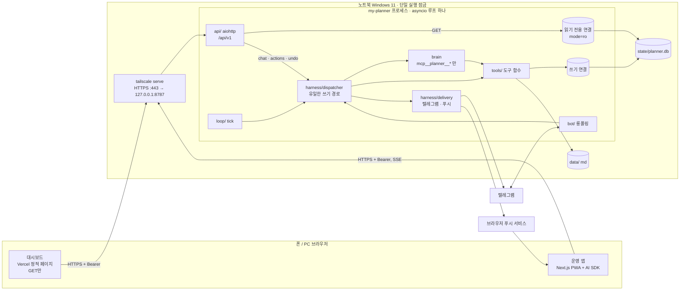

# SP3-4 HTTP API · 인생 곡선 · 상태창 · 웹 대시보드 상세 설계

- 상태: 초안 v3 (문서 리뷰, 운영 앱 스레드 승인 반영), Dahun 검토 대기
- 작성일: 2026-10-24
- 상위 문서: [마스터 설계](2026-10-23-my-planner-master-design.md), [SP1 비서 코어](2026-10-23-sp1-secretary-core-design.md) (v4)
- 용어: [`GLOSSARY.md`](../../../GLOSSARY.md), 결정 기록: [`docs/adr/`](../../adr/) (이번에 [0007](../../adr/0007-http-api-inside-be-single-writer.md), [0008](../../adr/0008-dashboard-on-vercel-browser-to-be-over-tailscale.md) 추가)
- 범위: 마스터 설계의 SP3(인생 곡선 + 상태창)과 SP4(웹 대시보드)를 하나로 합친다. 운영 앱이 쓸 BE HTTP API의 계약도 이 문서가 **유일한 정본**이다. SP2(기억 계층)는 미룬다.

## 1. 목표와 완료 조건

노트북의 my-planner 프로세스(BE) 안에 HTTP API 하나를 열고, 그 위에 인생 곡선과 게임형 상태창을 올린다. 텔레그램, 운영 앱(별도 FE), 웹 대시보드(읽기 전용)가 같은 데이터를 본다. 쓰기는 BE의 디스패처 한 곳에서만 일어난다.

**세 조각** (Dahun 결정 1)

| 조각 | 무엇 | 읽기 | 쓰기 | 이 문서의 범위 |
|---|---|---|---|---|
| BE | 노트북의 my-planner Python 프로세스(SP1) + HTTP API | 원본(SQLite, md) | **유일한 작성자** | 전부 |
| 대시보드 | Vercel에 올린 웹 화면. 폰에서도 Tailscale로 연다 | API `GET`만 | 없음 | 화면 4개, 데이터 출처, 상태 표시 |
| 운영 앱 | Next.js PWA + Vercel AI SDK (다른 스레드에서 설계) | API | API(`/chat`, `/actions`) | **API 계약만** ("운영 앱용"으로 표시) |

대시보드에서 무언가를 바꾸고 싶으면 텔레그램이나 운영 앱으로 한다.

**완료 조건 (수용 기준)**

1. 폰 브라우저에서 Tailscale로 대시보드를 열면 화면 4개(비서 상태, 할 일 + 컨디션, 인생곡선, 상태창)가 실제 데이터로 나오고, 인생곡선을 일·주·월·분기·년 다섯 단계로 확대·축소할 수 있다(마스터 SP4 완료 조건). 같은 시각에 텔레그램 `/today`, `/week`, `/status`가 보여 주는 할 일, 레벨, 경험치, 스탯과 값이 같다(같은 함수에서 나온다, 16장 계약 테스트).
2. 노트북이 꺼져 있으면 대시보드가 10초 안에 "BE 꺼짐 · 마지막 응답 {시각}"을 보여 준다. 그 브라우저가 BE에 붙은 적이 없으면 "BE 꺼짐 · 마지막 응답 기록 없음"이다.
3. 올바른 API 토큰이 없는 요청은 `401`이다. 허용 목록 밖 출처(Origin)에는 CORS 허용 헤더를 주지 않는다. 시스템 로그에 토큰, 메시지 본문, 할 일 제목, 도구 인자가 없다(로그 검사 테스트).
4. 데이터 변경은 모두 디스패처를 거친다. `GET` 처리기는 읽기 전용 SQLite 연결만 가진다(쓰기를 시도하면 `sqlite3.OperationalError`가 나는 테스트).
5. 매달 마지막 일요일 주간 회고에서 사다리 점수(지금, 5년 뒤)를 버튼으로 받아 `curve_ladder_scores`에 기록한다. 분기 마지막 주의 회고에서 6개 영역 점수를 받아 `curve_area_scores`에 기록한다. 지난 분기보다 내려간 영역은 상태창에 디버프와 회복 퀘스트 하나로 나온다.
6. 대화에서 꺼낸 사건은 초안으로만 저장되고, 버튼이나 자연어로 확정하기 전에는 곡선, 칭호, `GET /curve`에 나오지 않는다.
7. `python -m my_planner seed-life <파일>`이 검토를 마친 시드 파일에서 챕터와 사건을 가져온다. `sensitive`이거나 `storage` 표시가 있는데 `confirmed: true`가 아닌 항목은 저장하지 않는다. 사다리 점수와 영역 점수는 비어 있다.
8. 경험치 원장의 모든 행은 양수이고, 어떤 순서로 도구, 되돌리기, 회차를 실행해도 경험치 합계와 레벨은 줄지 않는다(속성 테스트).
9. (운영 앱용) `POST /api/v1/chat`의 응답이 AI SDK UI message stream 형식(SSE)이고, 기준 응답(golden, `tests/fixtures/app_golden/`, 16장)과 같은 파서로 읽힌다. 기준 응답은 BE가 6.4.1과 AI SDK UI message stream 규격으로 만들고 운영 앱 스레드가 확인한다. `POST /actions`의 낮은 위험 변경은 `undo_id`를 주고, `POST /activity/{id}/undo`가 그 변경을 정확히 한 번 되돌린다.
10. (운영 앱용) 주 통로가 기본값 `app`이고 유효한 푸시 구독이 하나 이상이면 아침 브리핑이 웹 푸시로 오고 텔레그램에는 오지 않는다. 구독이 없거나 푸시가 안 되면 텔레그램으로 온다. 어느 경우든 `usage_state.proactive_messages`는 회차마다 1만 오른다.
11. 16장의 자동 테스트가 모두 통과하고, SP1의 테스트도 그대로 통과한다.

## 2. 범위

| 포함 | 제외 (담당) |
|---|---|
| BE HTTP API `/api/v1` (aiohttp, BE 프로세스 안) | 기억 카드, 의미 회상, `/memory` (SP2, 미룸) |
| API 토큰 인증, CORS, Tailscale serve 운영 | 운영 앱의 화면과 FE 코드 (운영 앱 스레드) |
| 통로별 대화(텔레그램, 앱)와 공유 상태, 웹 푸시, 주 통로 설정 | 클라우드 DB, 클라우드 BE 서버 (BE URL만 바꿀 수 있게 둔다) |
| 활동 기록과 되돌리기 | 여러 사용자 |
| 인생 곡선: 챕터, 사건, 사다리 점수, 영역 점수, 안심 보기 | 과거 그래프 인터뷰 (시드 가져오기로 대신, 12장) |
| 상태창: 레벨, 경험치, 스탯, 디버프, 퀘스트, 칭호, 텔레그램 `/status` | 텔레그램 차트 이미지 (대시보드로 대신, 17장 미결 8) |
| 월·분기·연 회고 단계 (주간 회고 위에 얹는다, 새 회차 종류 없음) | 별도 월간·분기·연간 회고 회차 |
| 두뇌 도구 10개 + 앱 전용 도구 6개(화면 3, 카드 3) | 반복 할 일 (SP1과 같이 나중) |
| 시드 가져오기 CLI `seed-life` | 시드 파일 내용 (개인 정보, 저장소에 넣지 않음) |
| 웹 대시보드 화면 4개 (Vercel, 읽기 전용) | 대시보드에서 쓰기 |

## 3. 착수 전 검증 (스파이크)

SP1의 S0~S6에 이어 번호를 붙인다. 구현 계획의 첫 작업이고, 결과는 `docs/spikes/2026-11-sp3-4.md`에 남긴다. 실패한 항목은 이 스펙의 해당 절을 먼저 고친다.

| # | 확인할 것 | 실패 시 대안 |
|---|---|---|
| S7 | `pythonw`로 띄운 BE 안에서 aiohttp `AppRunner` + `TCPSite("127.0.0.1", 8787)`가 텔레그램 폴링, 1분 tick과 같은 이벤트 루프(Windows Proactor)에서 돈다. 콘솔 창이 뜨지 않는다 | API만 별도 스레드의 이벤트 루프에서 돌리고, 쓰기와 두뇌 갈래 제출은 `asyncio.run_coroutine_threadsafe`로 BE 루프의 디스패처에 넘긴다(단일 작성자 유지). `WindowsSelectorEventLoopPolicy`로 바꾸는 길은 쓰지 않는다: Selector 루프는 Windows에서 하위 프로세스를 못 띄워 Agent SDK(Claude CLI 자식 프로세스)가 멈춘다 |
| S8 | 사전 조건: tailnet 관리 화면에서 MagicDNS와 HTTPS 인증서를 켠다. `tailscale serve --bg --https=443 http://127.0.0.1:8787`로 폰(셀룰러 + Tailscale)과 노트북 브라우저에서 HTTPS로 닿는다. SSE가 버퍼링 없이 조각마다 도착한다(첫 `text-delta`까지 지연 측정) | 15초 간격 SSE 주석 줄로 버퍼를 민다. 그래도 묶여 오면 응답 끝에 한 번에 보내는 것을 받아들인다(운영 앱 스레드에 알림) |
| S9 | Vercel 출처(`https://*.vercel.app`)의 페이지가 Tailscale 주소(`*.ts.net`, 100.64.0.0/10)로 `fetch`할 때: Chrome의 Private/Local Network Access 사전 요청(`Access-Control-Request-Private-Network`)과 권한 창, iOS Safari 동작 | BE가 사전 요청에 `Access-Control-Allow-Private-Network: true`로 답한다(기본 구현에 포함). 권한 창은 사용자 안내 문서에 적는다 |
| S10 | 웹 푸시: `pywebpush`로 VAPID 서명 푸시를 보내 Android Chrome과 iOS(홈 화면에 추가한 PWA, iOS 16.4 이상)에서 받는다. Windows에서 `pywebpush`가 설치되고 돈다 | iOS 구독이 안 되면 그 구독은 D4가 처리한다(404/410이면 끄고, 받는 구독이 하나도 없으면 텔레그램으로 대체). 주 통로는 기기별 설정이 아니므로(6.4.9) 기기마다 바꾸지 않는다 |
| S11 | Agent SDK `include_partial_messages=True`로 글 조각(`StreamEvent`)을 받고, `resume=<session>` + `fork_session=True`로 회차 세션을 다른 통로에서 갈라 이어 간다 | 글 조각이 안 되면 두뇌 답 전체를 `text-delta` 하나로 보낸다. 가르기가 안 되면 SP1의 resume 실패 대체 경로(새 세션 + 회차 본문 + 원문 기록 20개)를 쓴다 |
| S12 | S2 재확인: 도구가 12개에서 22개(앱 대화는 28개)로 늘어도 기본 도구가 하나도 보이지 않고 `mcp__planner__*`만 호출된다 | SP1 S2의 대안(PreToolUse 훅) |

## 4. 구조

### 4.1 전체 그림



데이터는 브라우저와 노트북 사이에서만 오간다. Vercel은 정적 파일(HTML, JS)만 내려 주고 데이터를 보지 않는다(ADR 0008). 텔레그램과 브라우저 푸시 서비스는 SP1처럼 메시지를 전달하는 길로만 쓴다(푸시 본문은 RFC 8291로 암호화되어 푸시 서비스가 읽지 못한다).

### 4.2 서버 선택: aiohttp

| 후보 | 판단 |
|---|---|
| **aiohttp `web`** (채택) | 이미 돌고 있는 asyncio 루프에 `AppRunner` + `TCPSite`로 끼워 넣는 것이 공식 사용법이다. 신호 처리기나 루프 수명을 가져가지 않는다(SP1 5.1의 시작·종료 순서를 그대로 둔다). `StreamResponse`로 SSE를 바로 쓴다. ASGI 서버가 따로 필요 없어 의존성이 하나다. Windows Proactor 루프에서 쓰인다(S7로 확인) |
| Starlette/FastAPI + uvicorn | 스키마 자동화는 좋지만 uvicorn `Server.serve()`가 신호 처리와 수명 관리를 함께 하려 해 SP1 종료 순서와 겹친다. 의존성이 셋(starlette, uvicorn, anyio 판 맞춤)이다 |
| 표준 라이브러리 `http.server` | 스레드 기반이라 단일 루프·단일 연결 원칙을 깨고, SSE와 CORS를 손으로 짜야 한다 |

요청·응답 모양은 이미 쓰는 pydantic 모델로 정의하고 검증한다. 같은 모델에서 JSON 스키마를 뽑아 `GET /api/v1/schema`로 내준다(운영 앱의 타입 생성용, 6.4).

### 4.3 단일 작성자 (ADR 0007)

- **단일 실행 잠금**(SP1 5.1 1단계, `state/my-planner.lock`)은 그대로다. API는 잠금을 잡은 프로세스 안에서만 열린다. `seed-life` CLI도 같은 잠금을 잡는다(BE가 돌고 있으면 거절, 12장).
- **쓰기 경로는 `Dispatcher` 하나다.** 갈래가 둘이다.
  - **두뇌 갈래**(SP1 그대로): 우선순위 큐 → 두뇌 호출 → 도구. 텔레그램 메시지, 앱 메시지(`POST /chat`), 회차가 여기로 간다. 직렬 처리.
  - **즉시 갈래**(신규 `Dispatcher.apply_action(req) -> ActionResult`): 두뇌 없이 도구 함수 하나를 부른다. `POST /actions`, `POST /activity/{id}/undo`, 텔레그램 버튼(SP1 `bot/callbacks.py`의 `handle_callback`이 지금은 `Tools`를 직접 부른다 → 이 함수로 바꾼다)이 여기로 간다. 동기 함수이고 안에서 `await`하지 않는다. 그래서 같은 이벤트 루프 위에서 두뇌 호출의 도구 실행 사이에 끼어들 수는 있어도 트랜잭션 도중에 끼어들지는 않는다. 앱의 체크 표시가 5분짜리 두뇌 호출 뒤에서 기다리지 않게 하려는 것이다.
- 모든 도구 함수는 지금처럼 쓰기 연결(`open_db`) 하나를 쓴다. API의 `GET` 처리기는 따로 연 **읽기 전용 연결**(`sqlite3.connect(db_path.resolve().as_uri() + "?mode=ro", uri=True)`)만 받는다. Windows 경로(`E:\…`)를 `file:` 뒤에 그대로 붙이면 열리지 않으므로 `Path.as_uri()`로 만든다. WAL이라 쓰기와 동시에 읽어도 커밋된 값만 본다.
- **데이터**를 바꾸는 길은 위 두 갈래뿐이다. 표마다 쓰는 곳은 아래와 같다.

**누가 어느 표를 쓰나** (빠진 표는 SP1 그대로)

| 표·값 | 쓰는 곳 | 갈래 |
|---|---|---|
| `tasks`, `task_areas`, `task_events`, `priorities`, `conditions`, `curve_*`, `app_cards`, `tool_events_log` | 도구 함수 | 두뇌 갈래(두뇌가 부름) 또는 즉시 갈래(`apply_action`) |
| `activity` | 위 변경과 같은 트랜잭션(`tools/activity.py`) | 변경을 일으킨 갈래 |
| `pending_confirms` | 만들기: 도구 함수(10.1) 또는 `/actions`. 확인·거절: `apply_action`(앱 `/actions`의 `confirm_token`, 텔레그램 확인 버튼). 만료: 하루 한 번 작업 | 만든 갈래 / 즉시 갈래 |
| `status_xp_ledger` X1, X2, X4, X6, X7, X10 | 그 변경을 쓰는 도구 함수, 같은 트랜잭션 | 변경을 일으킨 갈래 |
| `status_xp_ledger` X3, X5, X8, `runs.answered_at`·`answered_via` | 디스패처의 답 판정 `mark_answered(run, channel)`(7.5 M3, 6.4.5), 한 트랜잭션 | 메시지면 두뇌 갈래, 버튼·`/actions`면 즉시 갈래 |
| `status_xp_ledger` X9, 할 일·사건·챕터 초안 만료, `api_idempotency` 정리 | 하루 한 번 작업이 `apply_action`을 부른다(`actor = secretary`, `channel = scheduler`) | 즉시 갈래 |
| `push_subscriptions` 추가·삭제, `app_state.notify_primary` | `POST`/`DELETE /push/subscriptions`, `PUT /settings/notify` → `apply_action` | 즉시 갈래 |
| `push_subscriptions.last_success_at`·`failure_count`·`disabled_at`, `run_deliveries` | `harness/delivery.py`. 회차 전달은 두뇌 갈래 작업 안에서, `POST /push/test`는 즉시 갈래로 결과를 기록한다(보내기는 `asyncio.to_thread`, 기록은 루프 스레드) | 두뇌 갈래 또는 즉시 갈래 |
| `api_idempotency` 쓰기, `inbound_pending`(통로 `app`) | 받을 때 `api/chat.py`(`inbound_pending` 저장), 끝낼 때 디스패처(7.5 M5). `/actions`·`/undo`·명령은 `apply_action`이 결과와 함께 쓴다 | 해당 요청의 갈래 |
| `conversations`(앱 요청이 여는 대화, 가르기 포함) | 디스패처의 동기 함수 `Dispatcher.route_app_message(at, *, conversation_id, checkin_id)`(6.4.1, 7.2). `api/chat.py`가 받을 때 부르고, 다시 넣은 행의 대화가 닫혔으면 디스패처가 다시 부른다(7.5 M6). 쓰기 경로 감시(16장)에 넣는다 | 갈래 밖(SP1의 대화 열기와 같음) |
| `runs` 상태, `app_state`(`notify_primary` 빼고), `usage_state`, `telegram_updates`, 백업 | SP1처럼 `loop`와 디스패처가 직접. 하네스가 자기 일을 기록하는 운영 상태다 | 갈래 밖(SP1과 같음) |

갈래 밖의 쓰기는 모두 이벤트 루프 스레드 위의 동기 호출이라 트랜잭션끼리 섞이지 않는다.

### 4.4 폴더

SP1 4장의 구조에 아래를 더한다. 마스터 5.1의 `src/my_planner/dashboard/`는 만들지 않는다(대시보드는 별도 웹 앱, ADR 0008).

```
src/my_planner/
├── api/
│   ├── server.py      # build_app(), start_api(), stop_api(): AppRunner/TCPSite 수명
│   ├── auth.py        # Bearer 토큰 검사(hmac.compare_digest), 실패 횟수 제한
│   ├── cors.py        # 출처 허용 목록, 사전 요청, Private Network 헤더
│   ├── models.py      # 요청·응답 pydantic 모델 (JSON 스키마의 정본)
│   ├── read.py        # GET 처리기: 읽기 전용 연결만 받는다
│   ├── chat.py        # POST /chat: Inbound(channel="app") + UI message stream
│   ├── actions.py     # POST /actions, /activity/{id}/undo → Dispatcher.apply_action
│   ├── push.py        # 구독 저장, VAPID 공개키
│   └── health.py      # 연결 확인 + ErrorCounter(로그 처리기)
├── harness/
│   ├── delivery.py    # 회차 전달: 주 통로, 푸시, 텔레그램 대체 (7.3)
│   ├── stream.py      # StreamSink: 두뇌·도구 이벤트 → UI message stream 조각
│   └── prompts/       # + review_month.md, review_quarter.md, review_year.md, channel_app.md
├── curve/
│   ├── model.py       # 확대 단위 묶기, 안심 보기 계산 (순수 함수)
│   └── seed.py        # seed-life 가져오기 (12장)
├── status/
│   ├── xp.py          # 경험치 규칙과 레벨 곡선 (순수 함수, 9장)
│   └── snapshot.py    # status_snapshot(): /status, GET /status, 대시보드가 같이 쓴다
├── store/repos/       # + curve.py, status.py, activity.py, push.py, cards.py, channels.py
└── tools/
    ├── core.py        # + 곡선·상태창 도구 (10장)
    ├── ui.py          # ui_* 화면 도구 (그리기만, 부작용 없음)
    └── activity.py    # 변경 → activity 행 + 되돌리기 재료 (같은 트랜잭션)
web/dashboard/         # Next.js 정적 내보내기 (output: "export"), Vercel 루트 디렉터리
```

## 5. 데이터 모델

SP1 5.5의 규칙을 따른다: 시각은 UTC ISO 8601 문자열, 날짜는 논리적 날짜 `YYYY-MM-DD`, 기간은 `priorities.period`와 같은 형식(`2026-10`, `2026-Q4`, `2026`). 마이그레이션은 `store/migrations/NNN_*.sql`, `PRAGMA user_version`으로 하나씩 트랜잭션 안에서 적용한다(`store/db.py migrate`).

### 5.1 `006_channels.sql`: 통로, 회차 전달, 답한 회차

```sql
ALTER TABLE conversations ADD COLUMN channel TEXT NOT NULL DEFAULT 'telegram'
    CHECK (channel IN ('telegram', 'app'));
ALTER TABLE conversations ADD COLUMN forked_from INTEGER NULL REFERENCES conversations (id);
CREATE INDEX idx_conversations_channel ON conversations (channel, kind, closed_at, last_message_at);

ALTER TABLE inbound_pending ADD COLUMN channel TEXT NOT NULL DEFAULT 'telegram'
    CHECK (channel IN ('telegram', 'app'));
ALTER TABLE inbound_pending ADD COLUMN client_msg_id TEXT NULL;
ALTER TABLE inbound_pending ADD COLUMN checkin_id INTEGER NULL;      -- 앱이 답한 회차(runs.id)
CREATE UNIQUE INDEX idx_inbound_client_msg ON inbound_pending (client_msg_id)
    WHERE client_msg_id IS NOT NULL;

ALTER TABLE runs ADD COLUMN answered_at  TEXT NULL;
ALTER TABLE runs ADD COLUMN answered_via TEXT NULL CHECK (answered_via IS NULL OR answered_via IN ('telegram', 'app'));

CREATE TABLE run_deliveries (
    run_id              INTEGER NOT NULL REFERENCES runs (id),
    channel             TEXT NOT NULL CHECK (channel IN ('telegram', 'app')),
    mode                TEXT NOT NULL CHECK (mode IN ('full', 'fallback')),  -- fallback: 푸시가 안 돼 텔레그램으로
    status              TEXT NOT NULL CHECK (status IN ('sent', 'not_sent')),
    telegram_message_id INTEGER NULL,   -- 버튼이 붙은 마지막 조각. 답한 뒤 버튼을 거둘 때 쓴다
    push_ok             INTEGER NOT NULL DEFAULT 0,
    push_failed         INTEGER NOT NULL DEFAULT 0,
    at                  TEXT NOT NULL,
    PRIMARY KEY (run_id, channel)
);
```

- 기존 행은 모두 `telegram`이다(SP1은 텔레그램만 있었다). `PendingInbound`(store/repos/state.py)에 `channel`, `client_msg_id`, `checkin_id`를 더하고(`conversation_id`는 SP1부터 있다), `StateRepo.add_pending_inbound`에 `channel`, `client_msg_id`, `checkin_id`, `conversation_id` 키워드 인자를 더한다(지금은 `update_id, text, sent_at, received_at`뿐이라 대화 id를 쓸 길이 없다). 앱 행만 `conversation_id`를 적고, 텔레그램 행은 SP1처럼 비워 둔다. 시작 때 다시 넣기는 이 통로를 보고 답을 보낼 곳을 정한다(7.5 M5).
- **받을 때 고른 대화**: 앱 행은 `api/chat.py`가 받을 때 `route_app_message`로 고른 대화 id를 `inbound_pending.conversation_id`에 미리 적는다. 이 열은 SP1 `005_inbound_pending.sql`에 이미 있다(SP1은 `brain_done`일 때 `save_inbound_reply`로 답이 속한 대화를 적고 `brain_done` 행에서만 읽는다. 앱 행에서 그 값을 덮어쓰는 것은 SP1과 같다). 그래서 **열을 더하는 마이그레이션은 없다**: 계획 초안의 `011_inbound_conversation.sql`은 만들지 않는다(`011`은 다른 마이그레이션이다, 5.2 `activity_targets`). SQLite의 `ALTER`로는 외래 키를 더할 수 없으므로 FK도 두지 않는다. `005_inbound_pending.sql`의 이 열 주석("답이 속한 대화(brain_done일 때)")은 SP1 시절 그대로이고, 앱 행에서는 이 문장이 우선한다(이미 적용된 마이그레이션 파일은 고치지 않는다). 시작 때 다시 넣기(`resubmit_inbound`)가 이 값을 `Inbound.conversation_id`로 넘기고, 그 대화가 닫혔으면 디스패처가 `route_app_message`로 다시 고른다(7.5 M6).
- **앱 메시지의 `inbound_id`**: `inbound_pending.update_id`는 텔레그램 `update_id`(양수)다. 앱 메시지는 `app_state.app_inbound_seq`에서 **음수**(−1, −2, …)를 받아 같은 열에 쓴다. 그래서 `tool_events_log.inbound_id`와 SP1 5.2의 다시 넣기 규칙(사용자 줄, 저장한 답, 도구 기록, 3회 뒤 버림)을 그대로 쓴다. 앱 메시지의 `sent_at`은 받은 시각과 같다(브라우저 시계는 믿지 않는다).

### 5.2 `007_activity.sql`: 활동 기록, 요청 중복 방지

```sql
CREATE TABLE activity (
    id                 INTEGER PRIMARY KEY,
    at                 TEXT NOT NULL,
    actor              TEXT NOT NULL CHECK (actor IN ('secretary', 'user')),
    channel            TEXT NOT NULL CHECK (channel IN ('app', 'telegram', 'scheduler')),
    kind               TEXT NOT NULL,          -- 6.4.4 표
    target             TEXT NULL,              -- 'task:12', 'condition:2026-10-24', 'priorities:week:2026-W43',
                                               -- 'ladder:2026-10', 'areas:2026-Q4', 'milestone:7', 'chapter:3', 'card:2'
    summary            TEXT NOT NULL,          -- 확인 문구 한 줄(SP1 부록 A 형식). 메시지 본문은 넣지 않는다
    risk               TEXT NOT NULL CHECK (risk IN ('low', 'confirm')),
    undo_json          TEXT NULL,              -- 되돌릴 때 쓸 이전 값. NULL이면 되돌릴 수 없다
    undone_at          TEXT NULL,
    undone_by          INTEGER NULL REFERENCES activity (id),
    conversation_id    INTEGER NULL,
    run_id             INTEGER NULL,
    inbound_id         INTEGER NULL
);
CREATE INDEX idx_activity_at ON activity (at);
CREATE INDEX idx_activity_target ON activity (target, at);

CREATE TABLE api_idempotency (
    client_msg_id   TEXT PRIMARY KEY,
    endpoint        TEXT NOT NULL CHECK (endpoint IN ('chat', 'actions', 'undo')),
    status_code     INTEGER NOT NULL,
    response_json   TEXT NULL,     -- actions·undo: 응답 JSON. chat: {"conversation_id", "reply_text"(가린 뒤의 답 글), "confirmation"(확인 문구, 없으면 null. 명령 답에는 없다)}
    conversation_id INTEGER NULL,
    at              TEXT NOT NULL
);

CREATE TABLE pending_confirms (            -- 확인을 기다리는 변경(6.4.2 needs_confirm, 10.1 회차 차례의 확인)
    token           TEXT PRIMARY KEY,      -- 'ct_' + secrets.token_urlsafe(16)
    action          TEXT NOT NULL,         -- 6.4.2 표의 action 이름
    args_json       TEXT NOT NULL,
    summary         TEXT NOT NULL,         -- 확인 문구 한 줄
    origin          TEXT NOT NULL CHECK (origin IN ('actions', 'run_turn')),
    run_id          INTEGER NULL,
    conversation_id INTEGER NULL,
    created_at      TEXT NOT NULL,
    expires_at      TEXT NOT NULL,         -- actions: +10분, run_turn: 그 회차 답장 창 끝
    resolved_at     TEXT NULL,
    resolution      TEXT NULL CHECK (resolution IS NULL OR resolution IN ('applied', 'declined', 'expired', 'stale'))
);
```

- 변경 도구는 데이터 변경, `tool_events_log`(SP1), `activity`를 **같은 트랜잭션**에서 쓴다(`tools/activity.py`). `tool_events_log`는 SP1의 재실행 판정용으로 그대로 두고, `activity`는 사람(운영 앱)에게 보여 주고 되돌리는 용도다.
- `api_idempotency.response_json`의 chat 모양은 위 SQL 주석이 정본이다. 티켓 01이 넣은 `007_activity.sql`의 같은 주석("확인 문구 포함")은 옛 문구이고 열 모양은 같다. 이미 적용된 마이그레이션 파일은 고치지 않고 이 문장이 우선한다.
- `api_idempotency`는 하루 한 번 작업이 2일 지난 행을 지운다(텔레그램 `telegram_updates`와 같은 보관 기간).
- `pending_confirms`: 확인 토큰을 DB에 둔다(재시작해도 남는다). 쓰고 나면(`resolved_at`) 다시 쓰지 않는다. 확인 시점에 대상이 이미 바뀌었으면(그 대상의 `activity`가 토큰 뒤에 있으면) 적용하지 않고 `stale`로 닫는다. 하루 한 번 작업이 7일 지난 행을 지운다.
- **`011_activity_targets.sql`**: 한 활동이 대상을 여럿 바꿀 수 있다(초안 묶음 확정, 초안 정리, 내려놓기로 비워진 우선순위 칸).

```sql
CREATE TABLE activity_targets (
    activity_id INTEGER NOT NULL REFERENCES activity (id),
    target      TEXT NOT NULL,
    PRIMARY KEY (activity_id, target)
);
CREATE INDEX idx_activity_targets_target ON activity_targets (target);
```

  - 모든 활동이 대상 전부를 이 표에 적는다(같은 트랜잭션). `activity.target`은 대상이 하나일 때 그 값, 여럿이면 `NULL`이다. 되돌리기 U3(6.4.3)와 확인 토큰의 낡음 판정은 이 표로 본다.
  - **보기만 하는 대상**: `priorities_set`이 적는 목록 안의 할 일 대상(`task:<id>`)은 토큰 낡음 판정에만 세고 U3에는 세지 않는다.
- `record_condition`은 SP1처럼 `tool_events_log` 행을 쓰지 않는다(쓰면 컨디션만 한 회차가 "도구가 이미 돌았다"로 읽힌다). 그 활동 행은 컨디션 변경과 같은 트랜잭션에서 쓴다.

### 5.3 `008_push_cards.sql`: 푸시 구독, 고정 카드

```sql
CREATE TABLE push_subscriptions (
    id              INTEGER PRIMARY KEY,
    endpoint        TEXT NOT NULL UNIQUE,   -- 비밀값처럼 다룬다: 로그에 남기지 않는다
    p256dh          TEXT NOT NULL,
    auth            TEXT NOT NULL,
    label           TEXT NULL,              -- 사용자가 붙인 기기 이름(예: "폰")
    created_at      TEXT NOT NULL,
    last_success_at TEXT NULL,
    failure_count   INTEGER NOT NULL DEFAULT 0,
    disabled_at     TEXT NULL               -- 404/410을 받았거나 연속 5번 안 됨
);

CREATE TABLE app_cards (
    id              INTEGER PRIMARY KEY,
    component       TEXT NOT NULL,          -- ui 카탈로그의 이름 (6.4.7)
    props_json      TEXT NOT NULL,          -- 카탈로그 스키마로 검증한 값. 할 일은 id로만 가리킨다
    sort_order      INTEGER NOT NULL,
    pinned_at       TEXT NOT NULL,
    unpinned_at     TEXT NULL,
    conversation_id INTEGER NULL
);
```

주 통로 설정은 `app_state.notify_primary`(`telegram` | `app`, 없으면 `config.toml`의 `notify.default_primary`)에 둔다.

### 5.4 `009_curve.sql`: 인생 곡선

```sql
CREATE TABLE curve_chapters (
    id          INTEGER PRIMARY KEY,
    seed_key    TEXT NULL UNIQUE,     -- 시드의 챕터 id(예: 'C1'). 시드로 만든 것만
    title       TEXT NOT NULL CHECK (length(title) BETWEEN 1 AND 100),
    theme       TEXT NULL,            -- 주제 한 줄
    start_month TEXT NOT NULL CHECK (start_month GLOB '[0-9][0-9][0-9][0-9]-[0-9][0-9]'),
    end_month   TEXT NULL CHECK (end_month IS NULL OR end_month GLOB '[0-9][0-9][0-9][0-9]-[0-9][0-9]'),  -- NULL = 지금까지
    sketch      TEXT NULL,            -- 과거 그래프의 방향 메모(시드 curve_sketch.direction, 자유 글)
    certainty   TEXT NOT NULL DEFAULT 'fact' CHECK (certainty IN ('fact', 'estimate')),
    status      TEXT NOT NULL CHECK (status IN ('draft', 'confirmed')),
    origin      TEXT NOT NULL CHECK (origin IN ('seed', 'chat', 'review')),
    source_ref  TEXT NULL,            -- 시드의 출처 메모. 화면에는 내보내지 않는다
    draft_since TEXT NULL,            -- 초안 만료 시계의 시작. 초안이면 NOT NULL(제안 시각, 되돌린 시각), 확정하면 NULL로 되돌린다
    created_at  TEXT NOT NULL,
    updated_at  TEXT NOT NULL,
    CHECK (end_month IS NULL OR end_month >= start_month)
);

CREATE TABLE curve_milestones (
    id             INTEGER PRIMARY KEY,
    chapter_id     INTEGER NULL REFERENCES curve_chapters (id) ON DELETE SET NULL,  -- 챕터 초안을 지우면 NULL
    date_text      TEXT NOT NULL,     -- 'YYYY' | 'YYYY-MM' | 'YYYY-MM-DD' (기억하는 만큼만)
    precision      TEXT NOT NULL CHECK (precision IN ('year', 'month', 'day')),
    sort_date      TEXT NOT NULL,     -- 정렬용: 그 기간의 첫날 YYYY-MM-DD
    kind           TEXT NOT NULL CHECK (kind IN ('high', 'low', 'turning_point')),
    kind_certainty TEXT NOT NULL DEFAULT 'fact' CHECK (kind_certainty IN ('fact', 'estimate')),
    title          TEXT NOT NULL CHECK (length(title) BETWEEN 1 AND 100),
    note           TEXT NULL,
    sensitive      INTEGER NOT NULL DEFAULT 0 CHECK (sensitive IN (0, 1)),
    certainty      TEXT NOT NULL DEFAULT 'fact' CHECK (certainty IN ('fact', 'estimate')),
    status         TEXT NOT NULL CHECK (status IN ('draft', 'confirmed')),
    origin         TEXT NOT NULL CHECK (origin IN ('seed', 'chat', 'review')),
    title_label    TEXT NULL,         -- 칭호 이름을 사용자가 고쳤을 때(9.4)
    conversation_id INTEGER NULL,     -- 초안을 꺼낸 대화("전부 저장" 버튼)
    source_ref     TEXT NULL,
    draft_since    TEXT NULL,         -- 초안 만료 시계의 시작(제안 시각, 확정을 되돌린 시각). 확정하면 NULL
    created_at     TEXT NOT NULL,
    confirmed_at   TEXT NULL,
    updated_at     TEXT NOT NULL,
    CHECK ((status = 'confirmed') = (confirmed_at IS NOT NULL))
);
CREATE INDEX idx_milestones_sort ON curve_milestones (status, sort_date);

CREATE TABLE curve_ladder_scores (
    period      TEXT PRIMARY KEY CHECK (period GLOB '[0-9][0-9][0-9][0-9]-[0-9][0-9]'),  -- 달
    now         INTEGER NULL CHECK (now IS NULL OR now IN (0,1,2,3,4,5,6,7,8,9,10)),
    future      INTEGER NULL CHECK (future IS NULL OR future IN (0,1,2,3,4,5,6,7,8,9,10)),  -- 5년 뒤
    note        TEXT NULL,
    recorded_at TEXT NOT NULL,
    CHECK (now IS NOT NULL OR future IS NOT NULL)   -- 5년 뒤만 먼저 답해도 된다
);

CREATE TABLE curve_area_scores (
    period         TEXT NOT NULL CHECK (period GLOB '[0-9][0-9][0-9][0-9]-Q[1-4]'),  -- 분기
    area           TEXT NOT NULL CHECK (area IN
        ('career', 'finance', 'health', 'relationships', 'learning', 'quality_of_life')),
    score          INTEGER NOT NULL CHECK (score IN (1,2,3,4,5,6,7,8,9,10)),
    note           TEXT NULL,
    recovery_quest TEXT NULL CHECK (recovery_quest IS NULL OR length(recovery_quest) <= 80),  -- 내려갔을 때 제안
    recorded_at    TEXT NOT NULL,
    PRIMARY KEY (period, area)
);

CREATE TABLE curve_area_defaults (           -- 영역별 기본 회복 퀘스트(시드 areas[].quest, 확인한 것만)
    area           TEXT PRIMARY KEY,
    recovery_quest TEXT NOT NULL CHECK (length(recovery_quest) <= 80),
    updated_at     TEXT NOT NULL
);

CREATE TABLE curve_questions (               -- 시드 questions[]: 회고에서 하나씩 묻는다(11.1)
    id          INTEGER PRIMARY KEY,
    text        TEXT NOT NULL,
    status      TEXT NOT NULL DEFAULT 'open' CHECK (status IN ('open', 'asked', 'answered', 'skipped')),
    asked_at    TEXT NULL,
    answered_at TEXT NULL
);
```

- **초안은 지운다**: 사건과 챕터의 초안을 빼거나(✗ 버튼) 만료(`draft_since`부터 3일, `limits.draft_ttl_days`)되면 행을 **지운다**. 챕터 초안을 지우면 그 챕터를 가리키던 사건의 `chapter_id`는 `ON DELETE SET NULL`로 비워진다(`foreign_keys=ON`이라 이 규칙이 없으면 오류가 난다). 할 일 초안(SP1, `dropped`로 남김)과 다르다. 사용자가 저장하지 않기로 한 삶의 기억을 DB에 남기지 않으려는 것이다.
- 확정한 사건의 삭제는 v1 범위 밖이다(운영 앱이 필요하면 다음 개정에서 `drop_milestone`을 확정 행까지 넓힌다).
- 마스터 5.2의 `curve_*` 원본이다. `data/curve/*.md` 내보내기는 변경 도구 뒤마다 다시 만든다(`curve/chapters.md`: 챕터와 확정 사건, 민감 사건은 제목 대신 "(민감)").

### 5.5 `010_status.sql`: 상태창 원장, 칭호

```sql
CREATE TABLE status_xp_ledger (
    id           INTEGER PRIMARY KEY,
    at           TEXT NOT NULL,
    logical_date TEXT NOT NULL,
    source_kind  TEXT NOT NULL CHECK (source_kind IN
        ('task_done', 'checkin_reply', 'condition', 'review_week', 'ladder', 'wheel',
         'year_review', 'rest_day', 'secretary')),
    source_ref   TEXT NOT NULL,          -- 'task:12', 'run:340', 'date:2026-10-24', 'ladder:2026-10', ...
    amount       INTEGER NOT NULL CHECK (amount > 0),   -- 오르기만 한다(ADR 0006)
    area         TEXT NULL,
    label        TEXT NOT NULL,          -- 상태창 "최근 경험치" 줄: '할 일 완료', '쉬는 날' 등. 제목은 넣지 않는다
    UNIQUE (source_kind, source_ref)
);
CREATE INDEX idx_xp_date ON status_xp_ledger (logical_date);

CREATE TABLE status_titles (
    id           INTEGER PRIMARY KEY,
    milestone_id INTEGER NOT NULL UNIQUE REFERENCES curve_milestones (id),
    granted_at   TEXT NOT NULL
);
```

레벨, 스탯, 디버프, 퀘스트는 저장하지 않고 원장, `curve_area_scores`, `priorities`, `tasks`에서 매번 계산한다(마스터 P6). 원장에는 UPDATE와 DELETE를 하지 않는다(저장소 함수가 없다).

## 6. HTTP API 계약 (`/api/v1`)

### 6.1 공통 규칙

| 항목 | 규칙 |
|---|---|
| 주소 | BE는 `api.host`(기본 `127.0.0.1`), `api.port`(기본 `8787`)에만 연다. 지금은 `tailscale serve`가 `https://<노트북>.<tailnet>.ts.net` → `http://127.0.0.1:8787`로 넘긴다. FE는 BE URL을 설정값으로 받는다(나중에 클라우드로 옮겨도 FE 코드는 같다) |
| 판 | 경로 앞머리 `/api/v1`. 깨지는 변경은 `/api/v2`로 낸다. 필드 추가는 깨지지 않는 변경이고, 클라이언트는 모르는 필드를 무시한다 |
| 인증 | 모든 경로(사전 요청 `OPTIONS` 제외)에 `Authorization: Bearer <API_TOKEN>`. 토큰은 `.env`의 `API_TOKEN`(32바이트 이상 무작위, `python -m my_planner gen-token`이 만든다). 비교는 `hmac.compare_digest`. 쿼리 문자열이나 쿠키로는 받지 않는다. **`API_TOKEN`이 없거나 43자(`secrets.token_urlsafe(32)`의 길이) 미만이면 API를 열지 않는다**: `api_token_missing` 경고 한 줄(토큰 값은 남기지 않는다)을 남기고 텔레그램과 루프는 그대로 돈다(15장) |
| 형식 | 요청·응답 `application/json; charset=utf-8`(`/chat` 응답만 `text/event-stream`). 본문 상한 64KB(`api.max_body_kb`) |
| 시각 | 응답의 시각은 UTC ISO 8601(`2026-10-24T09:00:00Z`), 날짜는 논리적 날짜, 기간은 `priorities.period` 형식. 화면 표시는 FE가 `Asia/Seoul`로 바꾼다. 도구 결과(`Tools._task_dict`는 `+09:00` 현지 시각을 준다)를 담는 `/actions`의 `result`와 `/chat`의 `tool-output-available.output`도 **API 경계에서 UTC로 바꾼다**(`api/models.py`가 시각 필드를 변환). 두뇌가 받는 도구 결과는 SP1 그대로 현지 시각이다 |
| ID | DB의 정수 id를 그대로 쓴다(`task_id`, `run_id`, `conversation_id`, `activity_id`). 클라이언트가 만드는 것은 `client_msg_id`(UUID 문자열) 하나다 |
| 중복 방지 | 쓰기 요청(`/chat`, `/actions`, `/undo`)은 `client_msg_id`가 필수다. 같은 값이 다시 오면 처음 응답을 그대로 돌려준다(`api_idempotency`, 2일). `400`은 저장하지 않는다. 되돌리기에서 같은 `client_msg_id`를 다른 활동에 다시 쓰면 `409 conflict` |
| 오류 모양 | `{"error": {"code": "<코드>", "message": "<사람용 한 줄>"}}` |

**오류 코드**

| HTTP | `code` | 언제 |
|---|---|---|
| 400 | `invalid_request` | JSON이 아님, 필수 필드 없음, 형식 오류 |
| 401 | `unauthorized` | 토큰이 없거나 틀림. 응답에 이유를 더 적지 않는다 |
| 404 | `not_found` | 없는 경로나 id |
| 409 | `conflict` | 상태가 맞지 않음(예: 이미 정리된 초안) |
| 409 | `superseded` | 되돌리려는 변경 뒤에 같은 대상을 바꾼 변경이 있음(6.4.3) |
| 409 | `undo_expired` | 되돌리기 24시간이 지남 |
| 413 | `too_large` | 본문 상한 초과 |
| 422 | `rejected` | 도구가 거절(예: 우선순위 4개). `message`는 도구의 오류 문구 |
| 422 | `not_undoable` | 되돌릴 수 없는 종류 |
| 429 | `too_many_auth_failures` | 1분에 인증 실패 10회. 1분 동안 모든 요청 거절 |
| 503 | `safe_mode` | DB 안전 모드(SP1 5.1 3단계). `/health`만 답한다 |
| 500 | `internal` | 그 밖. 로그에는 예외 종류만 |

하루 두뇌 호출 상한, 사용 한도, 로그인 문제는 **오류가 아니다**. SP1처럼 고정 문구로 답한다(`/chat`의 글 조각, 6.4.1).

### 6.2 경로 한눈에

| 메서드 | 경로 | 누가 | 쓰기 경로 | 절 |
|---|---|---|---|---|
| GET | `/health` | 대시보드, 운영 앱 | 없음 | 6.3.1 |
| GET | `/today` | 대시보드, 운영 앱 | 없음 | 6.3.2 |
| GET | `/week` | 대시보드, 운영 앱 | 없음 | 6.3.3 |
| GET | `/conditions?from&to` | 대시보드, 운영 앱 | 없음 | 6.3.4 |
| GET | `/curve?zoom&from&to&include_sensitive` | 대시보드, 운영 앱 | 없음 | 6.3.5 |
| GET | `/status` | 대시보드, 운영 앱 | 없음 | 6.3.6 |
| GET | `/priorities?cadence&period` | 운영 앱용 | 없음 | 6.3.7 |
| GET | `/drafts` | 운영 앱용 | 없음 | 6.3.8 |
| GET | `/schema` | 운영 앱(빌드 때) | 없음 | 6.4 |
| POST | `/chat` | 운영 앱용 | 두뇌 갈래 | 6.4.1 |
| POST | `/actions` | 운영 앱용 | 즉시 갈래 | 6.4.2 |
| POST | `/activity/{id}/undo` | 운영 앱용 | 즉시 갈래 | 6.4.3 |
| GET | `/activity?since&limit&order&before` | 운영 앱용 | 없음 | 6.4.4 |
| GET | `/checkins?date`, `/checkins/{id}` | 운영 앱용 | 없음 | 6.4.5 |
| GET | `/conversations?channel&limit`, `/conversations/{id}/messages` | 운영 앱용 | 없음 | 6.4.6 |
| GET | `/ui/catalog` | 운영 앱용 | 없음 | 6.4.7 |
| GET | `/push/vapid-public-key` | 운영 앱용 | 없음 | 6.4.8 |
| POST | `/push/subscriptions` | 운영 앱용 | 즉시 갈래 | 6.4.8 |
| DELETE | `/push/subscriptions/{id}` | 운영 앱용 | 즉시 갈래 | 6.4.8 |
| POST | `/push/test` | 운영 앱용 | 즉시 갈래(결과 기록) | 6.4.8 |
| GET, PUT | `/settings/notify` | 운영 앱용 | PUT은 즉시 갈래 | 6.4.9 |

대시보드는 표의 `GET` 여섯 개만 쓴다.

### 6.3 읽기 (대시보드와 운영 앱 공통)

공통 할 일 모양 `Todo`:

```json
{ "id": 12, "title": "치과", "status": "open", "planned_for": "2026-10-25",
  "scheduled_at": "2026-10-25T05:00:00Z", "parent_id": null,
  "areas": ["health"], "note": "",
  "priority": {"cadence": "day", "period": "2026-10-25", "rank": 1},
  "completed_at": null }
```

`priority`는 그 할 일이 **지금 기간**(오늘, 이번 주, 이번 달, 이번 분기, 올해)의 우선순위면 가장 큰 주기 하나, 아니면 `null`이다. 초안(`draft`)과 소프트 삭제한 할 일은 어떤 `GET`에도 나오지 않는다. 예외는 둘이다: 초안 목록 `GET /drafts`(6.3.8)와 체크인 상세의 초안 카드(6.4.5). 소프트 삭제한 할 일은 예외 없이 나오지 않는다.

화면 조각이 붙이는 할 일 요약 `TodoRef`(대화의 `ui_todo_list`·`ui_todo_draft` 도구 출력, 체크인 `cards[].data`, 6.4.1·6.4.5·6.4.7):

```json
{ "id": 55, "title": "치과 예약", "cadence": "week", "area": "health", "status": "draft" }
```

`cadence`는 그 할 일 `Todo.priority`의 `cadence`(지금 기간 우선순위가 아니면 `null`), `area`는 `areas`의 첫 영역(SP1 영역 순서, 없으면 `null`), `status`는 `draft` | `open` | `done` | `dropped`다. `dropped`(사용자가 빼거나 만료된 할 일, `tasks.status`)는 행이 남아 있으므로 props가 가리키면 `status: "dropped"`로 넣는다(FE가 줄을 그어 보이는 등). 소프트 삭제(`tasks.deleted_at`이 있음, 예: `task_added` 되돌리기)는 `status`와 다른 것이고, 소프트 삭제한 할 일은 `TodoRef` 목록에서 빠진다.

#### 6.3.1 `GET /health`

연결 확인과 비서 상태 화면(13.2)의 출처다. 프로세스가 살아 있으면 상태와 상관없이 `200`이다.

```json
{
  "status": "ok",
  "version": {"app": "0.2.0", "api": "v1", "schema": 10, "ui_catalog": "2026-10-24.2"},
  "now": "2026-10-24T08:00:05Z",
  "started_at": "2026-10-24T00:01:10Z",
  "last_tick_at": "2026-10-24T08:00:00Z",
  "polling": "running",
  "brain": {"auth": "ok", "checked_at": "2026-10-24T01:00:41Z",
            "limited_until": null, "calls_today": 23, "calls_cap": 60},
  "proactive": {"sent_today": 1, "cap": 3},
  "paused_until": null,
  "plan_open": false,
  "notify": {"primary": "app", "effective": "app"},
  "runs_today": [
    {"id": 340, "loop": "morning_brief", "cadence": "day", "scheduled_for": "2026-10-24T01:00:00Z",
     "status": "done", "skip_reason": null, "delivered_via": ["app"], "checkin_state": "answered"},
    {"id": 341, "loop": "evening_checkin", "cadence": "day", "scheduled_for": "2026-10-24T09:00:00Z",
     "status": "pending", "skip_reason": null, "delivered_via": [], "checkin_state": null}
  ],
  "errors": {"window_hours": 24, "since": "2026-10-24T00:01:10Z", "total": 2,
             "by_event": {"send_error": 1, "tick_error": 1}},
  "push": {"subscriptions": 1, "last_success_at": "2026-10-23T08:30:02Z"}
}
```

| 필드 | 출처 |
|---|---|
| `status` | `ok`, 또는 아래 하나라도 해당하면 `degraded`: 폴링이 `down`, `brain.auth`가 `login`/`billing`, `limited_until`이 미래. 안전 모드면 `{"status": "safe_mode", "version": …, "now": …}`만 준다 |
| `version.app` | `importlib.metadata.version("my-planner")` |
| `version.schema` | `PRAGMA user_version` |
| `last_tick_at` | `app_state.last_seen_at` |
| `polling` | `running` \| `down`(`Runner._polling_down`) \| `stopped`(updater가 멈춤) |
| `brain.auth` | 신규 `app_state.brain_auth_state`: 디스패처가 두뇌 호출마다 `ok`, `login`, `billing`으로 기록. 이 프로세스에서 아직 부르지 않았고 값도 없으면 `unknown` |
| `brain.calls_today`, `proactive.sent_today` | `usage_state`(오늘 논리적 날짜) |
| `brain.calls_cap`, `proactive.cap` | `limits.daily_brain_calls`, `limits.daily_proactive_messages` |
| `limited_until`, `paused_until` | `app_state.limited_until`, `app_state.pause_until`(지난 값은 `null`) |
| `runs_today` | `runs` 가운데 `scheduled_for`의 논리적 날짜가 오늘인 행. `delivered_via`는 `run_deliveries.status='sent'`인 통로. `checkin_state`는 6.4.5 |
| `errors` | `api/health.py`의 `ErrorCounter`: 루트 로거에 붙인 처리기가 WARNING 이상 기록을 **이벤트 이름**(`log.warning("send_error")`의 첫 인자)으로만 센다. 메모리에만 있고 24시간 창, 프로세스 시작 후부터다(`since`). 재시작하면 0이다. 로그 파일을 다시 읽지 않는 대신 재시작 전 오류는 보이지 않는다(받아들임) |
| `inbound_pending_oldest_at` | (SP6 3.4에서 추가) 받은 메시지 중 아직 답을 만들지 않은 가장 오래된 것의 시각, 없으면 `null`. 자동 복구 감시자가 무응답을 잡는 데 쓴다 |
| `push` | `push_subscriptions`의 `disabled_at IS NULL` 개수, 가장 늦은 `last_success_at` |
| `notify` | `primary`는 설정값(`app_state.notify_primary`, 없으면 `notify.default_primary`), `effective`는 지금 회차가 실제로 갈 통로(7.3 D1a) |

#### 6.3.2 `GET /today`

텔레그램 `/today`(`bot/commands.py today_text`)와 같은 내용이다. 두 함수는 신규 `store/views.py today_view(tasks, conditions, now, tz, boundary)` 하나를 쓰도록 바꾼다(`today_text`는 이 값을 글로 바꾸기만 한다).

```json
{
  "date": "2026-10-24", "weekday": "토", "day_boundary": "04:00",
  "brief": {"run_id": 340, "loop": "morning_brief", "text": "…", "sent_at": "2026-10-24T01:00:12Z"},
  "condition": {"date": "2026-10-24", "score": 4, "note": "푹 잠"},
  "todos": [ {"group": "priority", "todo": {…Todo}}, {"group": "scheduled", "todo": {…}}, {"group": "open", "todo": {…}} ],
  "checkins": [ {…체크인 요약, 6.4.5} ],
  "cards": [ {"id": 2, "component": "ui_todo_list", "order": 1, "pinned_at": "…", "props": {…}, "data": {"todos": [ … ]}} ]
}
```

- `day_boundary`: 논리적 날짜가 바뀌는 시각 `HH:MM`(설정, 기본 `04:00`).
- `brief`: 오늘 논리적 날짜에 보낸(`done`) `morning_brief` 또는 `return` 회차의 `runs.outbound_text`. 없으면 `null`.
- `todos`: `today_text`의 묶음 순서 그대로(우선순위 → 일정 → 열린 할 일, 이미 나온 것은 빼고, 전에 잡은 일 포함). 묶음 이름 `priority` | `scheduled` | `open`.
- `cards`(운영 앱용): `app_cards`의 고정 카드(`unpinned_at IS NULL`, `sort_order` 순). `props`에 할 일 id가 있으면 BE가 지금 값으로 채운 `data`를 붙인다(카드가 낡지 않게). 대시보드는 `cards`를 쓰지 않는다.
- 운영 앱 스레드가 보낸 모양 `{date, brief, condition, todos[], cards[]}`에 `weekday`, `checkins`, `todos[].group`을 더했다.

#### 6.3.3 `GET /week`

텔레그램 `/week`(`week_text`)와 같은 내용, `store/views.py week_view` 하나에서 나온다.

```json
{ "week": "2026-W43", "start": "2026-10-19", "end": "2026-10-25",
  "priorities": [ {…Todo} ],
  "days": [ {"date": "2026-10-24", "weekday": "토", "is_today": true, "todos": [ {…Todo} ]} ] }
```

할 일이 없는 날도 `days`에 넣는다(`todos: []`). 대시보드가 빈 날을 같은 칸으로 그리기 위해서다.

#### 6.3.4 `GET /conditions?from=YYYY-MM-DD&to=YYYY-MM-DD`

기본은 오늘을 포함한 지난 30일, 최대 366일. 기록 없는 날은 넣지 않는다(빈 날은 0이 아니다).

```json
{ "from": "2026-09-25", "to": "2026-10-24",
  "items": [ {"date": "2026-10-23", "score": 3, "note": null} ],
  "days_logged": 21, "average": 3.4 }
```

#### 6.3.5 `GET /curve?zoom=month&from=…&to=…&include_sensitive=false`

```json
{
  "zoom": "month", "from": "2024-11-01", "to": "2026-10-31",
  "chapters": [ {"id": 1, "title": "…", "theme": "…", "start": "2019-03", "end": null,
                 "sketch": "↑", "certainty": "estimate"} ],
  "milestones": [ {"id": 7, "date": "2023-05", "precision": "month", "kind": "turning_point",
                   "title": "…", "note": null, "chapter_id": 1, "sensitive": false, "certainty": "fact"} ],
  "ladder": [ {"period": "2026-10", "now": 6, "future": 8, "note": null} ],
  "areas": [ {"period": "2026-Q4", "scores": {"career": 6, "finance": 5, "health": 4,
              "relationships": 7, "learning": 6, "quality_of_life": 5}} ],
  "condition": [ {"bucket": "2026-10", "start": "2026-10-01", "end": "2026-10-31", "average": 3.4, "days_logged": 21} ],
  "reassurance": [ {"period": "2026-10", "ladder_now": 6, "condition_average": 3.4,
                    "condition_scaled": 6.0, "days_logged": 21, "gap": 0.0} ]
}
```

- `zoom` ∈ `day` | `week` | `month` | `quarter` | `year`. 기본 범위: `day` 지난 30일, `week` 26주, `month` 24개월, `quarter` 20분기, `year` 처음부터(가장 이른 챕터) 올해까지. `from`, `to`가 있으면 그 범위. 범위에 대한 제한은 묶음 수뿐이다: `zoom` 단위 묶음이 400개를 넘으면 자르지 않고 `400 invalid_request`("범위를 줄이거나 확대 단위를 키워 주세요")로 답한다.
- `chapters`, `milestones`는 범위와 겹치는 **확정** 행만. `include_sensitive=false`(기본)면 `sensitive=1` 사건을 뺀다. `true`면 넣고 `sensitive: true`로 표시한다.
- `ladder`는 달마다 하나. `areas`는 분기마다 하나(빠진 영역은 `scores`에 키가 없다). 묶음과 상관없이 원래 주기로 준다. FE가 x축 위치를 정한다.
- `condition`은 `zoom` 단위로 묶은 평균이다(`curve/model.py bucket_conditions`, 기록 있는 날만 평균). `bucket` 이름은 `period_of(cadence, d)`의 형식이고, `day`는 날짜다.
- `reassurance`: 사다리 `now`가 있는 달마다(5년 뒤만 있는 달은 뺀다), 그 달의 컨디션 평균을 0~10으로 옮긴 값(`condition_scaled = (average − 1) × 2.5`)과 차이(`gap = condition_scaled − ladder_now`, 소수 한 자리). 그 달 컨디션 기록이 7일 미만이면 `condition_*`과 `gap`은 `null`이다(근거가 적다). 8.3 참고.

#### 6.3.6 `GET /status`

`status/snapshot.py status_snapshot(now)` 그대로다. 텔레그램 `/status`(11.4)도 같은 함수를 쓴다.

```json
{
  "level": 6, "xp_total": 1380, "xp_into_level": 130, "xp_for_next": 400,
  "hp": {"date": "2026-10-24", "score": 4},
  "stats": [ {"area": "health", "label": "건강", "score": 4, "period": "2026-Q4",
              "prev_score": 6, "prev_period": "2026-Q3", "debuff": true,
              "recovery_quest": "저녁에 20분 걷기"} ],
  "main_quests": [ {"task_id": 31, "title": "…", "rank": 1, "period": "2026-Q4",
                    "first_steps": {"open": 2, "done": 3}} ],
  "daily_quests": [ {"task_id": 52, "title": "…", "parent_id": 31, "parent_title": "…", "planned_for": "2026-10-24"} ],
  "titles": [ {"milestone_id": 7, "title": "…", "kind": "turning_point", "date": "2023-05", "granted_at": "…"} ],
  "recent_xp": [ {"at": "…", "label": "할 일 완료", "amount": 10} ]
}
```

필드 계산은 9장. 영역 점수가 하나도 없으면 `stats`의 `score`가 `null`이고 `debuff`는 `false`다. `titles`의 민감 사건 칭호는 `GET /curve`와 같이 기본으로 빼고, `?include_sensitive=true`일 때만 넣는다.

#### 6.3.7 `GET /priorities?cadence=week|month|quarter|year&period=…` (운영 앱용)

운영 앱 할 일 화면의 이번 주·달·분기·올해 탭이다.

```json
{ "cadence": "quarter", "period": "2026-Q4",
  "items": [ {…Todo}, {…Todo} ] }
```

- `cadence`는 필수이고 `week` | `month` | `quarter` | `year`다(오늘 우선순위는 `GET /today`의 `priority` 묶음). `period`는 선택이고, 없으면 지금 기간(`period_of(cadence, 오늘 논리적 날짜)`)이다. `period`는 `priorities.period` 형식(`2026-W43`, `2026-10`, `2026-Q4`, `2026`)이어야 하고, 주기와 맞지 않으면 `400 invalid_request`다.
- `items`는 그 기간의 `priorities` 행을 `rank` 순서대로 `Todo`(6.3)로 준다. 초안과 소프트 삭제한 할 일을 가리키는 행은 뺀다. 우선순위가 없으면 `items: []`다.

#### 6.3.8 `GET /drafts` (운영 앱용)

운영 앱 할 일 화면의 초안 묶음이다. 아직 만료되지 않은 할 일 초안만 준다.

```json
{ "items": [ {"todo": {…Todo, "status": "draft"}, "proposed_at": "2026-10-24T09:01:10Z",
              "expires_at": "2026-10-27T09:01:10Z", "run_id": 341, "conversation_id": 44} ] }
```

- `proposed_at`은 그 할 일의 가장 최근 `proposed` 이벤트 시각(없으면 `created_at`)이다. 초안 만료가 보는 시각과 같다(6.4.3 `tasks_confirmed` 되돌리기). `tasks_confirmed`나 초안 `task_dropped`를 되돌리면 `proposed`를 새로 써 시계가 다시 시작한다. `expires_at = proposed_at + limits.draft_ttl_days`(3일)이고, `expires_at`이 지금 이후인 초안만 넣는다(하루 한 번 작업이 아직 지우지 않은 지난 초안도 뺀다).
- `run_id`, `conversation_id`는 그 초안을 만든 `propose_tasks` 도구 기록(`tool_events_log`)의 회차와 대화다. 없으면 `null`이다.
- 순서는 `proposed_at` 오래된 것부터, 같으면 `id` 순이다. 확정·빼기는 `/actions confirm_tasks`, `drop_task`(6.4.2)다.

### 6.4 운영 앱용 (계약 수준)

이 절은 운영 앱 스레드가 보낸 모양을 SP1 규칙에 맞춰 정한 것이다. 화면은 운영 앱 스레드가 정한다. `GET /schema`는 6장의 모든 요청·응답 모델의 JSON 스키마(`api/models.py`에서 생성)를 `{ "api": "v1", "models": { "<이름>": {JSON Schema} } }`로 준다. 운영 앱은 빌드 때 이것으로 타입을 만든다.

#### 6.4.1 `POST /chat` (운영 앱용)

AI SDK `useChat` + `DefaultChatTransport`(`api` = `<BE URL>/api/v1/chat`, `headers`에 토큰). 대화 기록은 BE가 가지므로 FE는 `prepareSendMessagesRequest`로 **마지막 사용자 메시지 하나만** 보낸다.

요청:

```json
{ "client_msg_id": "6f0c…", "conversation_id": 41, "checkin_id": null,
  "message": {"id": "msg-abc", "role": "user", "parts": [{"type": "text", "text": "내일 치과 추가해 줘"}]} }
```

- `conversation_id`: 앱이 마지막으로 받은 대화 id. 없거나 `null`이면 BE가 고른다. 아래 7.2 규칙으로 **이을 수 없으면 새 대화를 열고** 새 id를 응답 메타데이터로 알린다(오류가 아니다).
- **대화는 받을 때 고른다**: 첫 조각 `start`와 헤더 `x-conversation-id`에 대화 id가 있어야 하므로, 두뇌 갈래가 메시지를 꺼낼 때가 아니라 `api/chat.py`가 요청을 받을 때 디스패처의 동기 함수 `route_app_message(at, *, conversation_id, checkin_id) -> Conversation`이 7.2 규칙으로 고른다(필요하면 새 대화를 연다, 4.3 표). 고른 id는 `inbound_pending.conversation_id`(5.1)와 `Inbound.conversation_id`에 적고, 두뇌 갈래는 그 대화로 보낸다. 꺼낼 때 그 대화가 이미 닫혔으면 `route_app_message`가 다시 고른다.
- `messageId`(`start` 조각): `m-<conversation_id>-<|inbound_id|>`(앱 메시지의 음수 `inbound_id`의 절댓값, 5.1). 같은 `client_msg_id`의 재생과 M8에서도 같은 값이고, 6.4.6 비서 줄의 `id`와 같다.
- `checkin_id`: 앱의 체크인 화면에서 답할 때 그 회차 id. 7.2 규칙 1.
- `parts`의 `text`만 읽고 이어 붙인다. 글이 하나도 없으면(그림 등) SP1 `NON_TEXT_REPLY` 문구로 답한다.
- `/`로 시작하는 글은 텔레그램과 같은 명령으로 처리한다(`bot/commands.py`의 같은 함수). `/today`, `/week`, `/pause`, `/unpause`, `/done`, `/status`, `/help`는 두뇌 없이 답하고, 답은 글 조각 하나다. 이 명령들은 `inbound_pending`과 두뇌 갈래를 타지 않는다: 상태를 바꾸는 `/pause`, `/unpause`, `/done`은 `apply_action`(즉시 갈래)으로 처리하고, 중복 방지는 `api_idempotency`(`endpoint='chat'`, `response_json.reply_text`에 명령의 답)로 한다. 같은 `client_msg_id`가 다시 오면 명령을 다시 실행하지 않고 그 답을 돌려준다. **`/plan [주제]`는 예외**다: SP1(`bot/telegram_io.py handle_update`)처럼 앱 통로의 계획 대화를 열고 주제를 두뇌 갈래로 넘기므로, 일반 메시지와 같은 스트림으로 답한다.
- 받은 글은 SP1 5.8 가리기를 거친 뒤 `inbound_pending`(통로 `app`, 음수 id)에 먼저 저장하고 두뇌 갈래에 넣는다(SP1 5.2 전달 보장). 두뇌 갈래 안에서 앱 메시지를 어떻게 묶고, 답을 어디로 보내고, 처리 완료를 어디에 적는지는 7.5.

응답: `200`, `Content-Type: text/event-stream`, `Cache-Control: no-cache`, `X-Accel-Buffering: no`, `x-vercel-ai-ui-message-stream: v1`, `x-conversation-id: <id>`. 본문은 AI SDK UI message stream 조각(`data: <JSON>\n\n`)이고 `data: [DONE]`으로 끝난다.

```
data: {"type":"start","messageId":"m-41-7","messageMetadata":{"conversation_id":41,"channel":"app","kind":"chat","checkin_id":null}}
data: {"type":"data-status","data":{"state":"queued"},"transient":true}
data: {"type":"data-status","data":{"state":"thinking"},"transient":true}
data: {"type":"start-step"}
data: {"type":"text-start","id":"t1"}
data: {"type":"text-delta","id":"t1","delta":"내일 치과를 "}
data: {"type":"text-delta","id":"t1","delta":"추가할게요."}
data: {"type":"text-end","id":"t1"}
data: {"type":"tool-input-available","toolCallId":"tc_01","toolName":"add_task","input":{"title":"치과","areas":["health"],"planned_for":"2026-10-25"}}
data: {"type":"tool-output-available","toolCallId":"tc_01","output":{"id":53,"status":"open"}}
data: {"type":"finish-step"}
data: {"type":"data-activity","data":{"activity_ids":[912],"undo_ids":[912],"confirmation":"✓ 추가: 치과 → 내일"}}
data: {"type":"finish","messageMetadata":{"conversation_id":41,"channel":"app","kind":"chat"}}
data: [DONE]
```

| 조각 | 규칙 |
|---|---|
| `start` | 첫 조각. `messageMetadata`에 `conversation_id`, `channel`, `kind`(`chat` \| `plan` \| `run`), `checkin_id` |
| `data-status` | `transient`(기록에 남지 않음). 두뇌 큐에서 기다리면 `queued`, 두뇌가 시작하면 `thinking`(`start-step` 앞에 둘 다 보낸다). 기다리는 동안 15초마다 SSE 주석 줄 `: ping`을 보낸다 |
| 글 | 두뇌의 글 블록마다 `text-start`/`text-delta`/`text-end` 한 벌. 글 조각은 SDK `StreamEvent`에서 온다(S11). 확인 문구(SP1 5.5)는 앱 통로에서 **글 조각으로 보내지 않는다**(`h-confirm` 글 조각은 없다. AI SDK의 글 부분에는 조각 id가 남지 않아 확인 문구를 두뇌 글과 가를 수 없다). 확인 문구는 `data-activity`의 `confirmation`으로 간다. 텔레그램은 SP1 그대로 두뇌 답 아래에 같은 글을 붙인다 |
| 도구 | 두뇌가 부른 `mcp__planner__*` 도구마다 `tool-input-available`(이름은 `mcp__planner__` 앞머리를 뺀다) + `tool-output-available`(도구 결과 dict) 또는 `tool-output-error`. MCP 처리기(`tools/mcp_adapter.py _handler`)가 입력을 검증한 뒤에 보낸다 |
| 화면 도구 | `ui_*`도 도구 조각이다. `input`이 그 컴포넌트의 props다(6.4.7). 하네스가 만든 화면 조각은 `toolCallId`가 `h_`로 시작한다(초안 카드, 컨디션 고르기, 사다리 고르기, 확인 카드 `ui_confirm`). `h_*_<n>`의 `n`은 한 답 안에서 종류와 상관없이 하나로 센다. 할 일을 가리키는 `ui_todo_list`(두뇌)와 `ui_todo_draft`(하네스)의 `tool-output-available.output`은 `{"ok": true, "data": {"todos": [TodoRef]}}`다(6.3, props의 `task_ids` 순서, 소프트 삭제한 것은 빠진다). 다른 `ui_*`의 출력은 `{"ok": true}`다 |
| `data-activity` | 이 답에서 생긴 활동 id(`activity_ids`), 되돌릴 수 있는 id(`undo_ids`, 6.4.3), 확인 문구 `confirmation`(SP1 5.5 형식의 줄들을 `\n`으로 이은 글, 없으면 `null`). `/chat`은 늘 사용자 메시지에 답하는 차례라 10.1의 확인(`confirm_requested`, `ui_confirm`)이 생기지 않는다(A1·A3). `ui_confirm`은 회차 차례에서만 나고, 앱은 체크인 상세 `cards`(6.4.5)로 받는다(회차 알림은 푸시, 6.4.8). 활동도 확인 문구도 없으면 이 조각을 보내지 않는다. 순서는 두뇌 글·도구 조각 → 하네스 화면 조각 → `data-activity` → `finish` |
| `finish` | 마지막 조각. 그 뒤 `[DONE]` |
| `error` | 프로토콜 수준 문제(요청이 잘못돼 스트림 도중 끊을 때)만. 두뇌 오류, 하루 상한, 사용 한도, 로그인 문제는 SP1과 같은 고정 문구를 **글 조각**으로 보내고 정상 `finish`로 끝낸다 |

- **끊김**: 브라우저 연결이 끊겨도 두뇌 호출과 쓰기는 끝까지 간다. 답은 원문 기록과 `GET /conversations/{id}/messages`(6.4.6)로 받는다. 같은 `client_msg_id`로 다시 보내면 두뇌를 다시 부르지 않고 저장한 답을 글 조각 하나로 돌려준다. 저장한 `confirmation`이 있으면 그 뒤에 `data-activity`(`activity_ids`는 그 메시지의 `activity.inbound_id`로 찾고, `undo_ids`는 지금 시각으로 판정, 6.4.4)로 보낸다. 처리가 끝났으면 `api_idempotency.response_json.reply_text`·`confirmation`, 아직 처리 중이면 M8이다(`inbound_pending.reply_text`는 M5에서 행과 함께 지워지므로 재생의 근거로 쓰지 않는다). 처리 중이면 `data-status: queued`를 보내고 끝날 때까지 기다린다.
- 명령이나 글이 아닌 메시지에 답하는데 열린 앱 대화가 없으면 `x-conversation-id`를 보내지 않는다.
- 큐에서 기다리다 다른 대화로 다시 골라진 메시지도 `messageId`를 그대로 둔다.
- 글 조각을 일부 보낸 뒤 두뇌 호출을 다시 하면 새 `start-step`과 새 글 id로 이어 간다. 재생에는 실제로 보낸 글만 쓴다.
- 하루 상한, 사용 한도, 로그인 문제의 고정 문구 답은 원문 기록에 `[-]` 줄로 남는다.
- 하루 두뇌 호출 상한 60회는 두 통로가 함께 쓴다.

#### 6.4.2 `POST /actions` (운영 앱용)

두뇌 없이 도구 함수 하나를 부른다(즉시 갈래). 할 일과 컨디션의 쓰기 경로다.

```json
{ "action": "complete_task", "args": {"id": 12}, "client_msg_id": "1d2e…", "confirm_token": null }
```

| `action` | `args` (SP1 5.5 도구 입력과 같다) | 위험 |
|---|---|---|
| `add_task` | title, areas, planned_for?, scheduled_at?, parent_id?, note? | low |
| `update_task` | id, title?, areas?, note?, scheduled_at? | low |
| `move_task` | id, planned_for | low |
| `complete_task` | id | low |
| `reopen_task` | id | low |
| `drop_task` | id | low. 그 할 일이 지금 기간 우선순위이거나 열린 첫 걸음이 있으면 `confirm` |
| `confirm_tasks` | ids | low |
| `set_priorities` | cadence, period, task_ids | low. `quarter`·`year`이면서 이미 비어 있지 않은 목록을 바꾸면 `confirm` |
| `record_condition` | date?, score 1~5, note? | low |
| `record_ladder_score` | period?, now?, future?, note? | low |
| `record_area_scores` | period?, scores, notes? | low |
| `confirm_milestones`, `confirm_chapters` | ids | low |
| `drop_milestone`, `drop_chapter` | id (초안만) | low, 되돌릴 수 없음(행을 지운다) |
| `pin_card` | component(`ui_todo_list`, `ui_choice`, `ui_summary_card`만), props(그 컴포넌트의 카탈로그 스키마로 검증) | low |
| `unpin_card` | id | low |
| `reorder_cards` | ids (새 순서) | low |
| `decline_confirm` | confirm_token | low, 되돌릴 수 없음. 확인 카드의 "그대로 두기". 아무것도 바꾸지 않고 토큰을 `declined`로 닫는다 |

`propose_tasks`, `add_milestone`, `propose_chapter`, `grant_xp`는 없다. 제안과 경험치 부여는 비서(두뇌)의 일이다.

응답:

| 결과 | HTTP | 본문 |
|---|---|---|
| 적용 | 200 | `{"status": "applied", "activity_id": 913, "undo_id": 913, "result": {…도구 결과}, "confirmation": "✓ 완료: 운동", "xp": {"gained": 10, "level_up": null}}` |
| 확인 필요 | 200 | `{"status": "needs_confirm", "confirm_token": "ct_…", "summary": "이번 분기 우선순위 3개를 바꿔요", "expires_at": "…"}`. 같은 요청에 `confirm_token`을 넣어 다시 보내면 적용한다. 토큰은 `pending_confirms`에 두고 10분 유효하다. 회차 차례에서 생긴 토큰(10.1)도 같은 길로 확인한다: `{"action": <토큰의 action>, "args": <토큰의 args>, "confirm_token": …}`. 이미 쓰였거나 만료된 토큰은 `409 conflict` |
| 거절 | 422 | `{"status": "rejected", "activity_id": null, "error": {"code": "rejected", "message": "<도구 오류 문구>"}}` |

- `needs_confirm`은 `/actions`에서 **앱 통로 요청에만** 적용한다. 텔레그램 버튼과 `scheduler`는 SP1처럼 바로 적용한다(누름이 곧 승인이다).
- `undo_id`는 되돌릴 수 있을 때만 있고, 값은 `activity_id`와 같다(따로 만들지 않는다). `risk = confirm`으로 적용한 변경은 `undo_id`가 없다.
- 운영 앱 스레드가 보낸 모양에 `result`, `confirmation`, `xp`를 더했다.

#### 6.4.3 `POST /activity/{id}/undo` (운영 앱용)

```json
{ "client_msg_id": "77ab…" }
```

**되돌리기 규칙**

| # | 규칙 |
|---|---|
| U1 | `risk = low`이고 `undo_json`이 있는 활동만 된다. 그 밖은 `422 not_undoable` |
| U2 | 활동 뒤 24시간 안에만 된다. 지나면 `409 undo_expired` |
| U3 | 같은 `target`을 바꾼, 되돌리지 않은 더 나중 활동이 있으면 `409 superseded`(예: 완료 → 날짜 이동 → 완료 되돌리기). 되돌리기 자체도 활동이므로, 되돌린 뒤 그 대상을 다시 바꾸면 앞선 되돌리기도 막힌다(여러 단계 거꾸로 되돌리기는 안 된다). 대상은 `activity_targets`로 본다(5.2). `tasks_confirmed`는 할 일마다 본다 |
| U4 | 같은 활동을 두 번 되돌리면 두 번째는 아무것도 바꾸지 않고 `200 {"status": "already_undone", "activity_id": <되돌리기 활동 id>}`다. `client_msg_id`가 같아도 같은 응답이다 |
| U5 | 되돌리기는 새 활동(`kind = "undo"`, `undo_json = NULL`)을 남기고 원래 행에 `undone_at`, `undone_by`를 적는다. 되돌리기를 되돌리지는 않는다 |
| U6 | 경험치는 그대로 둔다. 원장은 오르기만 하고, 같은 할 일을 다시 완료해도 `UNIQUE(source_kind, source_ref)`라 두 번 쌓이지 않는다(9.1) |

**종류별 되돌리기**

| 활동 `kind` | 되돌리면 |
|---|---|
| `task_added` | 소프트 삭제(`deleted_at`) |
| `task_updated` | 바뀐 필드를 이전 값으로 |
| `task_moved` | `planned_for`, `scheduled_at`을 이전 값으로 |
| `task_completed` | `open`, `completed_at = NULL` |
| `task_reopened` | 이전 상태(`done` + 이전 `completed_at`, 또는 `dropped`) |
| `task_dropped` | 이전 상태. 지워졌던 우선순위 행은 그 칸이 비어 있을 때만 되살리고, 차 있으면 `409 superseded` |
| `tasks_confirmed` | 확정한 할 일 가운데 아직 `open`이고 나중 변경이 없는 것**만** `draft`로(일부만 되돌려도 된다. 하나도 없으면 `409 superseded`). 확인 문구에는 되돌린 것만 적는다. 만료 시계는 **되돌린 시각부터 다시 센다**: 되돌릴 때 `task_events`에 `proposed`를 새로 쓰고, `TasksRepo.expire_drafts`는 `created_at` 대신 가장 최근 `proposed` 이벤트 시각(없으면 `created_at`)으로 본다 |
| `priorities_set` | 이전 목록 |
| `condition_recorded`, `ladder_recorded`, `area_scores_recorded` | 이전 행으로, 없었으면 행 삭제 |
| `milestones_confirmed`, `chapters_confirmed` | `draft`로, `draft_since` = 되돌린 시각(3일을 다시 센다. 오래된 사건의 확정을 되돌려도 다음 날 사라지지 않는다). 칭호도 지운다(칭호는 원장이 아니다) |
| `card_pinned`, `card_unpinned`, `cards_reordered` | 반대로 |

응답: `200 {"status": "undone", "activity_id": 920, "undone": 913, "confirmation": "↩ 되돌림: 운동 완료"}`.

#### 6.4.4 `GET /activity?since=<ISO>&limit=50&order=asc|desc&before=<커서>` (운영 앱용)

```json
{ "items": [ {"id": 913, "at": "…", "actor": "user", "channel": "app", "kind": "task_completed",
              "summary": "✓ 완료: 운동", "risk": "low", "undo_id": 913, "undone_at": null} ],
  "next_since": "…", "next_before": null }
```

- `order`(기본 `asc`): `asc`는 지금처럼 `since`보다 나중 행을 오래된 것부터 준다. `desc`는 최근 것부터 준다(운영 앱 기록 화면). `limit` 최대 200. `asc`는 `at`이 같은 행을 쪽 사이에서 가르지 않으므로 한 쪽이 `limit`보다 길 수 있다.
- `before`(`desc`에서만): 앞 응답의 `next_before` 값을 그대로 넣으면 그보다 앞선 행을 이어서 준다. 클라이언트는 이 값을 만들거나 풀지 않는다(BE는 마지막 행의 `id`를 문자열로 쓴다. `at`이 같은 행이 있어도 빠지거나 겹치지 않는다). `desc`에서 `since`도 있으면 `since`보다 나중 행만 본다. `asc`에 `before`를 주면 `400 invalid_request`다.
- `next_before`: `desc`이고 더 앞선 행이 남아 있으면 다음 쪽 커서, 아니면 `null`. `asc`에서는 늘 `null`이다. `next_since`는 받은 행 가운데 가장 늦은 `at`이다(`asc`는 마지막 행, `desc`는 첫 행). 그 뒤의 새 활동은 `order=asc&since=<next_since>`로 받는다. 메시지 본문은 없다. `summary`는 확인 문구 한 줄이다(할 일 제목은 들어간다).
- `undo_id`는 지금 되돌릴 수 있을 때만(U1~U3을 지금 시각으로 판정).
- `actor`/`channel`: 두뇌가 바꾸면 `secretary` + 그 대화의 통로(회차 첫 호출은 `scheduler`). 버튼은 `user` + `telegram`. `/actions`는 `user` + `app`. 하루 한 번 작업(초안 만료)은 `secretary` + `scheduler`.
- `kind` 값: `task_added`, `tasks_proposed`, `tasks_confirmed`, `task_updated`, `task_moved`, `task_completed`, `task_reopened`, `task_dropped`, `drafts_expired`, `milestone_drafts_expired`, `chapter_drafts_expired`, `priorities_set`, `condition_recorded`, `ladder_recorded`, `area_scores_recorded`, `milestone_proposed`, `milestones_confirmed`, `milestone_dropped`, `chapter_proposed`, `chapters_confirmed`, `chapter_dropped`, `xp_granted_by_secretary`, `rest_days_granted`(X9, `scheduler`), `card_pinned`, `card_unpinned`, `cards_reordered`, `notify_changed`, `push_subscribed`, `push_unsubscribed`, `confirm_requested`(10.1, 바뀐 것 없음), `confirm_declined`, `undo`.

#### 6.4.5 답할 회차 `GET /checkins?date=…`, `GET /checkins/{id}` (운영 앱용)

**답할 회차**(체크인)는 사용자에게 **보낸**(`done`) 회차다. `id`는 `runs.id`다. 모든 루프(`morning_brief`, `evening_checkin`, `review`, `return`)가 해당한다. 건너뛴 회차는 보내지 않았으므로 답할 회차가 아니다. 합쳐 보낸 회차(`merged_run_ids`)는 primary 하나로만 나온다(답장 창은 묶음의 가장 늦은 끝). 합쳐진 회차는 따로 나오지 않고, 답은 primary에 적는다.

| `state` | 조건 |
|---|---|
| `pending` | 보냈고, 지금이 답장 창(SP1 5.3, 합친 회차는 가장 늦은 끝) 안이고, 아직 답이 없다 |
| `answered` | `runs.answered_at`이 있다 |
| `missed` | 답장 창이 끝났고 답이 없다. 화면 문구는 "지나감"이다. "놓쳤어요"는 쓰지 않는다(SP1 금지어). 경험치나 스탯에 영향이 없다 |

**답으로 치는 것**(처음 한 번 `runs.answered_at`, `answered_via`를 적는다): 그 회차의 대화(어느 통로든, 7.2)에 들어온 사용자 메시지, 그 회차에 붙은 버튼(컨디션, 초안, 사다리)이나 같은 일을 하는 `/actions`(`record_condition`의 날짜가 그 저녁 체크인의 날짜일 때 등). 시각은 SP1처럼 **보낸 시각**으로 답장 창을 본다.

**한쪽에서 답하면 양쪽에서 닫힌다**: 답이 기록되면 (1) **첫 답이 앱에서 왔을 때만** 텔레그램에 보낸 회차 메시지의 버튼을 거둔다(텔레그램에서 답하면 SP1 그대로, `run_deliveries.telegram_message_id`로 `editMessageReplyMarkup`, 안 되면 로그만), (2) 앱은 다음 읽기에서 `answered`와 `answered_via`를 본다. 닫혀도 답장 창 안의 메시지는 7.2 규칙대로 그 회차 대화에 이어진다(대화는 닫지 않는다).

```json
{ "id": 341, "loop": "evening_checkin", "cadence": "day", "scheduled_for": "…", "sent_at": "…",
  "delivered_via": ["app"], "state": "pending", "answered_via": null, "answered_at": null,
  "reply_until": "2026-10-24T19:00:00Z",
  "conversation_ids": {"app": 44, "telegram": null},
  "text": "…회차 본문…",
  "cards": [ {"toolCallId": "h_draft_341", "component": "ui_todo_draft", "props": {"task_ids": [55, 56]},
              "data": {"todos": [ {"id": 55, "title": "…", "cadence": null, "area": "health", "status": "draft"},
                                  {"id": 56, "title": "…", "cadence": null, "area": "career", "status": "draft"} ]}},
             {"toolCallId": "h_cond_341", "component": "ui_condition_picker", "props": {"date": "2026-10-24"}} ] }
```

`GET /checkins?date=`(기본 오늘)는 위에서 `text`와 `cards`를 뺀 요약 목록이다.

**`cards` 만들기**: 텔레그램 버튼 재료(`Outbound.draft_task_ids` 등)는 저장되지 않으므로, 읽을 때마다 DB에서 다시 만든다. SP1이 텔레그램 버튼을 만드는 규칙과 같은 뜻이고, 순서도 텔레그램 버튼 줄과 같다.

| 카드 | `toolCallId` | 만드는 재료 | 빠지는 경우 |
|---|---|---|---|
| `ui_todo_draft {task_ids}` | `h_draft_<run_id>` | 그 회차(합친 회차 포함)의 `tool_events_log.run_id`로 찾은 `propose_tasks` 초안 가운데 아직 `draft`인 것 | 남은 초안이 없으면(모두 확정, 빼기, 만료) |
| `ui_milestone_draft {milestone_ids}`, `ui_chapter_draft {chapter_ids}` | `h_mdraft_<run_id>`, `h_cdraft_<run_id>` | 같은 방법으로 찾은 사건·챕터 초안 가운데 남은 것(11.3) | 남은 초안이 없으면 |
| `ui_condition_picker {date}` | `h_cond_<run_id>` | `ask_condition_for(run, merged, …)`(SP1 디스패처의 판정을 옮긴 순수 함수)가 고른 날짜 | 그 날짜의 컨디션이 이미 기록됐으면 |
| `ui_ladder_picker`, `ui_area_scores` | `h_ladder_<run_id>`, `h_areas_<run_id>` | 회고 단계(11.1) | 그 단계의 값이 이미 기록됐으면 |
| `ui_confirm {summary, confirm_token, action, args}` | `h_confirm_<run_id>_<n>`(`n`은 그 회차의 `pending_confirms` 전체를 `created_at` 순으로 센 번호라, 하나가 닫혀도 다른 카드의 id가 바뀌지 않는다) | 그 회차의 `pending_confirms`(`run_id`, `resolved_at IS NULL`, `expires_at` 전, 10.1) | 확인·거절·만료·`stale`로 닫혔거나, 대상이 그 뒤 바뀐 토큰(읽을 때 뺀다, 10.1 A9) |

- 할 일을 가리키는 카드(`ui_todo_draft`)는 `data.todos`에 지금 값 `TodoRef`(6.3)를 붙인다(`props.task_ids` 순서, 초안은 `status: "draft"`).
- **확인을 기다리는 `ui_confirm` 카드는 이 `cards`로 읽는다.** 확인 카드만 모아 주는 경로는 따로 두지 않는다.

#### 6.4.6 대화 기록 `GET /conversations`, `GET /conversations/{id}/messages` (운영 앱용)

- `GET /conversations?channel=app&limit=20` → `{"items": [{"id", "kind", "channel", "run_id", "opened_at", "last_message_at", "closed_at"}]}` 최근 것부터.
- `GET /conversations/{id}/messages` → `{"items": [{"id", "at", "speaker": "user" | "secretary", "text", "tools": ["add_task"], "channel": "telegram" | "app"}]}`. 원문 기록 md(`TranscriptStore`)에서 그 대화 id의 메시지를 읽는다.
- **`id`는 바뀌지 않는다**(운영 앱이 기기에 둔 화면 조각을 다시 붙이는 열쇠). 규칙은 이것 하나다.
  - **앱 통로이고 `inbound_id`가 있는 줄**(`POST /chat`으로 받은 메시지와 그 답): 사용자 줄은 받은 `message.id`(`[A-Za-z0-9_-]{1,64}`가 아니면 `u-<conversation_id>-<|inbound_id|>`), 비서 줄은 그 답의 `start.messageId`(`m-<conversation_id>-<|inbound_id|>`, 6.4.1)다. 이 둘만 원문 기록 머리글에 `#<id>`로 적는다(7.4).
  - **그 밖의 모든 줄**(텔레그램 줄, 이 개정 전 줄, 앱 통로라도 `inbound_id`가 없는 줄: 회차 차례가 쓴 회차 본문 등 `kind = run` 대화의 비서 줄): 머리글에 `#<id>`를 적지 않고, `id`는 `l-<conversation_id>-<n>`이다. `n`은 그 대화 id의 줄을 원문 기록 순서(날짜 파일 순, 파일 안에서는 위에서부터)로 **모두**(`#<id>`가 있는 줄도) 센 번호이고 1부터다. 대화 밖 줄(`[-]`)은 어느 대화에도 세지 않는다. 원문 기록은 덧붙이기만 하므로 `n`도 바뀌지 않는다. 이런 줄에는 SSE `start` 조각이 없으므로 `messageId`도 없다.

#### 6.4.7 생성형 UI `GET /ui/catalog` (운영 앱용)

```json
{ "version": "2026-10-24.2",
  "components": {
    "ui_todo_list":        {"origin": "brain",   "schema": {…JSON Schema…}},
    "ui_choice":           {"origin": "brain",   "schema": {…}},
    "ui_summary_card":     {"origin": "brain",   "schema": {…}},
    "ui_todo_draft":       {"origin": "harness", "schema": {…}},
    "ui_condition_picker": {"origin": "harness", "schema": {…}},
    "ui_ladder_picker":    {"origin": "harness", "schema": {…}},
    "ui_area_scores":      {"origin": "harness", "schema": {…}},
    "ui_milestone_draft":  {"origin": "harness", "schema": {…}},
    "ui_chapter_draft":    {"origin": "harness", "schema": {…}},
    "ui_confirm":          {"origin": "harness", "schema": {…}} } }
```

| 컴포넌트 | props (요지) | 누르면 FE가 하는 일 |
|---|---|---|
| `ui_todo_list` | `title`, `task_ids[]`(≤30) | 없음(보기). 체크 표시는 `/actions complete_task` |
| `ui_choice` | `question`, `options[{id, label}]`(2~4) | 고른 `label`을 새 사용자 메시지로 `/chat`에 보낸다 |
| `ui_summary_card` | `title`, `lines[]`(≤8, 줄마다 120자) | 없음 |
| `ui_todo_draft` | `task_ids[]` | `/actions confirm_tasks` 또는 `drop_task` |
| `ui_condition_picker` | `date` | `/actions record_condition` |
| `ui_ladder_picker` | `period`, `field`(`now` \| `future`) | `/actions record_ladder_score` |
| `ui_area_scores` | `period`, `previous{area: score}` | `/actions record_area_scores` |
| `ui_milestone_draft` | `milestone_ids[]`(정수 1~10개) | 사건마다 `/actions confirm_milestones` 또는 `drop_milestone` |
| `ui_chapter_draft` | `chapter_ids[]`(정수 1~5개) | 챕터마다 `/actions confirm_chapters` 또는 `drop_chapter` |
| `ui_confirm` | `summary`, `confirm_token`, `action`, `args` | 확인: `/actions`에 `action`, `args`, `confirm_token`. 그대로 두기: `/actions decline_confirm` |

- **ADR 0005 안에서**: 두뇌가 부르는 화면 도구는 `ui_todo_list`, `ui_choice`, `ui_summary_card` 셋이고, 같은 MCP 서버 `planner`에 있다(`mcp__planner__ui_*`). 그리기만 한다: props를 카탈로그 스키마로 검증하고 `{"ok": true}`를 돌려줄 뿐, DB와 파일을 건드리지 않는다(테스트로 확인, 16장). 스키마에 맞지 않으면 도구 오류로 돌려주고 조각을 보내지 않는다.
- **판 `2026-10-24.2`**: `.1`에 하네스 출처 `ui_milestone_draft`, `ui_chapter_draft` 둘을 더했다(컴포넌트 10개). 대화에서 꺼낸 사건·챕터 초안(11.3)을 앱에서도 확정·빼기 하려는 것이다. 텔레그램의 사건 초안 버튼(부록 A)과 같은 재료(`Outbound.draft_milestone_ids`, `draft_chapter_ids`)에서 만들고, 대화에서는 `h_mdraft_<n>`, `h_cdraft_<n>`(`n`은 그 답 안에서 종류와 상관없이 센 순번), 체크인에서는 6.4.5 표의 id다. 운영 앱 스레드가 이 판을 확인했다(SP5 스펙 7장).
- **사건·챕터 초안 출력**: `ui_milestone_draft`의 `tool-output-available.output`은 `{"ok": true, "data": {"milestones": [{id, title, date, area, sensitive}]}}`, `ui_chapter_draft`는 `{"ok": true, "data": {"chapters": [{id, title, start_month, end_month | null}]}}`다.
- **할 일 지금 값**: 할 일을 가리키는 `ui_todo_list`, `ui_todo_draft` 조각은 대화의 도구 출력 `{"ok": true, "data": {"todos": [TodoRef]}}`(6.4.1), 체크인 `cards[].data.todos`(6.4.5)로 제목과 상태를 함께 준다. props는 `task_ids`만 가진다.
- **하네스가 만드는 조각**: 초안 카드(할 일·사건·챕터), 컨디션·사다리 고르기, 영역 점수는 SP1처럼 하네스가 도구 이벤트와 회차에서 만든다. 두뇌는 부르지 않는다. 운영 앱 스레드는 `ui_todo_draft`를 두뇌 도구로 상정했지만, SP1의 "초안 버튼은 하네스가 `ToolEvent`에서 만든다"(5.7) 규칙에 맞춰 바꿨고, 운영 앱 스레드가 동의했다.
- `pin_card`는 두뇌 컴포넌트 `ui_todo_list`, `ui_choice`, `ui_summary_card`만 받는다(`ui_todo_draft`, `ui_confirm` 같은 하네스 컴포넌트는 거절).
- **텔레그램 대화에는 `ui_*` 도구와 카드 도구(`pin_card`, `unpin_card`, `reorder_cards`, 10장)를 주지 않는다.** 앱 대화의 두뇌 설정만 `channel_app.md` 지시문과 함께 이 여섯을 허용한다.
- 모르는 컴포넌트(새 판)는 FE가 글로 대신 보여 준다. `version`이 바뀌면 FE가 카탈로그를 다시 받는다.

#### 6.4.8 웹 푸시 (운영 앱용)

- `GET /push/vapid-public-key` → `{"public_key": "<base64url>"}`(`.env`의 `VAPID_PUBLIC_KEY`).
- `POST /push/subscriptions` 본문은 브라우저 `PushSubscription.toJSON()` + 이름: `{"endpoint": "…", "expirationTime": null, "keys": {"p256dh": "…", "auth": "…"}, "label": "폰"}` → `201 {"id": 3}`. 같은 `endpoint`면 키를 갱신하고 같은 id를 준다. `p256dh`(65바이트 점)와 `auth`(16바이트)가 맞지 않으면 `400 invalid_request`다.
- `DELETE /push/subscriptions/{id}` → `204`.
- `POST /push/test` → 모든 구독에 시험 알림을 보내고 `{"ok": 1, "failed": 0}`. 하루 3회 상한에 세지 않는다.
- 페이로드(암호화되어 간다):

```json
{ "type": "checkin", "checkin_id": 341, "title": "저녁 체크인", "body": "오늘 하루 어땠어요? …", "url": "/checkins/341" }
```

`type`은 `checkin`(회차) | `notice`(고정 안내, 시험). `title`은 루프 이름(부록 A), `body`는 회차 본문 첫 줄을 120자로 자른 것, `url`은 운영 앱 안의 경로다. 푸시 TTL은 그 회차의 답장 창 끝까지, `Topic`은 `run-<id>`(같은 회차를 다시 보내면 덮어쓴다).

#### 6.4.9 `GET /settings/notify`, `PUT /settings/notify` (운영 앱용)

`GET` → `{"primary": "app", "effective": "telegram", "push_subscriptions": 0}`. `PUT {"primary": "telegram" | "app"}` → `200` 같은 모양. 구독이 없어도 `app`으로 둘 수 있다: 그동안 `effective`는 `telegram`이다(7.3 D1a). 이 값은 BE의 `app_state.notify_primary`에 있다(기기마다가 아니다). 기본값은 `app`(Dahun 결정, `notify.default_primary`).

## 7. 통로와 대화 (운영 앱용 포함)

### 7.1 공유하는 것과 나누는 것

| 통로마다 따로 | 함께 |
|---|---|
| 대화(`conversations.channel`), 두뇌 세션, 대화 규칙(계획 2시간, 회차 답장 창, chat 30분)의 적용 | 할 일, 우선순위, 컨디션, 곡선, 상태창, 회차(`runs`), 멈춤, 하루 두뇌 호출 상한, 하루 3회 상한, 원문 기록 파일 |

- `ConversationRouter.for_user_message(at, sent_at=…, channel=…)`과 `ConversationsRepo.latest_open(kind, channel)`, `latest_open_run_opened_by(at, channel)`에 통로를 더한다. 텔레그램에서 연 `chat` 대화를 앱이 잇지 않고, 그 반대도 같다. 계획 모드도 통로마다 하나다. 회차가 계획 모드 때문에 기다리는 규칙(SP1 5.7-5)은 **어느 통로든** 계획 대화가 열려 있으면 적용한다.
- 앱 대화도 30분 규칙을 따른다. 30분 넘게 쉬면 다음 메시지는 새 대화다(6.4.1의 새 `conversation_id`). 운영 앱은 대화가 바뀌어도 한 화면에 이어 보여 준다(운영 앱 스레드 동의).
- **다른 통로의 변경 알림**: 두뇌를 부를 때마다(SP1 "매 호출 알림") 이 대화의 마지막 메시지 뒤에 **다른 통로**에서 생긴 활동(`activity`)이 있으면 최대 5줄의 `summary`를 "다른 곳에서 바뀐 것" 알림으로 붙인다. 두 세션이 서로의 대화를 몰라도 같은 상태를 보고 말하게 한다.

### 7.2 사용자 메시지를 어느 대화로 보내나

SP1 5.3 표에 통로를 더한 것이다. 위에서부터 처음 맞는 규칙을 쓴다.

1. **앱이 `checkin_id`를 보냄**: 그 회차가 보낸 시각 기준 답장 창 안이면 그 회차의 **앱 쪽 회차 대화**로. 없으면 아래 "가르기"로 만든다. 창 밖이면 2번부터.
2. 같은 통로에 열린 `plan` 대화(2시간)가 있으면 그것.
3. **회차 대화**: 보낸 시각 이전에 열린 가장 최근 `run` 대화를 **통로와 상관없이** 하나 본다(SP1 스펙 갭 7 규칙 1~4: 전달이 끝났고 답장 창 안). 맞으면 그 회차의 **이 통로 쪽** 회차 대화로 간다. 이 통로 쪽이 없으면 가르기로 만든다.
4. 같은 통로의 30분 이내 `chat` 대화.
5. 새 `chat` 대화(이 통로).

**가르기**(회차 대화를 다른 통로로 이어 가기): 회차의 두뇌 호출은 한 번, 그 회차를 전한 통로의 `run` 대화에서 일어난다(7.3). 다른 통로에서 그 회차에 답하면 그 통로에 `kind = run`, 같은 `run_id`, `forked_from = 원래 대화`인 대화를 열고, 첫 두뇌 호출을 `resume = 원래 session_id`, `fork_session = True`로 한다(S11). 그래서 두뇌는 회차 내용을 알고 시작하지만 그 뒤 세션은 통로마다 따로다. 가르기가 안 되면(같은 session id를 돌려주는 것도 안 된 것으로 친다) SP1 resume 실패 대체 경로를 쓰되(최근 줄은 합쳐 20줄), 원래 대화의 회차 본문(`runs.outbound_text`)을 앞에 붙인다.

### 7.3 회차 전달과 하루 3회 상한

| # | 규칙 |
|---|---|
| D1 | 회차의 두뇌 호출은 SP1처럼 한 번이고 본문을 `runs.outbound_text`에 먼저 저장한다(SP1 5.4 두 단계). 통로가 몇이든 두뇌를 다시 부르지 않는다 |
| D1a | **실제 통로**: 주 통로가 `app`(기본)이어도 유효한 푸시 구독(`disabled_at IS NULL`)이 하나도 없으면 실제 통로는 `telegram`이다. 운영 앱이 구독을 등록하는 순간부터 `app`이 된다. `GET /health`, `GET /settings/notify`의 `effective`가 이 값이다 |
| D2 | **실제 통로 `telegram`**(주 통로를 `telegram`으로 바꿨거나, D1a): 텔레그램에 전체 메시지(버튼 포함)를 SP1 그대로 보낸다. 앱에는 푸시를 보내지 않는다(같은 소식을 두 번 울리지 않는다). 앱은 `GET /today`, `/checkins`에서 같은 본문을 본다 |
| D3 | **실제 통로 `app`**: 활성 푸시 구독 모두에 6.4.8 페이로드를 보낸다. 하나라도 받으면(201) 전달 끝이다. 텔레그램에는 보내지 않는다. 전체 본문과 버튼은 앱의 체크인 화면(`GET /checkins/{id}`)에 있다 |
| D4 | **대체**: 실제 통로가 `app`인데 어느 구독도 받지 못하면 텔레그램에 전체 메시지를 보낸다(`run_deliveries.mode = fallback`). 구독마다 SP1 전송 규칙처럼 바로 3회(1초·2초 간격) 보내 본다. 404/410은 구독이 만료된 것이라 다시 보내지 않고 `disabled_at`을 적는다. 연속 5회 안 된 구독도 끈다(셈은 회차 전달이나 고정 안내 한 번에 한 번이다. 시험 푸시는 세지 않지만 404/410이면 끈다). 그래서 마지막 구독이 꺼지면 다음 회차부터는 D1a로 처음부터 텔레그램이다 |
| D5 | 회차 대화는 **전체 본문을 받은 통로**에 연다(D2 텔레그램, D3 앱, D4 텔레그램). 다른 통로의 답은 7.2 가르기로 이어진다 |
| D6 | **하루 3회 상한은 회차마다 한 번 센다.** `_run_delivered`가 `usage_state.proactive_messages`를 1 올리는 지금 자리(SP1) 그대로다. 푸시와 텔레그램을 다 보내도(D4) 하나다. 합친 회차도 SP1처럼 하나다 |
| D7 | SP1의 5분 뒤 재전송은 전달이 하나도 안 된 회차에만, 같은 D2~D4 순서로 한 번 한다 |
| D8 | 고정 안내(로그인·결제, 사용 한도)는 실제 통로로 보낸다(`app`이면 `type: notice` 푸시, 안 되면 텔레그램). DB 안전 모드 안내는 SP1처럼 텔레그램으로만 보낸다(안전 모드에서는 푸시 구독을 읽지 않는다) |

멈춤(`/pause`) 동안의 회차는 `skipped(paused)`라 보내지 않으므로 두 통로 모두 조용하다.

### 7.4 원문 기록의 통로 표시

SP1 5.8 머리글 끝에 통로를 붙이되, **앱 통로의 머리글에만** 붙인다: `### 21:05 사용자 [44] (evening_checkin) #msg-abc @app`. 텔레그램 머리글은 SP1과 한 글자도 다르지 않다(`### 01:00 사용자 [1]` 꼴. SP1 시험과 1장 완료 조건 11이 이 꼴을 본다). 읽을 때 ` @app`으로 끝나지 않는 머리글(텔레그램, 이 개정 전 기록)은 모두 `telegram`이다. 앱 머리글의 ` @app` 바로 앞 `#<id>`는 그 줄의 메시지 id이고, `inbound_id`가 있는 앱 줄에만 적는다. 회차 본문처럼 `inbound_id`가 없는 앱 줄은 `### 09:00 비서 [52] (morning_brief) @app`처럼 `#<id>` 없이 쓴다(그 `id`는 6.4.6의 `l-<conversation_id>-<n>`). 두 통로는 같은 날짜 파일에 시간 순으로 섞여 쓰인다(파일은 논리적 날짜마다 하나, SP1 그대로). `TranscriptStore.append(..., channel=...)`과 `_entries` 해석을 고친다. `read_transcript` 도구는 두 통로를 다 읽는다.

### 7.5 두뇌 갈래의 통로 처리 (운영 앱용)

지금 코드(`Dispatcher._drain_messages`, `_handle_messages`)는 큐에 쌓인 `Inbound`를 통로와 상관없이 한 묶음으로 합쳐 두뇌를 한 번 부르고, 답은 `Sender` 하나(텔레그램)로 보낸다. 앱 메시지를 넣으려면 아래처럼 바꾼다.

| # | 규칙 |
|---|---|
| M1 | **`Inbound`에 통로를 더한다**: `channel: "telegram" \| "app"`, `client_msg_id: str \| None`, `checkin_id: int \| None`, `sink: StreamSink \| None`(앱 요청 하나에 하나, `harness/stream.py`). 텔레그램 `Inbound`는 `channel="telegram"`, `sink=None`이다 |
| M2 | **묶음은 같은 통로끼리만**: `_drain_messages(lead)`는 `lead`와 통로가 같은 메시지만 꺼내고 나머지는 제자리에 둔다. 텔레그램 메시지끼리는 SP1처럼 묶는다. **앱 메시지는 묶지 않는다**: 요청마다 스트림이 하나라 답을 나눠 줄 수 없다. 앱 메시지 하나 = 두뇌 호출 하나다. 다시 넣은 메시지(`recovered`)는 SP1처럼 묶지 않는다 |
| M3 | **대상 대화**: 묶음의 대화는 7.2 규칙으로 통로마다 고른다. 텔레그램 묶음은 SP1처럼 꺼낼 때 고르고, 앱 메시지는 받을 때 `route_app_message`가 이미 고른 `Inbound.conversation_id`의 대화로 간다(6.4.1. 그 대화가 닫혔으면 다시 고른다). 묶음 안의 메시지는 모두 같은 통로라 같은 대화로 간다. 그 대화가 회차 대화이고 답장 창 안이면 디스패처가 `mark_answered(run, channel)`로 `runs.answered_at`, `answered_via`, X3/X5/X8 원장을 한 트랜잭션에 쓴다(처음 한 번만) |
| M4 | **답은 통로별 보낼 곳으로**: `Dispatcher`는 SP1의 `sender`(텔레그램, `TelegramSender`)를 그대로 받고, 앱 답을 보낼 `app_sender: AppReplySender \| None = None`을 더 받는다(생성자를 `senders: dict`로 바꾸지 않는다: SP1의 `Dispatcher(sender=…)` 시험이 그대로 돈다). `telegram` → `sender`. `app` → `app_sender`: `Inbound.sink`에 글 조각, 하네스 화면 조각, `data-activity`(확인 문구 포함, 6.4.1)를 쓴다. `Outbound`에 `channel`을 더해 고정 안내(하루 상한, 사용 한도, 로그인, 글 아님)도 같은 길로 간다. 회차 전달은 이 표가 아니라 7.3(`harness/delivery.py`)이 맡는다 |
| M5 | **처리 완료 기록**: 텔레그램은 SP1 그대로(`telegram_updates` 기록 + `inbound_pending` 삭제, 한 트랜잭션). 앱은 `telegram_updates`에 쓰지 않는다(음수 id를 넣지 않는다). 대신 답을 싱크에 다 쓴 뒤(싱크가 끊겼으면 답을 `reply_text`에 저장한 뒤) `api_idempotency(client_msg_id, endpoint='chat', conversation_id, response_json = {conversation_id, reply_text, confirmation})` 기록과 `inbound_pending` 행 삭제를 한 트랜잭션으로 한다. `reply_text`는 가린 뒤의 답 글, `confirmation`은 그 답의 확인 문구(앱 통로에서는 `data-activity`로 보낸 것, 6.4.1)이고, 둘이 재요청 재생(6.4.1)의 유일한 근거다. 2일 뒤 행과 함께 지워진다. 그다음 비서 줄을 원문 기록에 `@app`으로 쓴다 |
| M6 | **시작 때 다시 넣기**(SP1 5.1 4b): `channel='app'` 행은 `sink=None`, `conversation_id = inbound_pending.conversation_id`(받을 때 고른 대화, 5.1)로 다시 넣는다. 그 대화가 닫혔으면 `route_app_message`가 다시 고른다. SP1 5.2-4의 규칙(사용자 줄, 저장한 답, 도구 기록, 3회 뒤 버림)은 그대로지만, **답을 어디에도 보내지 않는다**: 텔레그램으로 보내지 않고 푸시도 하지 않는다. 답은 원문 기록과 `reply_text`에만 남고 M5로 끝낸다. 운영 앱은 `GET /conversations/{id}/messages`로 읽거나, 같은 `client_msg_id`로 다시 보내면 저장한 답을 받는다(6.4.1) |
| M7 | **싱크가 끊김**: 앱 요청의 연결이 끊기면 `AppReplySender`는 쓰기를 조용히 그만둔다(오류를 올리지 않는다). 두뇌 호출, 도구 쓰기, 원문 기록, M5는 끝까지 간다 |
| M8 | **같은 `client_msg_id`가 처리 중에 다시 옴**: 새 `Inbound`를 만들지 않는다. 새 요청의 스트림을 처리 중인 메시지의 싱크에 덧붙여(싱크 하나에 연결 여럿 가능) 같은 조각을 받게 한다. 시작 때 다시 넣어 `sink=None`으로 처리 중인 행(M6)이면 새 요청의 싱크를 그 처리에 새로 붙인다. 끝난 뒤라면 6.4.1의 저장한 답 재생이다 |

텔레그램만 쓰면(앱 메시지가 없으면) 동작은 SP1과 같다.

## 8. 인생 곡선

### 8.1 층

| 층 | 데이터 | 주기 | 누가 넣나 |
|---|---|---|---|
| 큰 선 | 사다리 점수 `now`(0~10), 점선 `future`(5년 뒤) | 달 | 사용자(버튼, 앱 고르기, 자연어 → `record_ladder_score`) |
| 시기 | 챕터 | 해 단위 | 시드, 연말 회고의 초안 확정 |
| 점 | 사건(고점 ▲, 저점 ▼, 전환점 ◆) | 아무 때나 | 시드, 대화 중 초안 확정 |
| 근거 | 영역 점수(Wheel, 6개 영역 1~10) | 분기 | 사용자 |
| 경험 | 컨디션(1~5) | 날 | 저녁 체크인(SP1) |

사다리 점수는 "기억하는 나"의 평가이고 컨디션은 "겪는 나"의 기록이다. 둘을 같은 축에 둔 것이 안심 보기(8.3)다.

### 8.2 확대 단위

`zoom`은 `day` | `week` | `month` | `quarter` | `year`. x축 묶음은 `clock.period_of(cadence, d)`와 같은 경계(ISO 주, 분기 Q1~Q4)를 쓴다. 사다리 점수는 그 달 가운데(15일)에 찍고 달 사이를 직선으로 잇는다. 기록 없는 달은 선을 끊는다(0으로 내리지 않는다, P2). `day`, `week`에서는 사다리 점수가 계단처럼 보이고 컨디션 점이 주인공이 된다.

### 8.3 안심 보기

사다리 점수가 있는 달마다 그 달 컨디션 평균을 0~10으로 옮겨 나란히 놓는다(6.3.5 `reassurance`). 문구는 판단하지 않는다(부록 A):

| `gap` | 화면 문구 |
|---|---|
| ≥ +1.0 | 기억보다 하루하루가 괜찮았던 달이에요 |
| ≤ −1.0 | 하루하루는 버거웠지만 한 달을 좋게 기억하는 달이에요 |
| 그 사이 | 기억과 하루하루가 비슷했던 달이에요 |
| `null` | 이 달은 컨디션 기록이 적어서 비교하지 않았어요 |

목적은 "힘든 달로 기억하지만 실제로는 좋은 날도 많았다"를 보여 주는 것이다. 점수를 고치라고 권하지 않는다.

## 9. 상태창 규칙

모든 숫자는 **제안값이고 Dahun 확인이 필요하다**(17장 미결 1). 순수 함수 `status/xp.py`에 상수로 두고 `config.toml`로 바꾸지 않는다(바꾸면 지난 원장과 레벨 계산이 어긋난다. 바꿀 때는 이 표와 원장 재계산 계획을 함께 고친다).

### 9.1 경험치 (오르기만 한다, ADR 0006)

| # | 언제 | 경험치 | `source_kind` / `source_ref` | 한 번만 |
|---|---|---|---|---|
| X1 | 할 일 완료, 우선순위가 아님(첫 걸음 포함) | 10 | `task_done` / `task:<id>` | 할 일마다 |
| X2 | 할 일 완료, 완료 순간 그 할 일이 든 우선순위 가운데 가장 큰 주기가 일 / 주 / 월 / 분기 / 년 | 15 / 25 / 50 / 100 / 200 | 같음 | 할 일마다 |
| X3 | 회차에 답함(6.4.5 "답으로 치는 것", 주간 회고 제외) | 5 | `checkin_reply` / `run:<id>` | 회차마다 |
| X4 | 컨디션 기록 | 5 | `condition` / `date:<날짜>` | 날마다 |
| X5 | 주간 회고에 답함(X3 대신). 일요일 저녁 체크인과 합쳐 보낸 회차면 묶음 전체에 X5 하나 | 30 | `review_week` / `run:<회고 회차 id>` | 회고마다 |
| X6 | 사다리 점수 기록(그 달 처음) | 10 | `ladder` / `ladder:<YYYY-MM>` | 달마다 |
| X7 | 영역 점수 기록(그 분기 처음, 한 영역이라도) | 20 | `wheel` / `areas:<YYYY-Qn>` | 분기마다 |
| X8 | 연말 회고에 답함(12월 마지막 일요일 회고 대화에 답) | 50 | `year_review` / `year:<YYYY>` | 해마다 |
| X9 | **쉬는 날**: 완료한 할 일이 없는 논리적 날짜(멈춤 기간 포함) | 5 | `rest_day` / `date:<날짜>` | 날마다 |
| X10 | 비서가 주는 경험치(`grant_xp`, 10장) | 5 또는 10 | `secretary` / `secretary:<날짜>:<n>` | 하루 3회까지 |

- X1~X8은 그 변경을 쓰는 같은 트랜잭션에서 `INSERT … ON CONFLICT DO NOTHING`으로 쌓는다. 되돌리기는 원장을 건드리지 않는다(U6).
- X9는 하루 한 번 작업이 어제까지의 날짜를 본다. 마지막으로 본 날(`app_state.last_rest_day_checked`) 다음 날부터 어제까지, 최대 14일, `installed_at` 이후만. 노트북이 꺼져 있던 날도 쉰 날이다(꺼져 있었다고 아무것도 잃지 않는다).
- 경험치가 줄어드는 길은 없다: 원장 `amount > 0` CHECK, 저장소에 UPDATE/DELETE 함수 없음, 연속 기록·기간 한정 보상 없음.
- 한 주의 예상: 하루 할 일 3개(30) + 회차 답 2(10) + 컨디션(5) ≈ 45, 주 7일 ≈ 315 + 주간 회고 30 ≈ 350.

### 9.2 레벨 곡선

레벨 L에 닿는 누적 경험치 `T(L) = 25 × (L − 1) × (L + 4)`. 레벨 L에서 L+1로 가는 데 `150 + 50 × (L − 1)`이 든다. 상한 없음.

| 레벨 | 누적 | 위 예상(주 350)으로 대략 |
|---|---|---|
| 2 | 150 | 3일 |
| 5 | 900 | 2.5주 |
| 10 | 3,150 | 9주 |
| 20 | 11,400 | 8개월 |
| 30 | 24,650 | 1년 4개월 |

`xp_into_level = xp_total − T(level)`, `xp_for_next = T(level + 1) − T(level)`. 레벨이 오르면 그 변경의 확인 문구 끝에 "레벨 {N}이 됐어요." 한 줄을 붙인다(텔레그램, `/actions`의 `xp.level_up`). 따로 먼저 보내는 메시지는 만들지 않는다(하루 3회 상한).

### 9.3 스탯, 디버프, 퀘스트

- **스탯**: 영역마다 가장 최근 분기의 영역 점수(1~10). 사용자가 넣은 값 그대로이고 계산하지 않는다. 이번 분기 점수가 아직 없으면 지난 분기 값을 그 분기 표시와 함께 보여 준다.
- **디버프**: 가장 최근 분기 점수 < 바로 앞 분기 점수(둘 다 있을 때). 벌이 아니라 신호다. 다음 분기에 같거나 오르면 사라진다.
- **회복 퀘스트**(디버프마다 하나, 15~30분): `curve_area_scores.recovery_quest`(분기 회고에서 두뇌가 제안해 함께 기록) → 없으면 `curve_area_defaults`(시드에서 확인한 것) → 없으면 `status/xp.py`의 영역별 기본 문구(부록 A). 퀘스트는 할 일이 아니다. 사용자가 "그거 할게"라고 하면 두뇌가 `add_task`로, 앱은 `/actions add_task`로 할 일을 만든다.
- **HP**: 오늘 컨디션(1~5). 기록이 없으면 "기록 없음"이다. 할 일과 무관하고 줄어들게 하는 장치가 없다. MP는 v1에서 보여 주지 않는다(17장 미결 4).
- **메인 퀘스트**: 이번 분기 우선순위(`priorities` cadence `quarter`, 최대 3개)와 그 첫 걸음 수(열림/완료).
- **일일 퀘스트**: 첫 걸음(`parent_id`가 있는 `open` 할 일) 가운데 오늘 하려는 것. 오늘 것이 없으면 메인 퀘스트마다 날짜 없는 다음 첫 걸음 하나.

### 9.4 칭호

확정한 사건 가운데 고점(`high`)과 전환점(`turning_point`)마다 칭호 하나(`status_titles`). 저점에는 칭호를 주지 않는다. 이름은 `title_label`이 있으면 그것, 없으면 틀(부록 A): 고점 "「{제목}」의 순간", 전환점 "「{제목}」을 지나온 사람". 사건을 초안으로 되돌리면(되돌리기) 칭호도 지운다.

## 10. 두뇌 도구

마스터 5.3의 이름을 지키고, 초안 확정·빼기와 챕터 때문에 곡선 도구 넷(`confirm_milestones`, `drop_curve_drafts`, `propose_chapter`, `confirm_chapters`)과 앱 전용 도구 여섯(화면 도구 셋, 카드 도구 셋)을 더한다. 모두 `mcp__planner__*`이고 파일·셸·웹은 여전히 없다(ADR 0005). 입력 검증과 오류 문구는 SP1 도구와 같은 방식(`{"error": "…"}`)이다.

| 도구 | 입력 | 하는 일 | ToolEvent / 활동 | 비고 |
|---|---|---|---|---|
| `record_ladder_score` | period?, now?, future?, note? | 사용자가 **말한** 점수를 기록. `now`, `future` 가운데 하나는 있어야 하고, 없는 쪽은 그 달 기존 값을 둔다. 미래 달은 거절. `period` 기본값은 아래 "기간 기본값" | `ladder_recorded` | 마스터 |
| `record_area_scores` | period?(기본값은 아래), scores{area: 1~10}, notes?{area}, recovery_quests?{area: ≤80자} | 사용자가 말한 영역 점수 기록. `recovery_quests`는 지난 분기보다 내려간 영역에만 받는다 | `area_scores_recorded` | 마스터 |
| `add_milestone` | date('YYYY'·'YYYY-MM'·'YYYY-MM-DD'), kind, title, note?, chapter_id?, sensitive? | 사건 **초안**. 버튼 `✓ 저장` `✗ 빼기`가 붙는다 | `milestone_proposed` | 마스터(초안으로 좁힘) |
| `confirm_milestones` | ids | 초안 확정. 고점·전환점이면 칭호 | `milestones_confirmed` | **추가**: 자연어 확정("응 저장해"), SP1 `confirm_tasks`와 같은 이유 |
| `propose_chapter` | title, theme?, start('YYYY-MM'), end? | 챕터 **초안**(연말 회고) | `chapter_proposed` | **추가**: 연말 챕터 회고 |
| `confirm_chapters` | ids | 챕터 초안 확정 | `chapters_confirmed` | **추가** |
| `drop_curve_drafts` | milestone_ids?, chapter_ids? | 사건·챕터 **초안**을 뺀다(행 삭제). 확정한 것은 거절 | `milestone_dropped`, `chapter_dropped` | **추가**: "그거 빼 줘"를 자연어로. 확정은 말로 되는데 빼기는 안 되는 비대칭을 없앤다 |
| `get_curve` | from?, to?, zoom?(기본 month) | 6.3.5와 같은 데이터를 짧게(민감 사건은 제목 대신 "(민감)") | 없음 | 마스터 |
| `get_status` | 없음 | 6.3.6과 같은 데이터 | 없음 | 마스터 |
| `grant_xp` | amount(5 \| 10), reason(≤60자) | 하네스 규칙(9.1)에 없는 일을 사용자가 했다고 말했을 때 주는 경험치. 하루 3회, 넘으면 거절 | `xp_granted_by_secretary` | 마스터(상한을 둠) |
| `ui_todo_list`, `ui_choice`, `ui_summary_card` | 6.4.7 스키마 | 앱 화면 조각을 그린다. 부작용 없음 | 없음 | **추가**: 운영 앱 대화에만 |
| `pin_card` | component, props | 화면 조각을 고정 카드로(`app_cards`). props는 **고정하는 그 컴포넌트**의 카탈로그 스키마로 검증하고, 맞지 않으면 도구 오류 | `card_pinned` (`actor = secretary`, low, 되돌릴 수 있음) | **추가**: 운영 앱 대화에만 |
| `unpin_card` | id | 고정 해제 | `card_unpinned` (같음) | **추가**: 운영 앱 대화에만 |
| `reorder_cards` | ids(새 순서, 고정된 카드 전부) | 순서 바꾸기 | `cards_reordered` (같음) | **추가**: 운영 앱 대화에만 |

- **기간 기본값**: `period`가 없으면, 지금 대화가 회고 회차의 대화(`kind = run`, 회차 `review`)이면 그 회차 `scheduled_for`의 논리적 날짜가 든 달(사다리)·분기(영역)이고, 아니면 오늘이 든 달·분기다. 그래서 R1로 넘겨 받은 회고(+3일)나 답장 창 24시간 안의 늦은 답도 회고한 달·분기에 기록된다(예: 11/29 회고에 12/1에 답해도 `2026-11`).
- 도구 수: 텔레그램 대화 22개(SP1 12 + 10), 앱 대화 28개(+ 화면 3, 카드 3). S12로 다시 확인한다. `max_turns=10`은 그대로 둔다.
- **사건 초안 버튼**(SP1 5.7과 같은 모양): 초안마다 `✓ 저장: {제목 16자}` `✗ 빼기`, 맨 아래 `전부 저장`. 콜백 데이터는 `m:c:<id>`, `m:x:<id>`, `m:all:<대화 id>`, 챕터는 `h:c:<id>`, `h:x:<id>`. 버튼은 하네스가 즉시 갈래로 처리한다. 이미 정리된 초안이면 "이미 정리된 사건이에요."
- 비서는 사건을 **추측해서** 만들지 않는다. 사용자가 과거의 일을 이야기했을 때 "곡선에 남길까요?"와 함께 초안을 낸다(`system.md`에 추가할 원칙 9).
- 프롬프트(`system.md`)에 더할 원칙: 9. 사건과 챕터는 초안으로만 낸다. 10. 점수(사다리, 영역)는 사용자가 말한 숫자만 기록하고 비서가 매기지 않는다. 11. 점수가 내려가도 걱정하는 말 대신 회복 퀘스트 하나를 제안한다.

### 10.1 회차 차례의 확인 (자율 범위)

비서가 스스로 꺼낸 큰 변경은 사용자가 확인한 뒤에만 적용한다. "스스로 꺼냈는가"는 두뇌가 판단하지 않고 하네스가 **정해진 규칙**으로 정한다.

| # | 규칙 |
|---|---|
| A1 | **회차 차례**: 회차를 실행하는 두뇌 호출(`_RunJob`, `RunContext.run_id`가 있고 `inbound_id`가 없음. 묶음에 사용자 메시지가 없음)이다. 통로와 상관없이 적용한다 |
| A2 | 회차 차례에서 아래 도구는 **아무것도 바꾸지 않고** `{"status": "needs_confirm", "confirm_token": "ct_…", "summary": "<확인 문구 한 줄>"}`을 돌려준다. `pending_confirms`(`origin = run_turn`, 만료 = 그 회차 답장 창 끝)에 남기고 ToolEvent `confirm_requested`를 쌓는다: `drop_task`, `set_priorities`(모든 주기), `scheduled_at`을 바꾸는 `update_task`, `scheduled_at`이 있는 할 일의 `move_task`(날짜를 옮기면 `scheduled_at`도 바뀐다, SP1 5.5) |
| A3 | **사용자 메시지에 답하는 차례**(`inbound_id`가 있음)에서는 위 도구가 SP1 그대로 바로 적용된다. 사용자의 요청이 곧 승인이다. 회차 대화에 사용자가 답한 차례도 여기다 |
| A4 | `add_task`는 어느 차례에서든 바로 적용한다(SP1: 사용자가 직접 말한 할 일에만 쓴다). 비서의 제안은 SP1처럼 `propose_tasks` 초안이다 |
| A5 | **확인 카드**: 하네스가 `confirm_requested` 이벤트마다 `ui_confirm {summary, confirm_token, action, args}`(앱, `toolCallId = h_confirm_<run_id>_<n>`, 6.4.5 표의 번호 규칙. 앱은 체크인 상세 `cards`로 받는다)를 붙이고, 텔레그램에는 회차 메시지 아래 인라인 버튼 한 줄 `✓ 확인: {summary 16자}` `✗ 그대로 두기`를 붙인다(콜백 `k:a:<token>`, `k:x:<token>`. 초안 줄 다음, 컨디션 줄 앞) |
| A6 | 확인은 `apply_action`이 토큰의 `action`, `args`를 그대로 적용한다(`actor = user`, 누른 통로). 활동과 되돌리기는 그 동작의 규칙(6.4.3)을 따른다. 그대로 두기는 아무것도 바꾸지 않는다. 쓰인 토큰, 만료된 토큰, 대상이 그 뒤 바뀐 토큰(`stale`)은 적용하지 않고 "이미 정리된 제안이에요."로 답한다 |
| A7 | 두뇌에게는 도구 결과 `needs_confirm`이 오류가 아니다. 회차 지시문(`system.md`의 데이터와 도구 절)에 "확인이 필요한 변경은 제안으로 말하고, 적용했다고 말하지 않는다"를 더한다 |
| A8 | 회차 차례여도 **바꾸는 것이 없으면 바로 적용한다**: 초안 할 일의 `drop_task`, 값이 그대로인 `set_priorities`·`move_task`·`update_task` |
| A9 | 확인해서 적용한 변경은 되돌릴 수 없다(`risk = confirm`, A6). 대상이 그 뒤 바뀐 토큰의 `ui_confirm` 카드는 읽을 때 뺀다(토큰은 누를 때 닫힌다) |

이 규칙은 **SP1의 사용자 메시지 동작을 바꾸지 않는다**(A3). 바뀌는 것은 회차 차례에서 위 도구를 부를 때뿐이다. 지금은 SP1 회차가 이 도구들을 바로 적용할 수 있다. 위 도구 목록과 규칙은 17장 미결 13에서 Dahun이 확인한다.

## 11. 텔레그램 흐름

### 11.1 회고 단계 (주간 회고 위에 얹는다)

새 회차 종류를 만들지 않는다. `review(week)` 회차가 실행될 때, 그 회차 `scheduled_for`의 논리적 날짜가 아래에 해당하면 지시문을 이어 붙이고 단계를 더한다(SP1 5.3 "프롬프트 선택"의 합친 회차 방식).

| 해당하는 일요일 | 더하는 것 | 지시문 |
|---|---|---|
| 그 달의 마지막 일요일 | 사다리 점수(지금, 5년 뒤) | `review_month.md` |
| 분기 마지막 달(3, 6, 9, 12월)의 마지막 일요일 = 분기 마지막 주의 회고 | + 영역 점수 6개 | `review_quarter.md` |
| 12월의 마지막 일요일 | + 올해의 챕터와 사건 돌아보기 | `review_year.md` |

새 회차 종류를 만들지 않는 근거: 하루 3회 상한과 따라잡기(R1~R5), 답장 창, 넘겨 받은 회고 규칙을 그대로 쓴다. 회고가 늦어 `skipped(late)`이면 그 달의 사다리 점수는 비어 있다. 다음 회고가 두 번 묻지 않는다(빈 달은 빈 채로, P2). 사용자는 언제든 "이번 달 사다리 7"처럼 말해 기록할 수 있다. 그 달 `now`가 이미 있으면 1단계를 묻지 않는다. R1로 넘겨 받은 회고(+3일 안)는 원래 회차의 날짜로 판정하므로 단계도 따라간다.

**한 번에 하나씩**(P1): 단계는 차례로 묻는다. 한 메시지에 질문을 둘 넣지 않는다.

1. 회고 본문(두뇌, SP1). 주간 회고는 일요일 저녁 체크인과 언제나 합쳐 보내므로(SP1 5.4) 이 메시지에는 SP1처럼 초안 버튼 줄과 컨디션 `1`~`5` 줄만 붙고, **사다리 버튼은 붙이지 않는다**(한 메시지에 질문 하나, 숫자 버튼 줄이 섞이지 않게).
   - 사다리 1단계("지금 몇 칸인가요?", `0`~`10` 두 줄: 0~5, 6~10)는 하네스가 **컨디션 답 다음**에 보낸다: 컨디션 버튼을 누른 답("컨디션 {N} 기록했어요.") 아래(SP1의 컨디션 버튼 답은 콜백 토스트라 키보드를 붙일 수 없으므로, 회고 묶음의 컨디션 누름만 새 메시지로 답하고 거기에 1단계 키보드를 붙인다), 또는 컨디션 버튼 없이 그 회고 대화에 처음 들어온 사용자 글에 대한 답 아래에 붙인다. 그 날짜 컨디션이 이미 있어 컨디션 줄이 없는 메시지라면 1단계 키보드를 회고 메시지에 바로 붙인다.
   - 한 메시지에 붙는 키보드는 한 종류다(초안 줄은 SP1처럼 함께 둘 수 있다). 컨디션 줄과 사다리 줄이 한 메시지에 같이 오는 일은 없다.
2. `지금`을 누르면 하네스가 바로 답한다: "5년 뒤에는 몇 칸일 것 같아요?" + `0`~`10` + `건너뛰기`. 사용자 행동에 대한 답이라 하루 3회에 세지 않는다.
   - **콜백 데이터**: `l:<YYYY-MM>:n:<0-10>`(지금), `l:<YYYY-MM>:f:<0-10>`(5년 뒤), `l:<YYYY-MM>:f:skip`(건너뛰기). 달은 회고 회차 `scheduled_for`의 논리적 날짜가 든 달이다(10장 "기간 기본값"과 같다). 하네스가 즉시 갈래로 `record_ladder_score`를 부른다. 이미 그 달 값이 있으면 덮어쓴다(되돌리기 가능).
3. `5년 뒤`를 누르거나 건너뛰면 "기록했어요: 지금 {n}, 5년 뒤 {m}". 분기 마지막 회고면 이어서 고정 문구로 영역 점수를 묻는다(부록 A, 지난 분기 점수 함께). 사용자는 글로 답하고(예: "커리어 7 경제 5 …"), 회고 대화의 두뇌가 `record_area_scores`로 기록하며 내려간 영역에 회복 퀘스트를 하나씩 제안한다.
4. 12월 마지막 회고면 영역 점수 뒤에 두뇌가 올해의 확정 사건(`get_curve`)을 보여 주고 고점이나 전환점이 더 있었는지 하나씩 묻는다. 새 사건과 챕터는 초안 + 버튼이다.
5. 열린 시드 질문(`curve_questions.status = open`)이 있으면 월말 회고마다 하나만, 4단계 뒤(분기·연말이 아니면 3단계 뒤)에 두뇌가 묻는다(`asked`). 답하면 두뇌가 사건 초안이나 메모로 정리한다.

사용자가 버튼 대신 글로 답해도 된다(두뇌가 숫자를 읽어 `record_ladder_score`). 어느 단계에서든 "다음에"라고 하면 그 단계를 건너뛰고 다음 회고 때 다시 묻지 않는다. 답장 창(24시간)이 끝나면 남은 단계는 묻지 않는다.

주 통로가 `app`이면 같은 단계를 앱 화면 조각(`ui_ladder_picker`, `ui_area_scores`)으로 체크인 상세에 싣는다.

**회고 파일**: `save_weekly_review`(SP1)를 그대로 쓰고, 머리글 아래에 "포함: 월간(2026-10), 분기(2026-Q4)" 한 줄을 붙인다. 점수는 md에 복사하지 않는다(마스터 5.4). 마스터 5.1의 `data/reviews/month/`, `quarter/` 폴더는 만들지 않는다.

### 11.2 2026년의 첫 회고들 (달력 확인)

| 날짜 (일) | 무엇 |
|---|---|
| 11/29 | 첫 월말 회고(사다리). 10/25는 구현 전이라 해당 없음 |
| 12/27 | 월말 + 분기(4분기) + 연말이 겹친다: 사다리 → 영역 점수 → 올해 돌아보기를 한 대화에서 차례로. 무거우면 연말 단계를 따로 떼는 안이 있다(17장 미결 5) |

### 11.3 대화 중 사건 초안

1. 사용자가 과거의 일을 말한다("예전에 처음 혼자 제주 여행 갔을 때 정말 좋았어").
2. 두뇌가 "곡선에 고점으로 남길까요?"와 함께 `add_milestone`(초안). 하네스가 답 아래에 `✓ 저장: 제주 여행` `✗ 빼기`를 붙인다.
3. `✓ 저장` → `confirm_milestones`(즉시 갈래) → "✓ 저장: 제주 여행 (2019, 고점)", 칭호가 생기면 "칭호: 「제주 여행」의 순간". `✗ 빼기` → 행 삭제, "✗ 뺐어요: 제주 여행".
4. 3일 안에 정리하지 않으면 조용히 지운다(알리지 않음).
5. `sensitive`는 두뇌가 정하지 않고 기본 `false`다. 사용자가 "이건 민감한 거야"라고 하면 두뇌가 `sensitive: true`로 초안을 낸다. 민감 사건은 대시보드에서 기본으로 숨는다.

### 11.4 `/status`

두뇌를 거치지 않는다. `status_snapshot()`을 글로 바꾼다.

```
상태창
레벨 6 · 경험치 130/400
HP 4/5 (오늘 컨디션)

스탯 (2026-Q4)
커리어 6 · 경제 5 · 건강 4 ↓ · 관계 7 · 배움 6 · 삶의 질 5
↓ 건강 6 → 4: 회복 퀘스트 "저녁에 20분 걷기"

메인 퀘스트
1. {제목} (첫 걸음 3/5)

오늘의 퀘스트
- {첫 걸음 제목}

칭호: 「…」을 지나온 사람 외 2개
```

영역 점수가 없으면 스탯 묶음 대신 "영역 점수는 분기 마지막 주 회고에서 함께 정해요." `HELP_TEXT`에 `/status  레벨, 스탯, 퀘스트` 줄을 더한다.

## 12. 시드 가져오기 `seed-life`

```
python -m my_planner seed-life <파일> [--dry-run]
```

- 두뇌를 거치지 않는다. `__main__.py`에 하위 명령(argparse)을 더한다. 인자가 없으면 지금처럼 BE를 시작한다.
- **단일 작성자**: 시작할 때 `state/my-planner.lock`을 잡는다. 못 잡으면(BE가 돌고 있음) "my-planner가 실행 중이에요. 작업 스케줄러에서 멈춘 뒤 다시 실행해 주세요."를 출력하고 코드 3으로 끝낸다. 쓰기는 한 트랜잭션이고, 끝나면 `app_state.life_seed_imported_at`을 적는다. 이 값이 있으면 다시 가져오지 않는다(코드 4).
- `--dry-run`은 쓰지 않고 가져올 개수와 건너뛸 개수, 건너뛰는 이유별 개수만 출력한다. **항목 내용(제목, 메모)은 출력하지 않는다**(터미널 기록에 남지 않게).
- **파일 읽기**: `utf-8-sig`로 읽는다(Windows 메모장이 붙인 BOM이 있어도 된다). 파일이 없거나 읽을 수 없거나 JSON이 아니면(최상위가 객체가 아닌 경우 포함) 아무것도 쓰지 않고 코드 6으로 끝낸다. 오류 메시지에 파일 내용을 넣지 않는다.
- **틀린 항목**: 형식에 맞지 않는 항목(예: `date: "2019-13"`, 모르는 `kind`, 빠진 필수 키)은 그 항목만 건너뛰고 이유 `invalid`로 센다. 출력은 이유별 개수(`sensitive_unconfirmed`, `storage_unconfirmed`, `invalid`)뿐이고, 어떤 항목이 틀렸는지는 출력하지 않는다.
- **종료 코드**: `0` 가져옴(또는 `--dry-run` 끝남), `3` BE 실행 중(잠금), `4` 이미 가져옴, `5` `meta.reviewed`가 `true`가 아님, `6` 읽을 수 없거나 JSON이 아닌 파일.

**파일 형식** (스키마만, 내용은 저장소에 넣지 않는다)

| 키 | 모양 | 가져오기 |
|---|---|---|
| `meta` | `{version, created, status, sources{}}` + **`reviewed: true`** | `reviewed`가 `true`가 아니면 아무것도 가져오지 않는다(코드 5). Dahun이 파일을 검토한 뒤 직접 넣는 표시다 |
| `chapters[]` | `{id, title, start 'YYYY-MM', end 'YYYY-MM'\|null, source, certainty, note}` + `confirmed?` | `curve_chapters`(`seed_key = id`, `theme = note`, `status = confirmed`, `origin = seed`). `certainty` '사실' → `fact`, '추정' → `estimate`. 아래 확인 규칙 |
| `events[]` | `{date 'YYYY'\|'YYYY-MM', title, kind 'high'\|'low'\|'turning', chapter_id, source, certainty, kind_certainty, sensitive, storage?, note?}` + **`confirmed?`** | `curve_milestones`(`status = confirmed`, `origin = seed`, `chapter_id`는 `seed_key`로 찾는다). `kind` 'turning' → `turning_point`. 아래 확인 규칙 |
| `curve_sketch[]` | `{chapter_id, direction, certainty}` | 그 챕터의 `sketch` |
| `areas[]` | `{key, label, score, evidence, source, quest, sensitive, sensitive_parts?, storage?}` + `confirmed?` | `score`는 **가져오지 않는다**(영역 점수는 사용자가 회고에서 답할 때 생긴다). `quest`는 `curve_area_defaults`로, 아래 확인 규칙. `evidence`, `sensitive_parts`는 가져오지 않는다 |
| `ladder` | `{now, in5y}` | 가져오지 않는다(첫 월말 회고에서 묻는다) |
| `questions[]` | 문자열 | `curve_questions`(`open`) |

- **확인 규칙** (챕터, 사건, 영역 퀘스트 모두): `sensitive: true`이거나 `storage` 키가 있는 항목은 `confirmed: true`일 때만 가져온다. 그 밖의 항목은 `meta.reviewed: true`로 충분하다. 건너뛴 항목을 가리키는 사건의 `chapter_id`는 `NULL`이 된다.
- 확정 사건 가운데 고점·전환점은 칭호를 만든다(경험치는 주지 않는다).
- **시드 파일은 노트북의 `data/seed/` 아래에만 둔다**(`data/`는 `.gitignore`, 마스터 P5: 원본 데이터는 노트북에만). 검토용으로 다른 곳(클라우드 프로젝트 파일, 메신저 등)에 사본을 만들었다면 가져오기 순서는 (1) 노트북 `data/seed/`로 옮긴다 → (2) `--dry-run` → (3) 가져온다 → (4) 노트북 밖의 사본을 사용자가 지운다. 4단계는 수용 체크리스트의 한 줄이다.
- 테스트는 꾸며 낸 내용의 `tests/fixtures/life_seed_example.json`만 쓴다.

## 13. 대시보드

### 13.1 공통

- `web/dashboard/`, Next.js 정적 내보내기(`output: "export"`), **Pages Router**. App Router는 정적 내보내기에서도 인라인 스크립트(`self.__next_f`)를 넣어 `script-src 'self'`(14장)와 맞지 않으므로 쓰지 않는다. 서버 함수, API 라우트, 서버 렌더링 데이터 가져오기는 쓰지 않는다. 모든 데이터는 **브라우저가 BE로 직접** 가져온다(ADR 0008). Vercel 분석, 외부 글꼴·스크립트는 넣지 않는다.
- **연결 설정**: 처음 열면 설정 화면에서 BE URL과 API 토큰을 넣는다. 둘은 그 브라우저의 `localStorage`에만 둔다(빌드나 Vercel 환경 변수에 넣지 않는다: 정적 파일은 누구나 받을 수 있다). "연결 확인" 버튼이 `GET /health`를 부른다.
- 화면의 시각은 모두 한국 시각(`Asia/Seoul`)으로 보인다(API는 UTC).
- **화면 제작 도구**: UI UX Pro Max 스킬(github `nextlevelbuilder/ui-ux-pro-max-skill`)과 taste 스킬(github `Leonxlnx/taste-skill`). 색, 글꼴, 간격, 차트 모양은 구현 계획 단계에서 이 도구로 정한다. 아래 와이어프레임은 배치와 데이터만 정한다.
- **새로 고침**: 화면을 열 때와 60초마다(보이는 탭일 때만) 그 화면의 `GET`을 부른다. 모든 화면 위에 연결 띠를 둔다.
- **꺼짐 표시**: `GET /health`가 10초 안에 응답하지 않거나 네트워크 오류면 "BE 꺼짐 · 마지막 응답 {M/D HH:MM}"을 띠에 띄운다. 시각은 그 브라우저의 `localStorage["mp.lastHealthOk"]`(마지막으로 성공한 `/health`의 받은 시각과 `last_tick_at`)이다. 클라우드 DB가 없으니 BE가 꺼진 동안 그 시각을 알려 줄 곳이 브라우저밖에 없다.
  - 장점: 서버가 따로 필요 없고, 개인 데이터가 아닌 시각 하나만 저장한다.
  - 한계: 기기와 브라우저마다 다르다(폰은 어제, PC는 방금일 수 있다). 브라우저 데이터를 지우거나 사생활 보호 창이면 "마지막 응답 기록 없음"이다. 이 시각은 "이 브라우저가 마지막으로 BE에 닿은 때"이지 BE가 꺼진 때가 아니다. 화면 데이터는 저장하지 않으므로 꺼져 있는 동안 다른 화면은 내용 없이 꺼짐 안내만 보인다(폰에 개인 데이터를 남기지 않으려는 선택).
- **공통 상태**

| 상태 | 표시 |
|---|---|
| 연결 설정 없음 | 설정 화면으로 보낸다 |
| 꺼짐(네트워크 오류, 10초 초과) | 위 꺼짐 표시. 화면 내용 자리에는 "BE가 켜지면 다시 보여 드릴게요." |
| `401` | "토큰이 맞지 않아요. 설정에서 다시 넣어 주세요." |
| `429` | "잠시 뒤에 다시 시도해 주세요." |
| `503 safe_mode` | "데이터베이스 점검이 필요해요. PC에서 README의 복구 절차를 따라 주세요." |
| 그 밖 `5xx`, 응답 모양 오류 | "BE가 응답했지만 이 화면을 그리지 못했어요 ({code})." 다른 화면은 그대로 쓴다 |

화면 문구에는 SP1 금지어를 쓰지 않는다. 회차 상태 `failed`는 "전송 안 됨", `skipped`는 "건너뜀({사유})"으로 보인다. 사유 표시는 아래 여섯이다(대시보드가 정하는 문구라 BE 코드에는 없다, 16장 화면 작업에서 확정). 모르는 값은 "건너뜀"만 보인다.

| `skip_reason` | 사유 표시 |
|---|---|
| `late` | 한계 시각 지남 |
| `merged_into_return` | 복귀 인사로 합침 |
| `paused` | /pause 중 |
| `daily_cap` | 하루 두뇌 호출 상한 |
| `auth` | 로그인·결제 문제 |
| `rate_limit` | 사용 한도 |

### 13.2 (a) 비서 상태 — `GET /health`

```
┌──────────────────────────────────────────────┐
│ ● BE 켜짐 · 17:00:05 응답      [연결 확인]      │  ← 연결 띠 (꺼짐이면 회색 + 마지막 응답)
├──────────────────────────────────────────────┤
│ my-planner 0.2.0 · API v1 · 스키마 10          │
│ 마지막 tick 17:00 · 텔레그램 폴링 ● 연결됨       │
│ Claude 로그인 ● 정상     사용 한도 없음          │
│ 멈춤 없음 · 주 통로 앱 (지금 앱) · 푸시 구독 1    │
├──────────────────────────────────────────────┤
│ 오늘 회차                                      │
│  10:00 아침 브리핑   ● 보냄 (앱) · 답함          │
│  18:00 저녁 체크인   ○ 예정                     │
├──────────────────────────────────────────────┤
│ 두뇌 호출  ███████░░░░░░░░░░  23 / 60          │
│ 먼저 보낸 메시지  █░░  1 / 3                    │
│ 최근 24시간 경고·오류 2 (send_error 1, tick_error 1) │
└──────────────────────────────────────────────┘
```

빈 상태: 오늘 회차가 없으면 "오늘 예정된 회차가 아직 없어요." 오류 0이면 "최근 24시간 경고 없음".

### 13.3 (b) 할 일 + 컨디션 — `GET /today`, `GET /week`, `GET /conditions`

```
┌──────────────────────────────────────────────┐
│ [오늘] [이번 주]                               │
├──────────────────────────────────────────────┤
│ 오늘 (10/24 토)                                │
│ 우선순위  1. …   2. …                          │
│ 일정      14:00 치과                           │
│ 열린 할 일 - …   - … (10/22)                   │
│ 아침 브리핑 ▸ (펼치면 본문)                      │
├──────────────────────────────────────────────┤
│ 컨디션 지난 30일          평균 3.4 · 21일 기록   │
│ 5 ┤      ●     ●                              │
│ 4 ┤  ● ●   ●     ● ●   ●                      │
│ 3 ┤●         ●       ●   ● ●                  │
│ 2 ┤                                            │
│ 1 ┼──────────────────────────────── (빈 날은 비움) │
├──────────────────────────────────────────────┤
│ 바꾸려면 텔레그램이나 운영 앱에서 말씀해 주세요.     │
└──────────────────────────────────────────────┘
```

- 내용과 순서는 `/today`, `/week` 글과 같다(같은 `today_view`, `week_view`). 체크 상자는 없다(읽기 전용).
- 빈 상태: 할 일이 없으면 "아직 비어 있어요."(SP1 문구). 컨디션 기록이 없으면 "저녁 체크인에서 컨디션을 기록하면 여기에 그려져요."

### 13.4 (c) 인생곡선 — `GET /curve`

```
┌──────────────────────────────────────────────────────┐
│ 확대: [일] [주] [월] [분기] [년]   □ 민감한 사건 보기     │
├──────────────────────────────────────────────────────┤
│ 10 ┤                                                  │
│    │ ▒▒▒▒ 챕터 C3 ▒▒▒▒▒▒▒▒│▒▒▒▒ 챕터 C4 ▒▒▒▒▒▒▒▒▒▒▒   │  ← 챕터 띠
│  7 ┤        ◆            ▲      ●━━●━━●  ┄┄○ 5년 뒤     │  ← 사다리(지금) 실선, 5년 뒤 점선
│  5 ┤   ▼                         · · ·  ·             │  ← 컨디션(0~10로 옮김) 옅은 점
│  0 ┼──────────────────────────────────────────────    │
│      2019      2021      2023      2025    2026        │
├───────────────────────────┬──────────────────────────┤
│ 영역 (2026-Q4, 점선 Q3)     │ 안심 보기                  │
│        커리어               │ 10월 기억 6 · 하루하루 6.0   │
│   삶의질 ╱‾‾╲ 경제           │ "기억과 하루하루가 비슷했던   │
│        ╲__╱                 │  달이에요"                 │
│   배움        건강           │ 9월 기억 4 · 하루하루 5.5   │
│        관계                 │ "기억보다 하루하루가 괜찮았던 │
│                             │  달이에요"                 │
└───────────────────────────┴──────────────────────────┘
```

- 사건 점을 누르면 날짜, 종류, 제목, 메모가 뜬다. "민감한 사건 보기"는 켜면 `include_sensitive=true`로 다시 부르고, 그 탭에서만 유지한다(저장하지 않음).
- 레이더는 가장 최근 분기(실선)와 바로 앞 분기(점선). 내려간 꼭짓점에 ↓ 표시.
- 빈 상태: 챕터·사건이 없으면 "시드를 가져오거나 대화에서 사건을 남기면 여기에 그려져요." 사다리 점수가 없으면 선 대신 "첫 사다리 점수는 이번 달 마지막 일요일 회고에서 여쭤볼게요." 영역 점수가 없으면 "영역 점수는 분기 마지막 주 회고에서 함께 정해요." 안심 보기에 비교할 달이 없으면 "사다리 점수와 컨디션 기록이 한 달 쌓이면 비교해 드릴게요."

### 13.5 (d) 게임형 상태창 — `GET /status`

```
┌──────────────────────────────────────────────┐
│ Lv. 6     ████████░░░░░░░░  130 / 400 XP      │
│ HP ████░  4/5 (오늘 컨디션)                    │
├──────────────────────────────────────────────┤
│ 스탯 (2026-Q4)                                 │
│ 커리어   ██████░░░░ 6                          │
│ 경제     █████░░░░░ 5                          │
│ 건강     ████░░░░░░ 4  ↓ 디버프 (Q3 6)          │
│          └ 회복 퀘스트: 저녁에 20분 걷기 (15~30분) │
│ 관계     ███████░░░ 7                          │
│ 배움     ██████░░░░ 6                          │
│ 삶의 질  █████░░░░░ 5                          │
├──────────────────────────────────────────────┤
│ 메인 퀘스트 (이번 분기)                          │
│  1. …   첫 걸음 3/5                            │
│ 오늘의 퀘스트                                   │
│  ☐ … (15~30분)                                 │
├──────────────────────────────────────────────┤
│ 칭호  「…」을 지나온 사람 · 「…」의 순간            │
│ 최근 경험치  +10 할 일 완료 · +5 컨디션 · +5 쉬는 날 │
└──────────────────────────────────────────────┘
```

- 텔레그램 `/status`와 같은 `status_snapshot()`. 퀘스트 받기는 "텔레그램이나 운영 앱에서 '그 퀘스트 할게'라고 말씀해 주세요." 안내만(읽기 전용).
- 빈 상태: 메인 퀘스트가 없으면 "이번 분기 메인 퀘스트가 아직 없어요. 계획 모드(/plan)에서 함께 정할 수 있어요." 일일 퀘스트가 없으면 "오늘의 퀘스트는 첫 걸음이 생기면 나타나요." 칭호가 없으면 "고점이나 전환점을 곡선에 남기면 칭호가 생겨요." 경험치 0이면 "할 일, 체크인 답, 컨디션 기록, 쉬는 날 모두 경험치가 돼요."
- 연속 기록, 남은 시간, 놓친 것 수 같은 표시는 두지 않는다(ADR 0006).

## 14. 보안

| 항목 | 규칙 |
|---|---|
| 노출 범위 | BE는 `127.0.0.1`에만 연다. 밖에서는 `tailscale serve`(tailnet 안)로만 닿는다. **Tailscale Funnel은 쓰지 않는다**(공개 인터넷 노출). 사용자 안내 문서에 명령을 적는다 |
| 토큰 | BE는 `API_TOKEN`을 `.env`에서 읽는다. 클라이언트(대시보드, 운영 앱)는 사용자가 기기마다 넣어 그 기기(브라우저 `localStorage`)에만 둔다. 빌드, Vercel 환경 변수, 저장소, 로그에는 없다. 32바이트 이상(`gen-token`이 `secrets.token_urlsafe(32)`). 상수 시간 비교. 1분에 실패 10회면 1분 동안 `429`. 바꾸려면 `.env`를 고치고 BE를 다시 시작한 뒤 기기마다 다시 넣는다. 토큰은 로그, 오류 응답, 활동 기록 어디에도 나오지 않는다 |
| CORS | 허용 출처는 `config.toml`의 `api.cors_origins`(정확한 출처 문자열 목록)뿐이다. 미리보기 주소 패턴이나 정규식은 받지 않는다(설정 항목도 없다). `*.vercel.app` 전체는 허용하지 않는다(누구나 그 주소에 배포할 수 있다). 허용 헤더 `Authorization, Content-Type`, 메서드 `GET, POST, PUT, DELETE`, 노출 헤더 `x-conversation-id`, 자격 증명(쿠키) 허용 안 함. 사전 요청에 `Access-Control-Request-Private-Network`가 있으면 `Access-Control-Allow-Private-Network: true`(S9). 허용 밖 출처는 CORS 헤더 없이 답한다(토큰 검사는 그대로) |
| CSRF | 쿠키를 쓰지 않고 `Authorization` 헤더만 받으므로 해당 없다 |
| 로그 | aiohttp 기본 접근 로그를 끈다(`access_log=None`). 대신 요청마다 `method`, **경로 틀**(`/api/v1/activity/{id}/undo`), 상태 코드, 소요 시간만 남긴다. 쿼리 문자열, 헤더, 본문, 토큰, 푸시 `endpoint`, 할 일 제목, 도구 인자는 남기지 않는다(SP1 7장 로그 규칙). 로그 검사 테스트가 시험 토큰과 시험 문장이 로그 파일에 없는지 본다 |
| 브라우저 | 대시보드는 엄격한 CSP로 `localStorage`의 토큰을 XSS에서 지킨다: `default-src 'self'; script-src 'self'; style-src 'self'; img-src 'self' data:; connect-src 'self' ${NEXT_PUBLIC_CONNECT_SRC}; base-uri 'none'; form-action 'none'`(외부 스크립트, 인라인 스크립트, 인라인 스타일 없음. `default-src`만 두면 인라인 스타일도 막히므로 `style-src`를 따로 적는다). BE URL은 기기마다 넣는 런타임 값이라 CSP에 그대로 넣을 수 없으므로, `connect-src`는 빌드 상수 `NEXT_PUBLIC_CONNECT_SRC`(tailnet 도메인 와일드카드 `https://*.<tailnet>.ts.net`, 비밀값 아님)로 정한다. `vercel.json`은 빌드 상수를 읽지 못하므로 **CSP는 `pages/_document.tsx`의 `<head>` 첫 요소 `<meta http-equiv="Content-Security-Policy">`**로 넣는다(어떤 `<script>`보다 앞). `<meta>`로는 줄 수 없는 것은 `vercel.json` 헤더로 준다: `X-Content-Type-Options: nosniff`, `Referrer-Policy: no-referrer`, `Content-Security-Policy: frame-ancestors 'none'`, 최소 `Permissions-Policy`. 빌드 뒤 `scripts/check-csp.mjs`가 `out/**/*.html`마다 인라인 `<script>`(`application/json` 제외)·`<style>`·`style=`가 0개이고 CSP `<meta>`가 첫 `<script>`보다 앞인지 확인한다(16장). 설정 화면은 이 범위 밖의 BE URL을 받지 않는다. BE를 클라우드로 옮기면 이 상수를 바꿔 다시 빌드한다. 화면 데이터는 메모리에만 둔다 |
| 푸시 | `VAPID_PRIVATE_KEY`는 `.env`에만. 페이로드는 RFC 8291 암호화. 구독 `endpoint`는 비밀값처럼 다룬다(로그 금지) |
| 개인 데이터와 Git | `data/`, `state/`, `.env`는 지금처럼 `.gitignore`. 이번에 `*.seed.json`, `life-seed/`, `life-curve-seed*.json`을 더한다. 시드 파일 내용, 사건, 점수는 코드, 테스트, 문서, 커밋 메시지에 넣지 않는다. 테스트 고정 자료는 꾸며 낸 내용만 |
| 로컬 우선 | 데이터 원본은 노트북뿐이다. Vercel과 푸시 서비스에는 데이터가 머무르지 않는다(정적 파일, 암호화된 알림). 클라우드 백업 금지(마스터 6장) 그대로 |

## 15. 설정과 의존성

- `.env` 추가: `API_TOKEN`, `VAPID_PUBLIC_KEY`, `VAPID_PRIVATE_KEY`, `VAPID_SUBJECT`(`mailto:` 주소). `.env.example`에 자리 표시 값을 둔다. `API_TOKEN`이 없거나 43자 미만이면 `api.enabled = true`여도 API를 열지 않고 `api_token_missing` 경고를 남긴다. 텔레그램과 루프는 계속 돈다(6.1, 아래 포트 오류와 같은 원칙). `python -m my_planner gen-vapid`가 키 한 쌍을 출력한다. VAPID 값이 없으면 푸시 경로만 꺼진다(`/push/*`는 `404`, 실제 통로는 늘 `telegram`).
- `config.toml` 추가:

```toml
[api]
enabled = true
host = "127.0.0.1"
port = 8787
cors_origins = []          # 예: ["https://my-planner-dash.vercel.app", "https://my-planner-app.vercel.app"]
max_body_kb = 64

[notify]
default_primary = "app"   # app_state.notify_primary가 없을 때. 유효한 푸시 구독이 없으면 실제로는 텔레그램(7.3 D1a)
```

- `api.enabled = false`면 SP1과 똑같이 돈다. 포트가 이미 쓰이고 있으면 `api_bind_error`를 남기고 API 없이 텔레그램과 루프는 계속 돈다(BE 핵심이 API 때문에 멈추지 않는다).
- **시작 순서**(SP1 5.1에 더함): 6단계에서 폴링을 시작한 뒤 API를 연다. 안전 모드(3단계)에서는 DB 없이 `/health`만 답하는 API를 연다(`{"status": "safe_mode"}`). **종료 순서**: tick 멈춤 → **API 닫기**(새 쓰기 받지 않음, 열린 SSE는 `finish` 없이 끊김) → updater → app → dispatcher.
- 의존성 추가: `aiohttp`(3.x), `pywebpush`(+ `py-vapid`, `cryptography`). 정확한 버전은 구현 계획에서 `requirements.lock`에 고정한다. `pywebpush`는 동기 함수라 `asyncio.to_thread`로 부른다(쓰기 연결을 만지지 않는다. 결과만 돌려받아 디스패처가 기록).
- 대시보드: Node 20+, Next.js, 차트 라이브러리(구현 계획에서 고른다). 저장소의 Python 테스트와 따로 돈다.

## 16. 테스트

SP1 8장의 방식(FakeClock, FakeBrain, 임시 SQLite, 가짜 봇)을 그대로 쓰고 아래를 더한다. 실제 Claude, 실제 푸시 서비스, 실제 Tailscale은 스파이크와 수동 수용 테스트에서만 쓴다.

**시험 이음매**

| 이음매 | 용도 |
|---|---|
| `build_app(deps)` | aiohttp 앱을 의존성 주입으로 만든다. `aiohttp.test_utils.TestClient`로 HTTP를 부른다 |
| `FakeBrain` 확장 | 시나리오에 글 조각(`text_delta`)과 도구 호출을 재생해 스트림을 만든다. 가르기(`fork=True`) 호출을 기록한다 |
| `StreamSink` | 조각을 목록에 모으는 시험용 구현. 스트림 형식 검사를 HTTP 없이 한다 |
| `PushSender` 프로토콜 | `FakePushSender`(201, 404, 410, 예외를 구독마다 지정) |
| `ErrorCounter` | 시계 주입. 24시간 창 계산 |
| 읽기 전용 연결 | `GET` 처리기에 넘기는 연결이 `mode=ro`인지, 쓰기가 `OperationalError`인지 |
| 순수 함수 | `status/xp.py`(`xp_for`, `level_for`, `T(L)`), `curve/model.py`(묶기, 안심 보기), 회고 단계 판정 `review_steps(date)` |

**단위·통합 테스트**

| 대상 | 경우 |
|---|---|
| 인증 | 토큰 없음/틀림 → 401, 맞음 → 200, 실패 10회 → 429, `OPTIONS`는 토큰 없이. `.env`의 `API_TOKEN`이 없거나 43자 미만 → API가 열리지 않고 `api_token_missing` 경고, 텔레그램·루프는 계속 |
| CORS | 허용 출처의 사전 요청 헤더, 허용 밖 출처는 헤더 없음, 정규식, Private Network 헤더 |
| 로그 | 시험 토큰·시험 문장·푸시 endpoint가 로그 파일에 없음, 경로 틀만 있음 |
| `/health` | 각 필드 출처, `degraded` 조건, 안전 모드 응답 |
| 계약 | `/today`·`/week`가 `today_text`·`week_text`와 같은 할 일을 같은 순서로(같은 고정 자료), `/status`와 `/status` 명령이 같은 숫자. 응답이 `GET /schema`의 스키마에 맞음. 초안은 `/drafts`와 체크인 카드에만, 소프트 삭제는 어디에도 없음 |
| `/priorities`, `/drafts` | 주기 넷의 기본 기간과 `period` 지정, 주기와 맞지 않는 `period` → 400, `rank` 순서, 초안·삭제 할 일 빠짐. `/drafts`는 만료 전 초안만, `proposed_at`이 확정 되돌리기 뒤의 `proposed` 이벤트, `run_id`·`conversation_id`(없으면 `null`) |
| `/chat` | 조각 순서(start → … → finish → [DONE]), 도구 조각 이름에서 앞머리 제거, 하루 상한·사용 한도·로그인 문제는 글 조각, 같은 `client_msg_id` 재요청은 두뇌 없이 저장한 답, 연결 끊김 뒤에도 도구 쓰기와 원문 기록 완료, 명령(`/today`) 처리, 글 아닌 부분. 앱 통로에 `h-confirm` 글 조각이 없고 확인 문구가 `data-activity.confirmation`에 있음, 재생도 같음. `ui_todo_list`·`ui_todo_draft` 출력의 `data.todos`가 `TodoRef`. 대화 id를 받을 때 골라 `start`·`x-conversation-id`·`inbound_pending.conversation_id`가 같음. 아래 기준 응답과 비교 |
| 섞인 큐(7.5) | 텔레그램 메시지 2개와 앱 메시지 2개가 한 번에 큐에 있을 때: 텔레그램 둘은 한 묶음·한 두뇌 호출, 앱은 하나씩 두 호출, 답은 각자 통로로(텔레그램 가짜 봇, 앱 싱크 둘), 대화가 섞이지 않음. 앱 처리 완료가 `telegram_updates`에 음수 id를 쓰지 않음. 시작 때 다시 넣은 `channel='app'` 행이 텔레그램으로 답하지 않고 `reply_text`·원문 기록·`api_idempotency`만 남김. 싱크가 끊긴 뒤에도 M5 완료. 처리 중 같은 `client_msg_id` 재요청은 두뇌 호출 하나 |
| 통로 | 텔레그램 `chat`과 앱 `chat`이 서로 잇지 않음, 회차 답이 다른 통로에서 오면 가르기(`fork_session`), `checkin_id` 규칙, 계획 모드 대기는 어느 통로든, 다른 통로 변경 알림 5줄 |
| 전달 | D1a~D8: 기본 `app`인데 구독 없음 → 처음부터 텔레그램(`effective`), 주 통로 `telegram`/`app`, 푸시가 모두 안 됨 → 텔레그램 대체, 404/410 → 구독 끔, `proactive_messages`는 회차마다 1, 5분 뒤 재전송, 고정 안내 통로 |
| 답할 회차 | `pending`/`answered`/`missed`, 보낸 시각 기준, 한쪽 답 → 텔레그램 버튼 거둠, 합친 회차의 답장 창. `cards`를 DB에서 다시 만듦(6.4.5 표): 남은 초안만, 기록한 컨디션은 빠짐, 열린 확인 토큰마다 `ui_confirm`, `data.todos` |
| `/actions` | 표의 모든 동작, `needs_confirm` 조건과 토큰 만료, 거절 422, 중복 `client_msg_id` |
| 되돌리기 | U1~U6 전부, 종류별 되돌리기 표, 24시간 경계, `superseded`, 두 번 되돌리기, 경험치 그대로 |
| 활동 | 변경과 같은 트랜잭션(도구 예외 시 둘 다 없음), `actor`/`channel` 매핑, 본문 없음. `order=desc` 최근 것부터, `before`/`next_before`로 끝까지 빠짐·겹침 없이(같은 `at`의 행 포함), `asc`의 `before` → 400 |
| 화면 도구 | `ui_*`가 DB 파일과 데이터 폴더를 바꾸지 않음(호출 전후 비교), 스키마 오류 → 도구 오류 + 조각 없음, 텔레그램 대화의 허용 도구에 없음 |
| 카드 도구 | `pin_card`·`unpin_card`·`reorder_cards`가 앱 대화의 허용 도구에만 있음, `pin_card` props를 고정하는 컴포넌트의 스키마로 검증(다른 컴포넌트 스키마로는 거절), 활동 `actor = secretary`, 되돌리기 |
| 회차 차례의 확인(10.1) | A1 판정: 회차 차례(`run_id` 있고 `inbound_id` 없음)와 사용자 차례(회차 대화의 답 포함)를 두 통로에서. 회차 차례의 `drop_task`·`set_priorities`(주기 다섯)·`scheduled_at` 바꾸는 `update_task`·시각 있는 할 일의 `move_task` → 데이터 그대로, `pending_confirms` 행, `ui_confirm` 조각과 텔레그램 `k:` 버튼. 사용자 차례에는 SP1 그대로 바로 적용(SP1 시험 그대로 통과). `add_task`는 회차 차례에서도 바로. 확인 → 적용과 활동, 그대로 두기 → 변화 없음, 두 번 누름·만료·`stale` → 적용 안 함. 재시작 뒤에도 토큰 유효 |
| 곡선 | 마이그레이션 CHECK(사다리 0~10, 영역 1~10, 분기 형식, 사다리 `now`·`future` 둘 다 NULL 거절), 5년 뒤만 먼저 기록, 초안 3일 뒤 삭제(`draft_since` 기준), 확정 되돌린 사건이 다음 날 사라지지 않음, 사건이 가리키는 챕터 초안 삭제 → `chapter_id` NULL(FK 오류 없음), 빼기 = 삭제, `drop_curve_drafts`는 확정 거절, 기간 기본값(늦게 받은 회고 답이 회고한 달·분기로), 묶음 400개 초과 → 400, 확정 전에는 `/curve`에 없음, 민감 사건 기본 제외, 묶기(ISO 주, 분기 경계), 안심 보기 7일 기준 |
| 상태창 | X1~X10 표, X2의 가장 큰 주기, 원장 UNIQUE, X9 쉬는 날(멈춤, 꺼진 날, 14일 상한), 레벨 표, 디버프 조건, 회복 퀘스트 우선순위, 칭호 생성·삭제 |
| 속성 | 무작위 순서의 도구·되돌리기·회차 뒤에도 `xp_total`과 `level`이 줄지 않음(완료 조건 8) |
| 회고 단계 | 마지막 일요일 판정(5주 있는 달, 12/27), 분기·연말 겹침, 넘겨 받은 회고가 원래 날짜로 판정, 사다리 두 단계 버튼, 건너뛰기, 답장 창 뒤에는 묻지 않음, 늦은 회고 뒤 다음 회고가 두 번 묻지 않음 |
| `seed-life` | 꾸며 낸 시드로: `reviewed` 없음 → 아무것도 안 함(코드 5), 민감·`storage` 항목은 `confirmed`일 때만, 점수 안 가져옴, `turning` → `turning_point`, 다시 실행 거절(코드 4), BE 실행 중 거절(잠금, 코드 3), `--dry-run` 출력에 제목이 없음. BOM 있는 파일을 읽음, JSON이 아닌 파일 → 코드 6, 틀린 항목은 `invalid` 개수로만 |
| 원문 기록 | 앱 머리글만 ` @app`(`inbound_id`가 있는 줄만 `#<id>`, 회차 본문은 없이), `l-<conversation_id>-<n>`이 `[-]` 줄을 빼고 그 대화의 모든 줄을 셈, 텔레그램 머리글은 SP1과 같음, 표시 없는 머리글은 `telegram`으로 읽기. `GET /conversations/{id}/messages`의 `id`가 다시 읽어도 같고, 앱 비서 줄의 `id`가 그 답의 `start.messageId`와 같음 |
| 마이그레이션 | 0→011, 005→011(SP1 데이터 보존: 기존 대화·inbound는 `telegram`). 다시 넣은 앱 행이 `inbound_pending.conversation_id`(005의 열)의 대화로 가고, 닫혔으면 다시 고른 대화로 |
| 시각 | `/actions`의 `result`와 `tool-output-available.output`의 시각이 UTC `Z` 꼴, 두뇌가 받는 도구 결과는 `+09:00` 그대로 |
| 쓰기 경로 | 4.3 표의 표마다 다른 경로로 쓰지 않음(쓰기 연결 감시 이음매로 호출 위치 기록). 앱 요청이 여는 `conversations`는 `route_app_message`에서만 |

**실행 명령과 기대 출력**

| 묶음 | 명령 | 기대 |
|---|---|---|
| BE 전체 | `python -m pytest` | 실패 0, SP1 테스트 포함 |
| API | `python -m pytest tests/test_api_*.py` | 실패 0 |
| 통로·전달 | `python -m pytest tests/test_dispatcher_channels.py tests/test_delivery.py` | 실패 0 |
| 곡선·상태창·시드 | `python -m pytest tests/test_curve_*.py tests/test_status_*.py tests/test_seed_life.py` | 실패 0 |
| 린트 | `ruff check src tests` | `All checks passed!` |
| 대시보드 | `cd web/dashboard && npm test` | 실패 0 |
| 대시보드 빌드 | `cd web/dashboard && npm run build` | `out/`에 정적 파일 생성(서버 함수 없음) |
| 대시보드 CSP | `cd web/dashboard && npm run check:csp` | `CSP OK: 0 inline scripts, 0 inline styles, meta first` |
| 기준 응답 | `python -m pytest tests/test_app_golden.py` | 실패 0 |

**운영 앱 기준 응답(golden)**: 운영 앱 스레드가 따로 주는 기준 응답은 없다. BE가 6.4.1과 AI SDK UI message stream 규격대로 `tests/fixtures/app_golden/`에 만든다: `chat_add_task.sse`(도구 하나와 확인 문구), `chat_daily_cap.sse`(하루 상한 고정 문구), `chat_replay.sse`(같은 `client_msg_id` 재생), `chat_propose_tasks.sse`(하네스 `ui_todo_draft` 조각 `h_draft_*`), 그리고 응답 헤더 `headers.json`. `tests/test_app_golden.py`가 가짜 두뇌와 가짜 시계로 같은 요청을 보내 `messageId`만 바꿔 두고(`normalize_sse`) 이 파일과 바이트 단위로 비교하고, 모든 파일이 시험용 파서 `parse_sse`(첫 `start`, `text-*` id 짝, 같은 `toolCallId`의 출력, 마지막 `finish`와 `[DONE]`, 규격 밖 조각 종류는 오류)를 통과하는지 본다. `python -m pytest tests/test_app_golden.py --update-app-golden`이 파일을 다시 쓴다. 파일과 파서 규칙은 운영 앱 스레드에 보내 확인받지만, BE 작업은 그 답을 기다리지 않는다. 차이가 나오면 새 이슈로 고치고 다시 쓴다. 꾸며 낸 내용만 쓴다.

**대시보드 테스트**: 가짜 BE(MSW)로 화면마다 정상, 빈 상태, 꺼짐(네트워크 오류, 10초 초과), 401, 503, 모양 오류를 그린다. `localStorage`가 막힌 브라우저에서도 꺼짐 표시가 "기록 없음"으로 그려진다.

**수동 수용 테스트**: 1장의 완료 조건 1, 2, 5, 9, 10을 노트북·폰·Tailscale로 확인하고 `docs/acceptance/sp3-4-checklist.md`에 남긴다. 5는 11/29 첫 월말 회고에서 확인한다. 체크리스트의 단계마다 기대 결과를 적는다. 예:

| 단계 | 기대 결과 |
|---|---|
| 폰(셀룰러 + Tailscale)으로 대시보드를 열고 BE URL과 토큰을 넣는다 | 연결 띠 "BE 켜짐", 화면 4개에 값이 나온다 |
| 인생곡선에서 일·주·월·분기·년을 차례로 누른다 | 단계마다 x축 묶음이 바뀌고 오류가 없다 |
| 노트북 덮개를 닫아 절전시킨다 | 10초 안에 "BE 꺼짐 · 마지막 응답 {시각}" |
| 토큰 한 글자를 바꾼다 | "토큰이 맞지 않아요" |
| 운영 앱에서 푸시를 구독한 뒤 아침 브리핑 시각을 기다린다 | 폰에 푸시가 오고 텔레그램에는 오지 않는다. `/health`의 `proactive.sent_today`가 1 오른다 |
| 구독을 지우고 다음 회차를 기다린다 | 텔레그램으로 온다 |
| `state/logs/`에서 토큰과 보낸 문장을 찾는다 | 없다 |
| 시드를 가져온 뒤 노트북 밖의 시드 사본을 지운다 | 지웠다고 체크 |

## 17. 미결 사항 (Dahun 확인)

> 2026-10-24 Dahun 확인: 아래 항목은 모두 적힌 안대로 확정했다("추천대로"). 부록 A 문구도 이 안으로 시작하고, 쓰면서 바꿀 수 있다.

1. 경험치 숫자(9.1 X1~X10)와 레벨 곡선 `T(L) = 25(L−1)(L+4)`.
2. 영역 점수 척도 1~10(Wheel 관례). 용어집 v1은 1~5였다.
3. 쉬는 날(X9)의 정의: 완료한 할 일이 없는 날(멈춤, 꺼진 날 포함)에 5. 아니면 사용자가 "오늘은 쉬는 날"이라고 말한 날만.
4. HP는 오늘 컨디션으로만 보이고 MP는 v1에서 뺀다.
5. 12/27 회고에 사다리 → 영역 점수 → 연말 돌아보기가 겹친다. 차례로 묻기(지금 안) 또는 연말 단계를 다른 날로.
6. 대시보드 토큰: 운영 앱과 같은 토큰(지금 결정대로) 또는 읽기 전용 토큰을 따로.
7. 칭호 이름 틀("「{제목}」의 순간", "「{제목}」을 지나온 사람")과 부록 A의 새 문구.
8. 텔레그램 차트 이미지(마스터 SP3)를 빼고 대시보드로 대신하는 것.
9. 시드 표시 방식: `meta.reviewed: true`와 항목별 `confirmed: true`를 Dahun이 파일에 직접 넣는다.
10. 사건·챕터 초안은 빼거나 만료되면 행을 지운다(할 일 초안은 남김).
11. 주 통로 기본값은 `app`(결정됨). 남은 확인: 푸시가 간 회차는 텔레그램에 아무것도 보내지 않고, 텔레그램은 푸시가 안 되거나 구독이 없을 때만 쓴다(7.3 D1a~D4).
12. 대시보드 코드를 이 저장소 `web/dashboard/`에 둔다.
13. 회차 차례의 확인 규칙(10.1): 비서가 회차(아침 브리핑, 저녁 체크인, 회고)에서 스스로 꺼낸 `drop_task`, `set_priorities`(모든 주기), 일정 시각 바꾸기는 확인 버튼을 누른 뒤에만 적용한다. 사용자가 보낸 메시지에 답할 때는 SP1처럼 바로 적용하고(사용자 메시지 동작은 바뀌지 않음), `add_task`는 늘 바로다.

운영 앱 스레드와 맞춘 것(Dahun 확인 불필요): `ui_todo_draft`는 하네스가 만든다(6.4.7), 앱 대화도 30분 규칙으로 새 대화가 된다(7.1).

## 부록 A. 새 고정 문구 (Dahun 확인 필요)

| 상황 | 문구 |
|---|---|
| 푸시 제목 | 아침 브리핑 / 저녁 체크인 / 주간 회고 / 다시 이어서 (`return`) / 알림 (`notice`) |
| 사다리 1단계 (컨디션 답 다음, 11.1 1단계) | 이번 달, 가능한 최고의 삶을 10, 최악을 0이라고 하면 지금은 몇 칸인가요? |
| 사다리 2단계 | 5년 뒤에는 몇 칸일 것 같아요? |
| 사다리 기록 | 기록했어요: 지금 {n}, 5년 뒤 {m} (건너뛰면 "기록했어요: 지금 {n}") |
| 영역 점수 묻기 | 이번 분기 영역 점수도 여쭤볼게요. 1~10으로 답해 주세요. 지난 분기: {영역 점수 줄}. 예: 커리어 7 경제 5 건강 6 관계 8 배움 7 삶의 질 6 |
| 사건 초안 버튼 | ✓ 저장: {제목} / ✗ 빼기 / 전부 저장 |
| 사건 확정 | ✓ 저장: {제목} ({날짜}, {고점/저점/전환점}) |
| 사건 빼기 | ✗ 뺐어요: {제목} |
| 지난 사건 버튼 | 이미 정리된 사건이에요. |
| 칭호 생김 | 칭호: {칭호} |
| 레벨 오름 | 레벨 {N}이 됐어요. |
| 되돌림 확인 | ↩ 되돌림: {확인 문구 요지} |
| `/status` 빈 스탯 | 영역 점수는 분기 마지막 주 회고에서 함께 정해요. |
| 기본 회복 퀘스트 | 커리어: 하고 싶은 일 한 줄 적기 / 경제: 이번 주 지출 한 번 훑어보기 / 건강: 20분 걷기 / 관계: 생각나는 사람에게 안부 한 줄 / 배움: 읽고 싶던 글 한 편 / 삶의 질: 좋아하는 것 30분 하기 |
| 안심 보기 | 8.3 표 |
| 대시보드 상태 | 13장 표와 빈 상태 문구 |
| `seed-life` 실행 중 거절 | my-planner가 실행 중이에요. 작업 스케줄러에서 멈춘 뒤 다시 실행해 주세요. |
| 영역 점수 기록 (문구 C1, 11장. 미구현, 해당 티켓에서 확정) | ✓ 영역 점수를 기록했어요 ({YYYY-Qn}): 커리어 7 · 경제 5 (넣은 영역만, SP1 영역 순서) |
| 챕터 확정 (문구 C2, 11장·13장. 미구현, 해당 티켓에서 확정) | ✓ 저장: {제목} ({시작}~{끝 또는 "지금"}) (사건 확정과 같은 꼴) |
| 챕터 빼기 (문구 C3. 미구현, 해당 티켓에서 확정) | ✗ 뺐어요: {제목} (사건 빼기와 같은 꼴. 정리된 챕터 버튼은 "이미 정리된 챕터예요.") |
| 도구로 기록한 사다리 (문구 C4. 미구현, 해당 티켓에서 확정) | ✓ 사다리를 기록했어요 ({YYYY-MM}): 지금 {n} · 5년 뒤 {m}. 두뇌가 `record_ladder_score` 도구로 기록할 때만 쓴다(버튼 흐름은 위 "사다리 기록" 행). 없는 쪽은 ` · 5년 뒤 {m}` 째로 뺀다: ✓ 사다리를 기록했어요 (2026-10): 지금 6 |

### 구현 중 추가한 문구 (SP3-4, Dahun 확인 필요)

(변경 기록의 "Dahun 확인 필요(SP3-4 구현 중 추가)"가 이 묶음이다.) 구현이 정하고 `src/my_planner`가 내는 문구다. 컨디션 활동 요약은 SP1 그대로(`컨디션 {N} 기록했어요.`)라 뺐다.

| 상황 | 문구 |
|---|---|
| 활동 요약: 할 일 제안 | ✓ 제안: {제목}, {제목} |
| 활동 요약: 할 일 여럿 확정 | ✓ 확정: {제목}, {제목} |
| 활동 요약: 초안 정리 | ✓ 초안 정리: {N}개 |
| 활동 요약: 카드 고정 | ✓ 카드 고정: {제목} |
| 활동 요약: 카드 고정 해제 | ✓ 카드 고정 해제: {제목} |
| 활동 요약: 카드 순서 | ✓ 카드 순서 바꿈 |
| 활동 요약: 확인 카드의 그대로 두기 | ✗ 그대로 뒀어요 ({확인 문구}) |
| 활동 요약: 확인 기다림 (회차 메시지 글에도 한 줄) | 확인을 기다려요: {확인 문구} |
| 되돌림 요지 만드는 법 | ↩ 되돌림: 운동 완료 / 운동 추가 / 운동 옮김 / 운동 다시 열기 / 우선순위(이번 주) / 컨디션 5 기록 / 카드 순서 바꿈 (날짜 꼬리는 뗀다) |
| 푸시 켜기·끄기 | 푸시 알림을 켰어요[: {기기 이름}] / 푸시 알림을 껐어요[: {기기 이름}] |
| 주 통로 바꿈 | 주 통로: 앱 / 주 통로: 텔레그램 |
| 시험 푸시 본문 | 알림이 잘 오는지 시험으로 보냈어요. |
| 확인 문구: 우선순위 할 일 내려놓기 (`/actions`, 앱) | 우선순위 할 일을 내려놓아요: {제목} |
| 확인 문구: 첫 걸음이 남은 할 일 내려놓기 (`/actions`, 앱) | 첫 걸음이 남은 할 일을 내려놓아요: {제목} |
| 확인 문구: 우선순위 바꾸기 (`/actions`, 앱) | {이번 분기\|올해\|2027-Q1\|2027} 우선순위 {N}개를 바꿔요 |
| 확인 문구: 할 일 내려놓기 (회차 차례) | 할 일을 내려놓아요: {제목} |
| 확인 문구: 우선순위 바꾸기·비우기 (회차 차례) | {오늘\|이번 주\|이번 달\|이번 분기\|올해\|기간} 우선순위를 바꿔요: 1. {제목} 2. {제목} / … 우선순위를 비워요 |
| 확인 문구: 시각 바꾸기·지우기 (회차 차례) | 시각을 바꿔요: {제목} → {M/D HH:MM} / 시각을 지워요: {제목} |
| 확인 문구: 날짜 옮기기 (회차 차례) | 날짜를 옮겨요: {제목} → {오늘\|내일\|M/D\|날짜 없음} |
| 텔레그램 확인 버튼 | ✓ 내려놓기: {제목} / ✓ 우선순위: {기간} / ✓ 일정 변경: {제목} / ✓ 옮기기: {제목} (`✓ ` 뒤 16자에서 `…`로 자른다) |
| 텔레그램 그대로 두기 버튼 | ✗ 그대로 두기 |
| 확인 버튼 원문 기록 | [버튼] 확인: {확인 문구} / [버튼] 그대로 두기: {확인 문구} |
| 낡은·쓴·만료된 확인 | 이미 정리된 제안이에요. |
| 확인 토큰과 요청이 다름 | 확인한 제안과 요청이 달라요. |
| `/actions` 오류 | 알 수 없는 동작이에요. / args 형식이 맞지 않아요. / 요청 형식이 맞지 않아요. |
| `/chat` 처리 중 | 같은 메시지를 처리하고 있어요. 잠시 뒤에 다시 보내 주세요. |
| 되돌리기 오류 | 없는 활동이에요. / 되돌릴 수 없는 변경이에요. / 되돌릴 수 있는 24시간이 지났어요. / 그 뒤에 바뀐 내용이 있어서 되돌릴 수 없어요. / 이미 다른 요청에 쓴 client_msg_id예요. |
| 푸시 설정 오류 | 없는 구독이에요. / 없는 경로예요. / 주 통로는 telegram 또는 app이에요. |
| `seed-life` 이미 가져옴 (코드 4) | 이미 시드를 가져왔어요. 다시 가져오지 않아요. |
| `seed-life` 검토 표시 없음 (코드 5) | 시드 파일을 검토한 뒤 meta.reviewed를 true로 넣어 주세요. 아무것도 가져오지 않았어요. |
| `seed-life` 읽을 수 없는 파일 (코드 6) | 시드 파일을 읽을 수 없어요(없는 파일이거나 JSON 객체가 아니에요). 아무것도 가져오지 않았어요. |
| `seed-life` DB 제약에 걸린 항목 (코드 6, 모두 되돌림) | 시드 항목 가운데 DB에 넣을 수 없는 것이 있어요. 아무것도 가져오지 않았어요. |
| `system.md` 데이터와 도구 절 (모델용 지시문, 합니다체) | 회차 메시지를 쓰는 동안 도구가 `"status": "needs_confirm"`을 돌려주면 오류가 아닙니다. 아직 아무것도 바뀌지 않았고, 메시지 아래에 확인 버튼이 붙습니다. 확인이 필요한 변경은 제안으로 말하고, 적용했다고 말하지 않습니다. 같은 변경을 다시 부르지 않습니다. |

## 변경 기록

| 날짜 | 판 | 바뀐 것 | 근거 |
|---|---|---|---|
| 2026-10-24 | v1 | 첫 초안. 마스터 SP3과 SP4를 합침, SP2는 미룸 | Dahun 결정 1~8 |
| 2026-10-24 | v1 | 운영 앱 계약 추가: 웹 푸시와 주 통로, 통로별 대화와 공유 상태, 원문 기록 통로 표시 | 운영 앱 스레드 요청 1차 |
| 2026-10-24 | v1 | 운영 앱 계약 추가: 생성형 UI 카탈로그, `/actions`·되돌리기·활동, `/today` 카드, 답할 회차 상태, 푸시 페이로드, `/settings/notify`, `/chat` SSE | 운영 앱 스레드 요청 2차. `ui_todo_draft`는 SP1 규칙에 맞춰 하네스 생성으로 바꿈 |
| 2026-10-24 | v3 | 운영 앱 스레드 승인(6~7장, 14장)의 두 차이: 앱 대화 전용 두뇌 도구 `pin_card`, `unpin_card`, `reorder_cards`(앱 대화 28개). 회차 차례의 확인 규칙 10.1, `pending_confirms` 표, 하네스 확인 카드 `ui_confirm`과 텔레그램 확인 버튼, `decline_confirm` 동작, 미결 13 | 운영 앱 스레드 |
| 2026-10-24 | v2 | 문서 리뷰 반영(BLOCKER 1, SHOULD 13, NIT 12): 두뇌 갈래의 통로 처리 7.5(통로별 묶음, 통로별 보낼 곳, 다시 넣은 앱 행, 처리 완료 기록), 4.3 표별 작성자, 사다리 콜백과 기간 기본값, 컨디션 다음 사다리, `now` NULL 허용, 챕터 FK `ON DELETE SET NULL`, 초안 `draft_since`, API 경계 UTC, CSP, 시드 위치, `drop_curve_drafts`, 쉬는 날 용어, 시험 명령. 주 통로 기본값 `app`(텔레그램은 대체), 운영 앱 스레드가 동의한 두 항목을 미결에서 뺌 | 리뷰, 운영 앱 스레드 정정 |
| 2026-10-24 | v4 | 구현 계획의 계약 결정(빈 곳 1~7, 9, 11, 13, 15) 반영: 앱 머리글에만 `@app`(7.4), 받을 때 대화 고르기 `route_app_message`(6.4.1, 7.5 M3, 4.3 표), Pages Router와 `_document` `<meta>` CSP·`check-csp`(13.1, 14장), `API_TOKEN` 없음·짧음(6.1, 15장), `seed-life` 코드 6·BOM·`invalid`(12장), 체크인 `cards` 다시 만들기(6.4.5), 카탈로그 `2026-10-24.2`와 `ui_milestone_draft`·`ui_chapter_draft`(6.4.7), BE가 만드는 기준 응답(1장 조건 9, 16장), `sender` + `app_sender`(7.5 M4), 받을 때 고른 대화를 SP1 `005`의 `inbound_pending.conversation_id`에 적음(5.1, 7.5 M6. 계획 초안의 `011_inbound_conversation.sql`은 열이 이미 있어 만들지 않음. `011`은 이후 `activity_targets`가 쓴다) | SP3-4 구현 계획 "스펙 빈 곳과 이 계획의 결정" 표, 티켓 01 리뷰(011 중복 열) |
| 2026-10-24 | v4 | 운영 앱 스레드 요청(SP5 스펙 12장) R1 `GET /priorities`(6.3.7), R2 `GET /drafts`(6.3.8, 6.3 초안 규칙 고침), R4a `GET /activity`의 `order=desc`·`before`·`next_before`(6.4.4), R4b 확인 문구를 `data-activity.confirmation`으로, 앱 통로의 `h-confirm` 글 조각 없앰(6.4.1, 7.5 M4·M5, 5.2), R4c `TodoRef`와 `data.todos`(6.3, 6.4.1, 6.4.5, 6.4.7), R4d 메시지 `id`(6.4.6, 7.4). 확인을 기다리는 `ui_confirm`은 `GET /checkins/{id}`의 `cards`로 읽는다(새 경로 없음) | 운영 앱 스레드(SP5 스펙 PR #67 12장) |
| 2026-10-24 | v5 | SP3-4 구현 중 결정 반영(문구 C1~C4, 21b 목록) | SP3-4 구현 계획 문구 표와 빈 곳 8·10·12·14, 티켓 02~10 판정 |

**마스터 설계와 ADR에 반영할 것** (이 스펙이 승인되면 고친다)

| 문서 | 바뀌는 것 |
|---|---|
| 마스터 1.3 | "모바일 앱 없음" → 운영 앱(PWA)이 생김. "클라우드 서버 운영 없음"은 유지(Vercel은 정적 파일만) |
| 마스터 2, 3, 3.1 | 대시보드는 로컬 웹이 아니라 Vercel 정적 페이지, BE 안에 HTTP API, 통로 둘 |
| 마스터 2 | 인생 곡선 줄의 "영역 점수 초안" → 영역 점수는 분기마다 사용자가 매긴다 |
| 마스터 4 | SP3·SP4를 SP3-4로 합침, SP2 의존 제거. SP3 완료 조건 "첫 월간 회고에서 점수 초안과 레이더 차트" → 이 스펙 1장 완료 조건 5(월말 사다리, 분기 영역 점수와 레이더). SP4의 "기간별 확대·축소"는 1장 완료 조건 1에 넣었다 |
| 마스터 5.1 | `src/my_planner/dashboard/` 대신 `src/my_planner/api/`, `web/dashboard/`. `data/reviews/month/`, `quarter/` 없음 |
| 마스터 5.3 | curve 도구에 `confirm_milestones`, `drop_curve_drafts`, `propose_chapter`, `confirm_chapters`, 앱 전용 `ui_*` 셋과 카드 도구 셋 |
| 마스터 5.5 | 텔레그램 명령을 앱 대화에서도 같은 함수로 처리 |
| 마스터 6 | "대시보드는 127.0.0.1에만 바인딩" → "BE API는 127.0.0.1, 밖은 tailscale serve만" |
| 마스터 7 | 미결 5(경험치 규칙)와 6(UI 도구)은 이 스펙 9장과 13.1로 닫힘(숫자는 Dahun 확인 대기) |
| ADR 0002 | "유일한 통로는 텔레그램" → 운영 앱이 두 번째 통로(ADR 0007이 일부 대체). 이번 커밋에서 0002 끝에 대체 예정 표시 한 줄을 남겼다 |
| 용어집 | 갱신함(통로, BE, 활동 기록, 되돌리기, 답할 회차, 주 통로, 화면 조각, 안심 보기, 쉬는 날, 시드, 영역 점수 척도·주기, 디버프 기준) |
